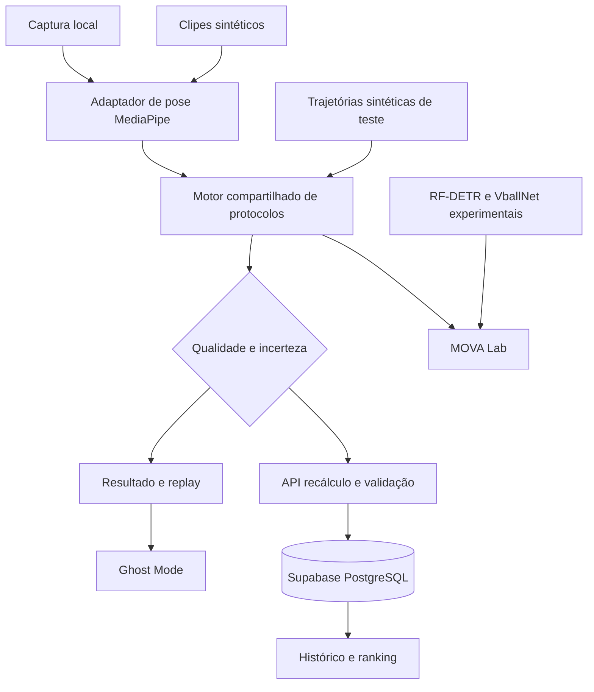
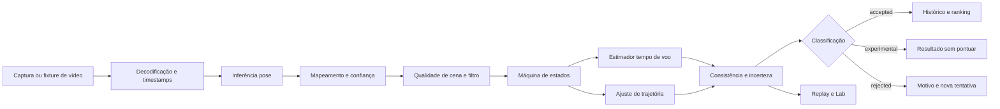
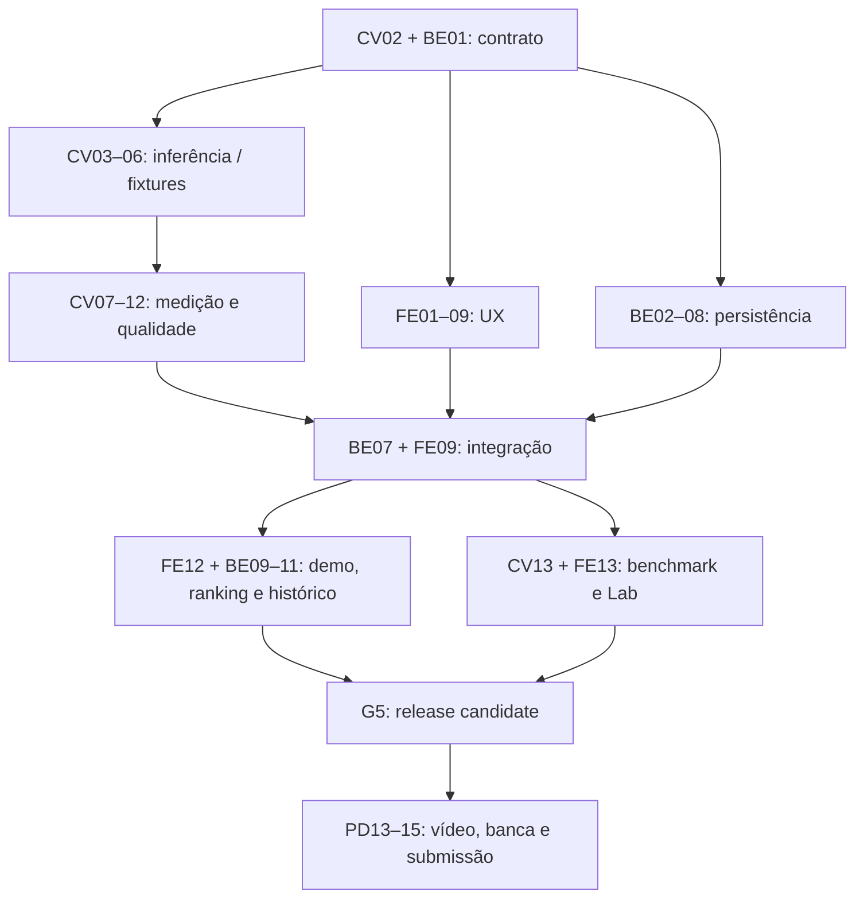

# MOVA Brasil — Plano mestre de desenvolvimento e entrega

> O jogo que acontece fora da tela. Todo movimento conta.
>
> Versão 2.0 — 24/11/2026 — Plano integral de execução, com especificação operacional e rastreabilidade.

## 0. Referências e premissas

Este documento consolida o plano operacional, sem substituir a documentação original. A Parte I (seções 0–13) preserva a síntese e o backlog original. A Parte II (seções 14–21) contém especificações completas, detalhamento das tarefas e matriz de rastreabilidade da análise original. Os requisitos do regulamento prevalecem; as tarefas são propostas, não evidências de implementação.

- [Projeto completo v4.1](MOVA_Brasil_Projeto_Completo_Hack_Brasil_2026.md)
- [Design e interface v1.0](MOVA_Brasil_Design_e_Interface.md)
- [Protótipo RF-DETR](https://github.com/Lucas-Andrade-Silva/hackasEsporteFilasOff/tree/teste/rfdetr-pose)
- [Protótipo de bola](https://github.com/Lucas-Andrade-Silva/hackasEsporteFilasOff/tree/teste/tracknet-bola)
- [Regulamento Hack Brasil](https://hackbrasil.com/regulamento), atualização de 18/11/2026, consultado em 24/11/2026, §§2–9.

| Marco | Data, horário de Brasília |
|---|---|
| Início do plano replanejado | 24/11/2026 |
| Jornada vertical | 25/11 |
| MVP público | 26/11 |
| Benchmark e diferenciais | 27/11 |
| Release candidate | 28/11 |
| Submissão antecipada | 29/11, meta 20h |
| Prazo oficial / congelamento | 30/11, 23h59 |
| Finalistas | 02/12 |
| Confirmação de presença | 04/12, 23h59 |
| Final presencial, São Paulo | 12/12 |
| Repositório público pelo menos até | 15/12 |

Premissas: quatro integrantes (papéis a definir), seis dias de execução de 24 a 29/11 inclusive, orçamento de infraestrutura sem gasto não autorizado. Confirmar disponibilidade real e mudanças de regulamento.

## 1. Objetivo e estado inicial

Maximizar a chance de vitória na trilha Saúde & bem-estar por meio de atividade física real, evolução mensurável, competição saudável e acesso democrático à avaliação esportiva. Público inicial: adultos de 18 a 24 anos, praticantes amadores de vôlei e basquete em atléticas, grupos e quadras públicas, inclusive usuários de Android de entrada. Recrutamento e descoberta de talentos são visão futura, não a função central da trilha. O comprador potencial é treinador/coordenador de grupos ou escolinhas; disposição a pagar ainda é hipótese.

| Referência auditada | Evidência | Limite |
|---|---|---|
| main d727ae715eb68f76d5b08eb0068c76390ba0ea67 | Projeto e design documentados, README vazio | Sem aplicação integrada nessa revisão |
| teste/rfdetr-pose 7a9179f1070d81d683780e94ee0616a7a84537ff | RF-DETR COCO-17, ByteTrack, One Euro, JSONL, MP4, CLI, Streamlit e testes | Sem medição validada de salto; sem teste móvel; faltam pontos específicos dos pés |
| teste/tracknet-bola 6dd7ceaf6fb64a50c4548065b682e88414c2dded | VballNet, TrackNetV3, YOLO, filtros e testes | Não é dependência do Core; rastreamento não equivale a métrica esportiva validada |

Os READMEs reportam 23,9 FPS de inferência de pose em RTX 3050 e, para o motor de bola, 90,5% de detecção e 5,4 px de erro mediano em um clipe específico contra referência de outro detector. Não foram reproduzidos nesta análise; não comprovam precisão de salto nem desempenho móvel. Repositório público, não fork, criado em 17/11; ainda é necessária auditoria de todo histórico, pesos, licenças e origem.

### Critérios competitivos

Quatro critérios de igual peso. Desempate: execução, depois impacto. Na final, avaliação começa do zero. Meta interna de banca simulada: 38/40 (10/9/9/10), não previsão.

| Critério | Evidência |
|---|---|
| Execução | URL pública, demo autônoma e jornada completa |
| Implementação | Pose, protocolos, matemática, segurança, testes e benchmark |
| Impacto | Problema e público, acessibilidade, feedback real, piloto como hipótese |
| Comunicação | Vídeo centrado no produto, Ghost Mode, transparência |

## 2. Escopo e critérios de aceite

P0: essencial; P1: diferencial após estabilidade P0; P2: opcional condicionado a capacidade; FUTURO: fora da submissão. Qualquer corte deve ser registrado com motivo e substituto.

| ID | P | Entrega | Aceite |
|---|---|---|---|
| F01 | 0 | PWA | HTTPS, responsiva, instalável quando suportado |
| F02 | 0 | Demo sintética | Sem cadastro/câmera, cálculo real, isolamento |
| F03 | 0 | Vôlei e basquete | Escolha de missão e esporte persistida |
| F04 | 0 | Missões | Protocolo, segurança e limites |
| F05 | 0 | Captura guiada | Permissões, enquadramento, timer, erros |
| F06 | 0 | Pose | Landmarks realmente inferidos e visualizados |
| F07 | 0 | Salto vertical | Medição calculada e versionada |
| F08 | 0 | Qualidade | Aceito, experimental ou rejeitado, com motivo |
| F09 | 0 | Resultado | Métrica, unidade, incerteza sustentada ou pendente |
| F10 | 0 | Passaporte | Histórico idempotente |
| F11 | 0 | Ranking | Só tentativas válidas, por grupo/protocolo |
| F12 | 0 | Privacidade | Sem vídeo real público; isolamento de sessões |
| F13 | 0 | MOVA Lab | Método, benchmark ou lacunas explícitas, limites |
| F14 | 1 | Ghost Mode | Comparação sincronizada ou lado a lado |
| F15 | 1 | Evolução | Baseline múltipla e incerteza |
| F16 | 1 | Participação | Percentual, período e regra definida |
| F17 | 1 | Conquistas | Sem penalizar descanso |
| F18 | 1 | Temas claro/escuro | Contraste e legibilidade |
| F19 | 2 | Painel treinador | Demo fictícia, sem dados reais |
| F20 | 2 | Biomecânica complementar | Validada ou explicitamente experimental |
| F21 | 2 | Replay de bola | Confiança, origem e estimativas |
| F22 | 2 | Salto com passada/alcance | Protocolo e benchmark específicos |
| F23–25 | futuro | Radar, recrutamento, app nativo | Roadmap pós-hackathon |

MOVA Lab elevado de P1 a P0 pela relevância científica; Ghost Mode é diferencial visual, não bloqueador. Fora de escopo: menores, feed público, chat com desconhecidos, diagnóstico, prescrição, apostas e nota universal de talento.

Jornada: início → esporte/missão → preparação segura → captura ou demo → processamento → resultado → Ghost/Passaporte → Copa MOVA → Lab.

Design: preservar #0E1A2B, #16263D, #C6F432, #4D8DFF, #FF7A1A, #FF5A5F, #F5F7FA; Barlow Condensed e Inter. Controles ≥48 px, informação nunca só por cor, segurança física, timer visual/sonoro opcional, estados vazios, rejeições com instrução, câmera negada, rede fraca, acessibilidade e legibilidade ao ar livre.

## 3. Arquitetura e contratos



- Next.js/TypeScript, Tailwind e componentes acessíveis, Canvas e gráficos leves; PWA com manifest, ícones e cache controlado.
- MediaPipe Pose Landmarker como candidato móvel, Web Worker se compatível, clipe curto se inferência contínua for lenta. Testar Lite/Full e versionar modelo/WASM/licença.
- Motor TypeScript puro compartilhado entre cliente e servidor; Python para pesquisa e benchmark. Evitar microserviços e GPU remota obrigatória.
- Supabase/PostgreSQL, Auth, RLS, API server-side, Vercel; verificar planos e quotas, não supor custo zero.
- Vitest, Playwright, Pytest, GitHub Actions, lockfiles, migrations e setup reproduzível.
- Preservar motores experimentais, integrar seletivamente após auditoria; as branches possuem versões diferentes do ball_engine. Não mesclar indiscriminadamente.

Estrutura alvo:

```text
src/app/{demo,missions,capture,results,leaderboard,passport,ghost,lab,api}
src/components/
src/contracts/
src/engine/{pose,protocols,biomechanics,quality,uncertainty,replay}
src/domain/{missions,rankings,groups,attempts}
src/workers/
src/lib/
pose_engine/                    # experimental
ball_engine/                    # experimental
fixtures/synthetic/
benchmarks/
supabase/migrations/
public/
tests/{unit,integration,e2e}
docs/{architecture,protocols,decisions,validation,privacy}
.github/workflows/
README.md
THIRD_PARTY_NOTICES.md
```

Contrato inicial a aprovar no dia 24:

```ts
type Sport = 'volleyball' | 'basketball';
type AttemptStatus = 'accepted' | 'experimental' | 'rejected';
type Landmark = { x: number; y: number; confidence: number; estimated: boolean };
type PoseFrame = {
  timestampMs: number; width: number; height: number; athleteCount: number;
  landmarks: Record<string, Landmark>;
};
type Measurement = {
  protocolId: string; protocolVersion: string; algorithmVersion: string;
  sport: Sport; metric: 'jump_height' | 'squat_repetitions';
  unit: 'cm' | 'repetitions'; value: number | null;
  uncertainty: number | null; uncertaintyMethod: string | null;
  status: AttemptStatus; effectiveFps: number | null; qualityFlags: string[];
  events: { name: 'takeoff' | 'apex' | 'landing'; timestampMs: number }[];
};
interface ExerciseProtocol {
  id: string; version: string;
  evaluate(frames: PoseFrame[]): Measurement;
}
```

Acordar coordenadas, escala, espelhamento, relógio monotônico, mapeamento COCO-17/MediaPipe, landmarks ausentes, confiança e estimativa. Não inventar pontos dos pés no COCO-17. Envelope inclui versão de esquema, origem sintética/real autorizada, sessão, fixture e chave idempotente. Se fallback de agachamento for ativado, estender eventos e critérios.

## 4. Motor de visão, qualidade e rankings

Protocolo inicial: salto parado, câmera fixa, corpo/chão visíveis, um adulto, espaço livre, aterrissagem no mesmo local. Bloqueio e rebote podem ter protocolos distintos se diferirem posições de braços. Máquina de estados: repouso → preparação → decolagem → voo → ápice → aterrissagem → estabilização.

- Baseline: h = 9,81 × t² / 8, assumindo alturas semelhantes do centro de massa na decolagem/aterrissagem.
- Complementar: ajustar y(t)=at²+bt+c ao quadril durante voo, com calibração de escala e perspectiva; quadril não é centro de massa. Usar gravidade para calibrar escala não constitui verificação física independente da própria gravidade.
- Comparar estimadores em benchmark. Não corrigir viés sem avaliação separada. A 30 FPS, um quadro adicional num voo de 0,5 s altera a estimativa em cerca de 4,2 cm; MAE de 3 cm é meta, não garantia.
- Medir timestamps reais, gaps, confiança, flags de estimativa e contatos dos pés quando observáveis. Incerteza considera resolução temporal, erro da referência, dispersão e viés. Se não calibrada, marcar pendente; não inventar margem.

| Condição | Ação |
|---|---|
| Corpo/pés cortados, cena ambígua, ausência de salto | Rejeitar e orientar |
| FPS baixo, timestamp irregular, câmera móvel | Experimental/rejeitado conforme protocolo |
| Pontos estimados/ocultos em fase crítica | Experimental/rejeitado |
| Múltiplos saltos, mudança de plano | Rejeitar fora do protocolo |
| Divergência, ajuste ruim, perspectiva | Experimental sem ranking |
| Todos os gates satisfeitos | Conferido pelo motor, não prova antifraude |

Limiar versionado e justificado por dados; não ajustado para favorecer a demo. Antifraude: sessão, limites, evidência, recálculo, idempotência e coerência física. Cliente controlado pelo usuário pode falsificar landmarks; não prometer autenticidade absoluta.

Ghost: alinhar pela decolagem, escala e eixos comparáveis, preservar diferença de altura, sinalizar estimados; bloquear conclusão se protocolos incompatíveis. Fallback lado a lado.

Rankings: desempenho = melhor marca aceita por grupo/protocolo/categoria; empates dentro da incerteza com regra determinística; evolução = ganho sobre múltiplas tentativas e além da incerteza combinada; participação = ativos/elegíveis no período e grupo mínimo definido. Primeira tentativa é registro, não baseline robusta. Rejeitadas e experimentais não pontuam.

## 5. Backend, privacidade e demonstração

| Entidade | Invariante |
|---|---|
| profiles | pseudônimo, faixa adulta, privado por padrão |
| groups/memberships | autorização e pertencimento |
| protocols/challenges | versão imutável, janela e limite |
| attempts | dono/sessão, protocolo/algoritmo, status, flags e chave idempotente única |
| pose_traces | mínimo necessário, retenção e exclusão |
| verification_events | trilha sem vídeo ou segredo |
| demo_sessions | namespace isolado, TTL e reset |
| leaderboard_entries | derivado apenas de tentativas aceitas |

API: iniciar sessão, submeter evidência, recuperar tentativa, histórico/ranking, excluir dados próprios e reset de demo. Servidor recalcula métrica, valida tamanho/timestamps/versões/ownership, nunca aceita score arbitrário. Persistência transacional e idempotente, RLS/grants mínimos, views seguras, segredos apenas server-side. Testes de acesso cruzado. Vídeo bruto não enviado por padrão nem registrado em logs; landmarks identificáveis também são dados pessoais. Preferir Ghost local e retenção mínima.

Demo pública e vídeo de submissão: somente dados sintéticos (§6.9). Testes reais privados e autorizados, sem publicação de vídeo/dados individuais. Consultar organização sobre captura real na final antes de realizar.

Fixtures: séries sintéticas com ground truth para matemática e rejeições; clipes de personagens sintéticos para inferência completa, documentar origem/licença. Fluxo principal: vídeo → MediaPipe → landmarks → motor → validação → resultado → ranking. Se clipe não for reconhecido, replay de landmarks explicitamente rotulado como pipeline parcial; consultar organização. Não fingir inferência nem usar score fixo. Perfis fictícios rotulados; tentativa calculada atualiza sessão, com reset e isolamento.

Cenários: D01 bloqueio válido; D02 rebote válido; D03 rejeição com motivo; D04 segunda tentativa/evolução; D05 atualização de ranking; D06 Lab. Verificar em janela anônima, sem câmera, conta ou intervenção humana.

## 6. Backlog executável

IDs para futuras issues; P=prioridade, h=horas-pessoa estimadas, dependências mínimas (trabalho antecipado pode usar contratos e mocks identificados). Tudo pendente de comprovação na main. Papéis não são atribuições nominais.

### A — IA, biomecânica e benchmark

| ID | P | h | Dep. | Tarefa / aceite |
|---|---|---:|---|---|
| CV01 | 0 | 2 | — | Auditar protótipos, origem, versões e testes |
| CV02 | 0 | 1 | — | Aprovar contrato de pose com BE01 e FE |
| CV03 | 0 | 3 | CV02 | Inferência web e overlay em fixture/aparelho |
| CV04 | 0 | 4 | CV02 | Fixtures/clipes e ground truth com PD08 |
| CV05 | 0 | 2 | CV03 | Timestamps efetivos e adaptação |
| CV06 | 0 | 2 | CV02 | Filtro testado, estimados explícitos |
| CV07 | 0 | 4 | CV05,CV06 | Máquina de estados e eventos |
| CV08 | 0 | 2 | CV07 | Tempo de voo, testes analíticos |
| CV09 | 0 | 4 | CV07 | Parábola e resíduos, limitar se instável |
| CV10 | 0 | 4 | CV07,CV08 | Gates, flags e casos inválidos |
| CV11 | 0 | 3 | CV08,CV09 | Incerteza e limitações |
| CV12 | 0 | 3 | CV08,CV10,BE01 | Mesmo motor cliente/servidor |
| CV13 | 0 | 6 | CV12,PD08 | Benchmark por aparelho, erros e rejeições |
| CV14 | 1 | 3 | CV12 | Dados de replay para Ghost |
| CV15 | 1 | 3 | CV01,CV13 | Comparar modelos com mesma referência |
| CV16 | 2 | 4 | CV01,G4 | Replay de bola experimental |

### B — Frontend e UX

| ID | P | h | Dep. | Tarefa / aceite |
|---|---|---:|---|---|
| FE01 | 0 | 2 | — | Scaffold PWA e build |
| FE02 | 0 | 3 | FE01 | Design system e componentes |
| FE03 | 0 | 3 | FE02 | Home e navegação |
| FE04 | 0 | 2 | FE03,BE01 | Seleção de esporte e missão |
| FE05 | 0 | 2 | FE04 | Preparação segura e instruções |
| FE06 | 0 | 4 | FE05 | Câmera, permissões, timer, parar tracks |
| FE07 | 0 | 3 | FE06,CV02 | Canvas, coordenadas e confiança |
| FE08 | 0 | 2 | FE06 | Processamento, progresso, timeout |
| FE09 | 0 | 3 | FE08,CV02 | Resultado, unidade, selo, retry |
| FE10 | 0 | 3 | BE10 | Passaporte e estado vazio |
| FE11 | 0 | 3 | BE09 | Ranking integrado |
| FE12 | 0 | 3 | FE09,CV04,BE11 | Demo sem conta/câmera |
| FE13 | 0 | 3 | CV11 | Lab, método e evidências |
| FE14 | 1 | 4 | FE09,CV14 | Ghost sincronizado ou lado a lado |
| FE15 | 1 | 2 | FE02 | Tema claro e contraste |
| FE16 | 0 | 3 | FE12 | Acessibilidade, mobile e teclado |
| FE17 | 0 | 4 | FE12 | Refinamento, estados e erros |

### C — Backend e DevOps

| ID | P | h | Dep. | Tarefa / aceite |
|---|---|---:|---|---|
| BE01 | 0 | 2 | — | Contratos API/domínio com CV02 |
| BE02 | 0 | 2 | — | Ambiente e segredos/quotas |
| BE03 | 0 | 3 | BE01,BE02 | Migrations, constraints e seeds |
| BE04 | 0 | 3 | BE03 | RLS/grants e acesso cruzado |
| BE05 | 0 | 3 | BE04 | Sessões/auth e fluxo privado adulto |
| BE06 | 0 | 3 | BE05 | Persistência de tentativas |
| BE07 | 0 | 4 | BE06,CV12 | Recálculo server-side |
| BE08 | 0 | 2 | BE06 | Idempotência e concorrência |
| BE09 | 0 | 3 | BE06,BE08 | Ranking derivado |
| BE10 | 0 | 2 | BE06 | Histórico por dono/sessão |
| BE11 | 0 | 3 | BE05 | Demo isolada, reset e TTL |
| BE12 | 0 | 2 | BE06 | Exclusão e retenção |
| BE13 | 0 | 3 | FE01 | Deploy e CI inicial |
| BE14 | 1 | 4 | BE09 | Evolução e participação |
| BE15 | 0 | 3 | BE07,BE11,BE13 | Segurança, logs e monitoramento |

### D — Produto, QA, pesquisa e pitch

| ID | P | h | Dep. | Tarefa / aceite |
|---|---|---:|---|---|
| PD01 | 0 | 1 | — | Auditoria de regras, histórico e licenças |
| PD02 | 0 | 1 | PD01 | Consultar organização sobre trilha/demo/final |
| PD03 | 0 | 2 | — | Recrutar voluntários adultos autorizados |
| PD04 | 0 | 4 | PD03 | Entrevistas de atletas, notas anonimizadas |
| PD05 | 0 | 5 | — | Entrevistas treinadores e atléticas |
| PD06 | 0 | 3 | — | Revisão de dados e fontes |
| PD07 | 1 | 3 | PD05 | Hipótese B2B/piloto |
| PD08 | 0 | 3 | — | Protocolo, referência, amostra e fixtures |
| PD09 | 0 | 5 | FE12 | Usabilidade e registro de falhas |
| PD10 | 0 | 2 | PD09 | Melhorias antes/depois documentadas |
| PD11 | 0 | 3 | — | README, setup, fontes, licenças |
| PD12 | 0 | 3 | PD06 | Roteiro com claims auditados |
| PD13 | 0 | 5 | G5,PD12 | Vídeo até três minutos |
| PD14 | 0 | 2 | PD13 | Formulário, links, aceite |
| PD15 | 0 | 3 | G5,PD12 | Banca simulada |

P0: A 40h + B 43h + C 38h + D 42h = 163 horas-pessoa. Capacidade com quatro pessoas × 8h produtivas × seis dias = 192h; margem 29h para integração, imprevistos e P1 selecionado. Estimativa, não garantia. P1 completo não cabe automaticamente. Se capacidade menor, cortar escopo; redistribuir conforme habilidades e carga, D auxilia fixtures/QA, C auxilia integração FE. Não sacrificar descanso, segurança ou honestidade.

Ritmo: sync curto 9h, integrar ao meio e fim do dia, PRs pequenos e revisão cruzada, main executável, comunicar bloqueio após 60–90 min, acompanhar tarefas aceitas e evidências (não linhas de código). Issues com ID, prioridade, dono, dependências, gate, aceite, estimativa e evidência. Milestones G1–G7.

## 7. Cronograma e caminho crítico

| Data | IA | Frontend | Backend | Produto | Gate |
|---|---|---|---|---|---|
| 24/11 | CV01–06 iniciados, pose e fixtures | FE01–05 | BE01–04, BE13 inicial | PD01–03, PD06, PD08 | G1 |
| 25/11 | CV07–10, medida inicial | FE06–09 | BE05–08 iniciados | PD04–05 e teste | G2 |
| 26/11 | CV10–12, benchmark inicial | FE10–13 | BE09–12, BE07 integrado | PD09, PD11, narrativa | G3 |
| 27/11 | CV13–14 se viável | FE13–14, FE16 | BE15, BE14 se viável | PD10, PD12 | G4 |
| 28/11 | Regressão e parâmetros | FE16–17 | CI, segurança e E2E | README, roteiro, ensaio | G5 |
| 29/11 | Validação final | Validação final | Release e links | PD13–15 | G6 |
| 30/11 | Contingência | Contingência | Contingência | Painel e aceite | G7 |

A tabela é sequência de marcos, não alocação rígida de horas.

- **G1 (24/11):** contrato v1, scaffold, CI, HTTPS, primeira inferência web e fixture. Se falhar, modelo leve/clipe curto.
- **G2 (25/11):** salto realmente calculado em condição controlada e tentativa persistida. Se inviável, avaliar imediatamente fallback de agachamento (repetições, não cm) com protocolo próprio; atualizar narrativa.
- **G3 (26/11):** demo pública, válido/rejeitado, histórico/ranking, jornada integrada. Cortar P1/P2 que bloqueiem.
- **G4 (27/11):** benchmark e limites publicados; Ghost simples se viável. Se erro alto, restringir protocolo e claims.
- **G5 (28/11):** release candidate, nenhum defeito crítico, checklist P0 verificado, freeze de features.
- **G6 (29/11):** 9–11h teste; 11–12h correções críticas; 13–15h gravação; 15–17h edição/upload; 17–18h revisão docs/licenças; 18–19h banca; 19–20h submissão; 20–21h verificar links e confirmação.
- **G7 (30/11):** margem de contingência, alvo interno freeze às 18h; prazo oficial 23h59. Confirmar versão enviada, commit e deploy; depois não alterar código até final autorizada.

Caminho crítico: contratos → inferência e fixtures → eventos/métrica/qualidade → integração API/UI → demo/benchmark → release → vídeo/submissão. FE e BE desenvolvem em paralelo por contrato. Pesquisa, recrutamento e docs começam no dia 24.

## 8. Validação e qualidade

Benchmark exploratório: buscar 8–12 adultos autorizados, 3–5 saltos por pessoa com descanso/segurança (24–60 tentativas), três dispositivos incluindo Android de entrada, 30/60 FPS quando possível. Referência independente deve medir a mesma grandeza (plataforma de força se disponível ou vídeo de alta velocidade com método de anotação); alcance da mão não equivale automaticamente à elevação do centro de massa. Separar calibração e avaliação por participante quando possível. Sem referência adequada, reportar verificação sintética, não validação empírica de precisão.

Registrar n, condições, método, aparelho, timestamps, versão, MAE (meta exploratória até 3 cm a 30 FPS), RMSE, mediana do erro absoluto, viés, dispersão, aceitação/rejeição, FPS efetivo e latência; reportar cobertura e erros sem esconder rejeições. Publicar metodologia e agregados autorizados, nunca vídeos pessoais. Amostra pequena não comprova generalização.

Produto: buscar 10–15 atletas entrevistados, 3–5 treinadores, 2–3 atléticas/escolinhas, 5–10 testes de uso, 2 interessados em piloto e 3 melhorias. Medir conclusão, tempo até primeira missão (meta <2 min), compreensão de margem/erros, intenção de retorno. Registrar dados reais e objeções; não fabricar entrevistas, cartas ou retenção. Métrica norte futura: missões em pelo menos dois dias distintos por semana. Validar dor atual, método de medição, frequência, comprador e preço.

| Área | Casos mínimos |
|---|---|
| Matemática | Ground truth, 30/60/120 FPS, jitter, gaps, valores impossíveis |
| Pose/protocolo | Nenhum atleta, múltiplos, oclusão, pés cortados, sem salto, câmera móvel |
| Incerteza | Divergência, ausência de calibração, status experimental |
| Dados | Duplicação, concorrência, payload inválido, rollback |
| Ranking | Rejeitadas excluídas, empate, grupos/protocolos separados, baseline |
| Segurança | Score adulterado, sessão expirada, acesso cruzado, isolamento |
| UX | Câmera negada, modelo falha, timeout, rede fraca, retry e vazio |
| Mobile | Android de entrada, orientação, luz, toque, parar câmera |
| E2E | Demo anônima, resultado, ranking, histórico, reset, rejeição |
| Release | Build reproduzível, janela anônima, URL direta, refresh, vídeo |

CI: lint, typecheck, unitários, build, smoke E2E; Python experimental separado. Teste com modelo real além de mocks. Evidências ligadas ao SHA; bugs com severidade, reprodução e dono. Zero falhas críticas conhecidas de privacidade, integridade, medição enganosa e acesso à demo.

Definition of Done: implementação integrada, aceite cumprido, testes aplicáveis aprovados, estados de erro, demo verificável, documentação e evidência, segurança/licenças revisadas. Mock não conta como integração.

## 9. GitHub e infraestrutura

- main estável; branches curtas feat/pose-engine, feat/jump-protocol, feat/mobile-app, feat/backend, feat/demo, feat/ghost-mode, feat/mova-lab, test/benchmark conforme necessidade.
- Auditar todos os commits, pesos, assets e datasets, especialmente código vendored TrackNetV3. §6.2 exige origem na mensagem do commit que copia código aberto preexistente; consultar organização se histórico não conforme, sem reescrever história sem decisão explícita.
- Preview/produção, migrations, seeds sintéticos, variáveis, quotas, logs sem PII. Teste externo e não habilitar gasto não autorizado.
- README: objetivo, demo, setup, arquitetura, testes, benchmark, real vs experimental, limitações, fontes, privacidade, licenças e roadmap.
- Identificar SHA entregue e deploy correspondente; tag interna antes do prazo. Manter demo no ar durante avaliação; não alterar código no congelamento. Evitar deploy automático de branch não relacionada sobre URL submetida.

## 10. Riscos e contingência

| Risco | Gravidade | Mitigação |
|---|---|---|
| Inelegibilidade/histórico/licença | Crítica | PD01/CV01, consultar organização antes de integrar |
| Dados reais em demo | Crítica | Sintéticos, auditoria de assets/logs |
| Trilha | Crítica | Atividade física central, consulta |
| Salto instável | Crítica | G2, baseline simples, fallback agachamento validado |
| Android lento | Alta | Lite/clipe curto, worker/cache, medir aparelho |
| Sintético não reconhecido | Alta | Produzir dia 24; replay parcial rotulado |
| Benchmark ruim/sem referência | Alta | Publicar limites, restringir claims |
| Banco indisponível | Alta | Demo local isolada e rotulada, não alegar ranking remoto |
| Fraude/acesso cruzado | Alta | Recálculo, RLS, testes, reconhecer cliente não confiável |
| Escopo e conflitos | Alta | Contratos, PRs pequenos, gates |
| Ghost instável | Média | Lado a lado |
| Bola imprecisa | Baixa no Core | Experimental |
| Vídeo atrasado | Alta | Roteiro antecipado e gravação dia 29 |

Cortar: recrutamento/radar → bola → painel treinador → protocolos novos → conquistas/participação avançada → temas/animações → Ghost avançado. Simplificar autenticação/UX se necessário preservando privacidade. Não cortar demo funcional, medida real (ou fallback validado), rejeição, histórico/ranking essencial, Lab honesto e segurança.

## 11. Comunicação e entrega

| Tempo de vídeo | Conteúdo |
|---|---|
| 0:00–0:15 | Problema, público, fonte e ano |
| 0:15–0:30 | MOVA e proposta de valor |
| 0:30–1:10 | Demo sintética, processamento real |
| 1:10–1:25 | Resultado, qualidade e ranking |
| 1:25–1:45 | Ghost/comparação |
| 1:45–2:10 | Arquitetura, benchmark e limites |
| 2:10–2:30 | Impacto, feedback e acessibilidade |
| 2:30–2:45 | Negócio como hipótese e roadmap |
| 2:45–2:55 | Encerramento |

Perguntas: HomeCourt (foco local e vôlei, acessível), IA própria (modelos abertos, contribuição nos protocolos/integração/qualidade), precisão (amostra/erro/limites), fraude (camadas não infalíveis), saúde (sem claim clínico), receita (hipótese), defensabilidade (rede e histórico autorizado como potencial, não ativo comprovado).

Submissão: nome, frase, descrição, trilha, links de todos os repositórios, demo funcionando, vídeo ≤3 min sem login e aceite do representante. Última versão dentro do prazo vale. Guardar confirmação.

Pós-submissão:
- 01/12: preparar apresentação e perguntas fora do repositório congelado.
- 02/12: conferir classificação e orientações.
- Até 04/12, 23h59: confirmar presença e logística/documentos de todos se finalista.
- 05–09/12: slides, ensaios, revisão de impacto, sem alterações de código.
- 10–11/12: banca simulada, verificar demo congelada, contingência.
- 12/12: retomar desenvolvimento apenas no local e quando autorizado, conforme agenda oficial; apresentar. Não depender do dia para completar P0.
- Até 15/12: manter repositório público.

## 12. Checklist final

- [ ] Elegibilidade e inscrição da equipe verificadas.
- [ ] Histórico, origem, licenças e assets auditados.
- [ ] Trilha e dados sintéticos em conformidade.
- [ ] HTTPS público, demo anônima isolada e resetável.
- [ ] Missão de vôlei e basquete.
- [ ] Inferência real ou replay parcial explicitamente rotulado.
- [ ] Medida calculada e protocolo versionado.
- [ ] Rejeição com motivo e orientação.
- [ ] Histórico idempotente e ranking válido.
- [ ] Ghost ou alternativa comparativa.
- [ ] MOVA Lab com evidências, incerteza e limites.
- [ ] Segurança física, acessibilidade e privacidade.
- [ ] Benchmark e lacunas documentados.
- [ ] Unitários, integração, E2E e teste mobile.
- [ ] RLS, ownership, idempotência, exclusão e isolamento.
- [ ] Nenhuma chave, dado pessoal ou vídeo real exposto.
- [ ] README, setup, fontes, licenças e roadmap.
- [ ] Vídeo público sem login, até três minutos.
- [ ] Banca simulada e revisão cruzada dos links.
- [ ] Submissão confirmada, SHA e deploy registrados.
- [ ] Congelamento respeitado e presença confirmada se finalista.

## 13. Decisões pendentes e próximos passos

Confirmar responsáveis nominais, horas reais, código local não enviado, acessos GitHub/deploy/banco, Android de entrada, equipamento de referência, voluntários adultos, posição da organização sobre trilha/clipes/captura na final, nome final e licenciamento.

Ações imediatas: 1) responsáveis e capacidade; 2) consulta organização; 3) auditoria de origem; 4) transformar backlog em issues/milestones; 5) contratos CV02/BE01; 6) scaffold FE01; 7) ambientes BE02/BE13; 8) MediaPipe e fixtures; 9) integração vertical; 10) evidências G1.

**Regra de execução:** jornada demonstrável desde o primeiro dia, frentes paralelas com integração frequente, expansão somente após estabilidade do núcleo. Tecnologia real, útil, verificável e comunicada com clareza.


---

# PARTE II — Especificação operacional integral

A parte I mantém as decisões e os IDs originais. Esta parte detalha a execução, os contratos, as interfaces, os testes, a entrega e os mecanismos de gestão. Os novos detalhes são propostas de implementação, não funcionalidades já entregues. Em caso de conflito, os gates de elegibilidade e segurança prevalecem. Os critérios de aceite abaixo complementam os da parte I.

## 14. Produto final: experiências, telas e design system

### 14.1. Os cinco pilares e suas fronteiras

| Pilar | Benefício | Evidência de entrega | Dependências |
|---|---|---|---|
| MOVA Engine | Medição acessível e transparente | Pose, evento, resultado calculado e controle de qualidade | CV02–13 |
| Missões | Incentivo para praticar esporte | Escolha de desafio, protocolo, guia e repetição voluntária | FE03–09 |
| Copa MOVA | Motivação social | Ranking isolado, atualizado por tentativas elegíveis | BE06–11, FE11 |
| Ghost Mode / Passaporte | Evolução pessoal | Histórico e comparação de duas tentativas comparáveis | BE10, FE10, CV14, FE14 |
| MOVA Lab | Credibilidade | Método, versão, evidência, métricas e limitações | CV11, CV13, FE13, PD08 |

Não depender de clubes ou treinadores para gerar valor. Produto inicial gratuito para atleta; hipótese B2B de gestão de turmas, relatórios e selo futuro, sem alegação de receita. O primeiro valor precisa aparecer antes de cadastro obrigatório. O MVP não precisa de feed, chat, scouting, monetização efetiva ou app nativo.

### 14.2. Mapa de navegação e especificação de telas

| Rota proposta | Conteúdo principal | Interações | Estados e aceite |
|---|---|---|---|
| / | Marca, frase de valor, missão da semana, esporte, começar, experimentar demo | Começar, escolher esporte, acessar histórico | Primeiro acesso sem bloqueio; CTA acima da dobra; retorno ao fluxo |
| /missions | Cards Bloqueio e Rebote; finalidade, protocolo, duração aproximada, tentativa limitada | Escolher missão e ler instruções | Missão indisponível explicitada; nunca confundir protocolo |
| /capture/[mission] | Guia, câmera, silhueta, esqueleto, semáforo textual, timer | Permitir câmera, preparar, iniciar, cancelar, repetir | Sem câmera → demo; pés cortados → dica; parar tracks ao sair; um único salto por tentativa |
| /results/[attempt] | Número grande, unidade, qualidade, incerteza sustentada, fases, dicas | Tentar novamente, ranking, passaporte, comparar | Experimental não pontua; rejeitada não mostra marca como recorde; resultado consistente após refresh |
| /leaderboard | Grupo, protocolo, período, desempenho; evolução e grupo se disponíveis | Trocar aba/filtro, ver posição | Posição atual identificada, empate determinístico, sem dados alheios ou ranking nacional fictício |
| /passport | Histórico, recordes, evolução, selo e versão | Abrir tentativa, comparar, excluir dados próprios | Estado vazio acolhedor; primeira tentativa é registro, não baseline validada |
| /ghost | Replay de dois esqueletos, fases, pico, delta | Play/pause, scrub, alternar sobreposição/lado a lado | Protocolos incompatíveis bloqueiam inferência de evolução; sem histórico orienta nova tentativa |
| /lab | Protocolo, método, versões, benchmarks, limitações e experimentos | Abrir metodologia, ver gráficos, inspecionar caso rejeitado | Pendente aparece como pendente; não inventar métricas; reproduzibilidade por commit |
| /demo | Escolha de esporte e cenário sintético, explicação, processamento, resultado | Selecionar fixture, repetir, resetar, consultar Lab | Nenhum cadastro ou permissão de câmera; etiqueta sintético permanente; sessão isolada |
| /privacy | Dados coletados, finalidade, retenção e exclusão, contato | Excluir dados, limpar sessão, retornar | Linguagem clara; exclusão funciona; sem retenção silenciosa |
| /settings (se viável) | Tema, som, acessibilidade | Alternar preferências | Não é pré-requisito do fluxo principal |

Rotas são propostas; ajustes de implementação permitidos se os fluxos permanecem completos e testáveis.

### 14.3. Especificação visual

| Token | Tema escuro | Tema claro (P1) |
|---|---|---|
| Fundo | #0E1A2B | #FFFFFF |
| Superfície | #16263D | #F5F7FA |
| Texto principal | #F5F7FA | #0E1A2B |
| Texto secundário | #9AA8BC | #5B6B80 |
| Ação | #C6F432 com texto #0E1A2B | #3F6212 ou fundo lima com texto escuro |
| Vôlei | #4D8DFF | #1D4ED8 |
| Basquete | #FF7A1A | #C2410C |
| Erro | #FF5A5F | Vermelho escuro acessível, a validar |

Tipografia: Barlow Condensed para títulos e resultados (48–64 px para a marca principal), Inter para textos; números tabulares onde útil. Usar fontes com licença, preferir cache local. Componentes: AppShell, BottomNav, MissionCard, PrimaryButton, CameraGuide, QualityIndicator, Countdown, PoseCanvas, MeasurementCard, AttemptStatus, RankingRow, HistoryCard, GhostPlayer, LabMetric, EmptyState, ErrorState, SyntheticBadge. Validar contraste AA nas combinações realmente usadas, incluindo superfícies e texto pequeno.

Captura: tela cheia; esqueleto lima; semáforo grande com texto/ícone; instruções a distância e timer visual/sonoro com alternativa silenciosa. Não depender exclusivamente de áudio ou cor. Resultado: valor grande, incerteza ao lado, selo, ações claras; animação curta opcional. Ranking: manter posição do usuário visível quando viável. Recorde: celebrar apenas ganho que supera margem sustentada. Ghost: tentativa atual lima, anterior laranja ou azul; legenda, controle de reprodução e fases. Preferir animação leve e respeitar reduced motion.

Usabilidade: alvo de primeira missão em menos de dois minutos; testar com uma mão, celular a 2–3 m quando enquadramento permite, outdoor, rede limitada, portrait/landscape, teclado e leitor de tela nas áreas não relacionadas à câmera. Alvos de toque 48×48 px; foco visível, textos alternativos e conteúdo sem humilhação ou pressão de sequência.

### 14.4. Wireframes funcionais (esquemáticos; não são produto implementado)

```text
INÍCIO                          CAPTURA
MOVA BRASIL                     [Vôlei · Bloqueio] [Sair]
Salta. Evolui. Aparece.          [Verde + ícone] Pode saltar
[Missão: Bloqueio]               ┌────────────────────────┐
[Começar missão]                 │ silhueta / pose / pés   │
[Experimentar demo]             │          3             │
[Início Ranking Evolução Lab]    └────────────────────────┘
                                [Cancelar] [Instruções]

RESULTADO                       GHOST
[Conferido / Experimental]       [Anterior] [Atual]
42 cm  ± 3 cm (ilustrativo)      [dois esqueletos / fases]
[Como medimos]                  [play/pause] [timeline]
[Tentar novamente]              36 → 42 cm (ilustrativo)
[Ver ranking] [Comparar]        [Método e comparabilidade]

LAB                             COPA MOVA
Método · versão · dispositivo   [Grupo] [Protocolo]
Erro / amostra / rejeições       Desempenho | Evolução | Grupo
[Gráfico se houver evidência]   [lista de marcas aceitas]
[Reproduzir caso sintético]     [sua posição, quando houver]
Limitações e fontes             [sem marcas → nova missão]
```

Valores são exclusivamente ilustrativos. A interface final deve renderizar resultados do motor e jamais os números do wireframe como resultados reais.

## 15. Engenharia: implementação por componente, dependências e decisões

### 15.1. Pipeline e ordem interna



1. Carregamento: resolver assets de modelo versionados, fallback explícito se indisponíveis; diferenciar tempo de download, inferência e cálculo. Captura local com limite de duração/tamanho, cancelamento e liberação de recursos.
2. Decodificação: usar timestamps de apresentação/captura efetivos; não tratar FPS solicitado ou nominal como observado. Verificar monotonicidade, duplicatas, frames faltantes e orientação.
3. Pose: MediaPipe no caminho móvel; adaptar COCO-17 do RF-DETR para um subconjunto comum somente se necessário. Não converter confiança e visibilidade como se fossem métricas equivalentes sem documentação. Marcar keypoints faltantes/estimados.
4. Filtro: preservar a trajetória original para análise, estimar ruído e suavizar apenas com parâmetros versionados. Não extrapolar oclusões longas ou inventar contato de pé.
5. Evento: detectar uma sequência válida de preparação, takeoff, apex e landing com janela de estabilização, baseado em pés/tornozelos, quadril e contexto temporal. Testar ausência de salto, dois saltos, passos, flexão sem voo e oclusão.
6. Métrica: implementar tempo de voo primeiro; comparar ajuste parabólico com escala válida, sinal de curvatura correto, resíduos e consistência. Não usar quadril como centro de massa exato. Considerar assimetria de postura no pouso.
7. Qualidade e incerteza: devolver flags, evidência e explicação. Antes de calibrar, não exibir ±3 cm como fato. Caso sem incerteza defensável, pode aparecer como experimental; critérios de aceitação para ranking precisam de protocolo documentado.
8. Persistência: server-side recálculo do mesmo protocolo a partir de evidência mínima; distinguir execução sintética, real autorizada e replay de landmarks. Só status aceito e escopo correto alimentam ranking.
9. Replay: armazenar localmente ou mediante autorização o subconjunto necessário de landmarks, alinhamento por tempo, unidade e fase; não comparar protocolos diferentes.

### 15.2. Sensibilidade temporal e exemplo analítico

Para tempo de voo de 0,5 s, a fórmula h = 9,81 t² / 8 produz 30,65625 cm. Acrescentar um frame ao tempo estimado tem os efeitos aproximados abaixo, considerando exclusivamente erro temporal.

| FPS efetivo | Duração de um frame | Variação de altura para +1 frame |
|---:|---:|---:|
| 30 | 33,33 ms | +4,22 cm |
| 60 | 16,67 ms | +2,08 cm |
| 120 | 8,33 ms | +1,03 cm |

Isto é cálculo teórico, não medição do MOVA. O erro pode ser maior se ambos os eventos forem deslocados, se houver erros de pose ou se as hipóteses biomecânicas falharem. Incluir esses casos nos testes unitários.

### 15.3. Estratégia de reaproveitamento dos motores já existentes

| Subsistema | Reaproveitar | Não transportar automaticamente | Verificação |
|---|---|---|---|
| RF-DETR pose | contrato JSONL, conceito PoseEstimator/Tracker, filtragem, overlay, testes e benchmarks de laboratório | dependência GPU, pesos Preview, tracking multipessoa obrigatório, estimativas congeladas como observação | executar pytest e CLI conforme README, conferir licenças e origem, comparar em clipe autorizado |
| TrackNet/VballNet | pipeline de bola, flags source/estimated, filtragem de lacunas, dados de replay, testes | vídeo real público, inferência obrigatória na PWA, checkpoints não auditados, promessa de detectar cesta/saque | pytest, inventário e referência; validar em dataset apropriado antes de promover |
| MediaPipe | modelo de pose móvel e adaptação para protocolo individual | precisão herdada da literatura sem reprodução própria | smoke em navegador e Android, clipe sintético e teste privado autorizado |

Fixar commits de origem no inventário e comparar as versões de ball_engine presentes em ambas as branches antes de integração seletiva. Manter pesquisa separada do caminho crítico. A detecção de bola é P2 somente como replay experimental; transformar trajetória em métrica esportiva exige protocolo e validação adicionais.

### 15.4. Stack completa e alternativas

| Camada | Escolha proposta | Alternativa se bloquear |
|---|---|---|
| UI | Next.js, TypeScript, Tailwind, shadcn/ui quando útil | Componentes próprios acessíveis |
| Movimento visual | CSS, Motion só onde necessário | Transições simples ou sem animação |
| Pose | MediaPipe Lite/Full, Web Worker | Inferência em clipe curto; avaliar outro modelo se benchmark justificar |
| Replay | Canvas 2D | Duas visualizações lado a lado |
| Gráficos | Recharts quando houver dados | SVG/tabela acessível |
| Domínio | TypeScript puro | Sem serviço remoto obrigatório |
| Experimentos | Python, RF-DETR, ByteTrack, VballNet/TrackNetV3 | Offline com exports rastreáveis |
| Persistência | Supabase/PostgreSQL, Auth, RLS | Demo local isolada e explicitamente limitada |
| Deploy | Vercel/HTTPS | Alternativa equivalente aprovada e testada |
| Testes | Vitest, Playwright, Pytest, Actions | Smoke manual documentado se ferramenta indisponível, não substituir gates críticos |

Documentar decisões em ADRs curtos: contexto, opções, critério, escolha, consequência e gatilho para rever. Não assumir que quotas ou licenças de planos gratuitos permitem todos os usos sem verificação.

## 16. Contratos de integração, persistência e segurança

### 16.1. Envelope e endpoints propostos

Contrato tipado e esquema de validação compartilhado; nomes abaixo são de projeto, não APIs já existentes.

```ts
type AttemptSource = 'synthetic_video' | 'synthetic_pose_replay' | 'authorized_capture';
type AttemptEvidence = {
  schemaVersion: string;
  sessionId: string;
  challengeId: string;
  protocolId: string;
  protocolVersion: string;
  algorithmVersion: string;
  source: AttemptSource;
  fixtureId?: string;
  idempotencyKey: string;
  frames: PoseFrame[];
};
type AttemptResponse = {
  attemptId: string;
  measurement: Measurement;
  rankingEligible: boolean;
  verificationLevel: 'recorded' | 'engine_checked';
};
```

| Operação | Dados de entrada | Resultado esperado | Teste |
|---|---|---|---|
| POST /api/sessions | modo e missão | sessão autorizada/isolada | sem acesso cruzado |
| POST /api/attempts | envelope, nunca score arbitrário | cálculo, status, ID idempotente | payload repetido não duplica |
| GET /api/attempts/:id | ID + sessão | tentativa autorizada | outro visitante recebe negação |
| GET /api/history | escopo autenticado/demo | histórico próprio ordenado | reset/demo não vaza |
| GET /api/leaderboard | grupo, protocolo, período | ranking derivado | inválidas excluídas |
| POST /api/demo/reset | sessão de demo | limpar apenas sessão própria | outra sessão permanece |
| DELETE /api/profile/data | autorização de dono | exclusão conforme política | sem acesso a terceiro |

Erro estruturado com código estável, texto de ação e request ID sem dados pessoais. Exemplos: INVALID_PROTOCOL, INVALID_TIMESTAMP, INVALID_CAPTURE, MODEL_UNAVAILABLE, SESSION_EXPIRED, RATE_LIMITED, FORBIDDEN, CONFLICT, NETWORK_ERROR. Rejeição de qualidade calculada é resultado de tentativa, não necessariamente erro HTTP; transporte inválido é erro de requisição. Nunca devolver stack trace, segredo ou frames privados em logs.

### 16.2. Matriz de acesso e invariantes

| Ator | Pode ler | Pode escrever |
|---|---|---|
| Demo sem cadastro | seeds fictícios e sua sessão | tentativa/replay no próprio namespace; reset próprio |
| Atleta adulto autenticado | perfil próprio, histórico próprio e ranking autorizado de grupo | preferências e evidência de tentativa via API |
| Outro membro do grupo | somente dados mínimos de ranking autorizados | próprias tentativas |
| Visitante externo | dados sintéticos públicos | sem escrita em dados reais |
| Servidor | apenas operações necessárias | recálculo, persistência, eventos e manutenção autorizados |

Tentativas não podem ser reatribuídas a outro dono. Protocolo versionado é imutável após uso; nova versão gera nova categoria de comparabilidade. Garantir chave única de idempotência no escopo e transação para resultado/registro. Definir retenção de traces e demo antes do deploy; perfil privado por padrão, exclusão verificável. Sem segredo em NEXT_PUBLIC, sem service role no browser; RLS também em tabelas de sessão e políticas para leitura e atualização. Não confiar em metadata editável para autorização. Testar views e funções com usuários distintos.

A separação sintético/real deve estar presente no armazenamento, API, interface e analytics. Nenhum resultado sintético deve alterar ranking real. Captura de câmera privada só sob condições autorizadas; demo pública não solicita permissão de câmera.

### 16.3. Regras de ranking detalhadas

| Ranking | Entrada | Saída | Casos de borda |
|---|---|---|---|
| Desempenho | tentativas aceitas, mesmo protocolo/categoria/período | melhor marca por atleta/grupo | empate com critério estável; sem ranking de tentativa rejeitada |
| Evolução | baseline de várias marcas válidas, nova marca comparável | ganho absoluto e relativo, se sustentado | sem baseline → mostrar histórico; ganho dentro da incerteza → sem recorde |
| Participação | membros elegíveis e dias/período definidos | percentual de ativos | grupos pequenos, alteração de membros e denominador zero |

Exemplos ilustrativos: 30→36 cm representa +6 cm e +20%, somente contado se superar a incerteza aplicável. Grupo com 8/10 ativos (80%) fica à frente de 15/20 (75%) se as regras comparáveis forem satisfeitas. Não aplicar ranking absoluto global, filtro por sexo/idade ou nota de talento sem justificativa de privacidade, inclusão e protocolo. Categorias devem ser mínimas e explicitadas; equidade é objetivo de pesquisa, não garantia.

## 17. Especificação integral de backlog e execução por frente

As tabelas da seção 6 são a lista canônica de tarefas (63). Esta seção explicita o produto de cada tarefa e o teste de conclusão; dependências e horas continuam na tabela canônica.

### 17.1. IA — 16 tarefas

| ID | Produto concreto | Evidência mínima de aceite |
|---|---|---|
| CV01 | inventário dos dois motores, dependências, commits, licenças, benchmarks existentes | relatório e comandos de reprodução; limitações registradas |
| CV02 | schema pose e measurement, adaptadores e versão | exemplos serializados validados em FE/BE |
| CV03 | adaptador MediaPipe com carregamento/erro, modo vídeo | inferência de pontos de verdade em clipe, teste browser/Android |
| CV04 | manifesto de fixtures com licença, casos positivos/negativos e ground truth | arquivos reproduzíveis, nenhum dado pessoal, origem declarada |
| CV05 | coleta de timestamp, tamanho, orientação e FPS efetivo | testes de gaps, tempo variável e conversão |
| CV06 | filtro parametrizado, saída raw e filtrada quando necessário | testes de ruído, oclusão e ausência |
| CV07 | detector de fases com eventos e flags | eventos sobre série conhecida, sem salto e salto duplo |
| CV08 | fórmula tempo de voo com unidade e hipóteses | casos analíticos e resolução temporal |
| CV09 | estimador complementar e diagnóstico | teste de trajetória sintética e caso não identificável |
| CV10 | regras de quality gate e classificação | matriz de inválidos reproduzível, motivos legíveis |
| CV11 | modelo de incerteza e estado não calibrado | documentação e testes sem intervalo fabricado |
| CV12 | entrada/saída compartilhada entre browser e servidor | mesma evidência produz mesma decisão e resultado |
| CV13 | runner, dados autorizados e relatório de benchmark | métricas, versões, amostra, cobertura e limites |
| CV14 | trace de replay e sincronização por evento | duas tentativas comparáveis e rejeição de incompatível |
| CV15 | comparação RF-DETR/MediaPipe offline | mesma referência, métricas comparáveis e custo de execução |
| CV16 | replay de bola no Lab, opcional | origem, confiança e estimados sinalizados; sem claim de prova esportiva |

### 17.2. Frontend — 17 tarefas

| ID | Produto concreto | Evidência mínima de aceite |
|---|---|---|
| FE01 | aplicação, manifest, layout, build | abre em HTTPS e navega em mobile |
| FE02 | tokens, fontes, componentes e estados | contrastes e controles documentados |
| FE03 | home, CTA, navegação inferior | usuário inicia fluxo sem cadastro obrigatório |
| FE04 | cards Bloqueio/Rebote | contrato de missão correto até resultado |
| FE05 | guia de segurança/câmera | instruções e opção de cancelar/demo |
| FE06 | aquisição de câmera, timer, cancelamento | permissão negada e tracks liberadas |
| FE07 | overlay Canvas, coordenadas, resize/espelhamento | pontos corretamente alinhados em tela |
| FE08 | processamento e feedback | loading, timeout, erro, retry, cancelamento |
| FE09 | tela de resultado e ações | três estados, unidade, método e limites |
| FE10 | passaporte | refresh, vazio e acesso autorizado |
| FE11 | Copa MOVA | ranking e atualização real, empate e vazio |
| FE12 | demo sem conta/câmera | D01–D06 testados conforme escopo, selo sintético |
| FE13 | Lab | evidência real/pendente distinguida, versões e metodologia |
| FE14 | Ghost Mode | sincronização, legenda e alternativa lado a lado |
| FE15 | temas | contraste, persistência e sol forte quando possível |
| FE16 | acessibilidade/mobile | teclado, leitor de tela, toque e orientação |
| FE17 | refinamento e mensagens | falhas do teste de uso tratadas, regressão do fluxo |

### 17.3. Backend — 15 tarefas

| ID | Produto concreto | Evidência mínima de aceite |
|---|---|---|
| BE01 | schema de API, domínio e erros | contratos acordados com CV/FE |
| BE02 | ambiente, variáveis e quotas | setup local/remoto sem segredos no git |
| BE03 | migrations, constraints, seeds sintéticos | recriação limpa do banco |
| BE04 | grants/RLS/ownership | teste com dois usuários e visitante |
| BE05 | sessão demo e auth adulta | criação, expiração e autorização |
| BE06 | persistência de tentativa | leitura posterior autorizada e transação íntegra |
| BE07 | recálculo server-side | score forjado e evidência incompatível não entram |
| BE08 | idempotência | duplicação e requisição concorrente |
| BE09 | ranking derivado | marcas aceitas, protocolo e grupo corretos |
| BE10 | consulta de histórico | paginação básica, ordem e isolamento |
| BE11 | namespace e reset demo | dois visitantes não interferem |
| BE12 | exclusão/retensão | dados próprios removidos, outros preservados |
| BE13 | CI e deploy | build/test em PR, preview e URL pública |
| BE14 | ranking evolução/participação | baseline, incerteza e denominador testados |
| BE15 | segurança/monitoramento | regressões, logs mínimos e nenhuma chave exposta |

### 17.4. Produto/QA — 15 tarefas

| ID | Produto concreto | Evidência mínima de aceite |
|---|---|---|
| PD01 | matriz do regulamento, origem e licenças | cada requisito tem dono e evidência |
| PD02 | consulta à organização | mensagem enviada, resposta registrada ou pendência |
| PD03 | recrutamento adulto e autorização | plano de segurança e consentimento adequados |
| PD04 | entrevistas atletas | notas anonimizadas e temas recorrentes |
| PD05 | entrevistas treinadores/atléticas | prática atual, dor e processo de compra |
| PD06 | fontes e mercado | anos, limites e hipóteses separados de fatos |
| PD07 | hipótese comercial/piloto | sinais reais, não contratos presumidos |
| PD08 | protocolo de validação | referência, amostra, condições e plano de análise |
| PD09 | usabilidade | tarefas, conclusão, tempo e falhas |
| PD10 | iterações | registro antes/depois e motivo da melhoria |
| PD11 | documentação | README e reprodução por pessoa externa |
| PD12 | roteiro | claims auditados e demo como centro |
| PD13 | vídeo | versão pública sem login, duração <= 3 min |
| PD14 | submissão | links e recibo conferidos |
| PD15 | banca | simulação, objeções, revisão cruzada |

### 17.5. Capacidade auditada e cobertura de extensões

| Frente | Tarefas P0 / P1 / P2 | Horas P0 / P1 / P2 | Total |
|---|---|---|---:|
| A | 13 / 2 / 1 | 40 / 6 / 4 | 50h |
| B | 15 / 2 / 0 | 43 / 6 / 0 | 49h |
| C | 14 / 1 / 0 | 38 / 4 / 0 | 42h |
| D | 14 / 1 / 0 | 42 / 3 / 0 | 45h |
| Total | 56 / 6 / 1 | 163 / 19 / 4 | 186h |

A análise aritmética das 63 tarefas confirma os totais. A margem nominal de 29h não significa que todos os extras cabem: P1 e P2 somam 23h somente para os itens já estimados, deixando 6h se todos forem executados. Além disso, parte do escopo opcional não tinha tarefa própria. Não comprometer integração, repouso e correções com essa soma.

Para não deixar funcionalidades sem rastreio, as seguintes extensões são propostas separadas do backlog original de 63; ativar apenas após G3/G4 e reavaliar horas. Não contam na estimativa P0.

| ID adicional | Funcionalidade | P | h preliminares | Dependências | Aceite |
|---|---|---|---:|---|---|
| EX01 | F17 onboarding e conquistas | 1 | 3 | FE03, FE09, BE10 | recorde sustentado; sem pressão ou penalidade |
| EX02 | F19 painel treinador sintético | 2 | 5 | BE09, FE10, G4 | turma fictícia e evolução; sem dados reais |
| EX03 | F20 métricas biomecânicas | 2 | 6 | CV13, G4 | protocolo e referência; experimental se não validado |
| EX04 | F22 salto com passada/alcance | 2 | 8 | CV13, G4 | novo protocolo, benchmark independente |
| EX05 | F15/F16 interface das abas adicionais | 1 | 3 | BE14, FE11 | abas de evolução e participação com regras claras |

Total opcional adicional estimado: 25h. Estes itens são novos desdobramentos do escopo que já existia; não são compromisso de entrega. Usar estimativas como hipóteses. Com 192h de capacidade e 163h de P0, selecionar P1/P2 por valor por hora e risco. Se a equipe tiver apenas 6 horas produtivas por pessoa por dia, 144h totais implicam déficit de 19h frente ao P0 estimado: reduzir complexidade ou redistribuir trabalho antes de iniciar extras.

### 17.6. Matriz de rastreabilidade de funcionalidades

| Funcionalidade | Tarefas principais | Gate |
|---|---|---|
| F01 | FE01–03, FE16, BE13 | G1/G5 |
| F02 | CV04, CV12, FE12, BE11 | G3 |
| F03–04 | FE04, BE01, BE03 | G2 |
| F05 | FE05–06, CV05 | G2 |
| F06 | CV02–06, FE07 | G2 |
| F07 | CV07–09, CV12, CV13 | G2/G4 |
| F08–09 | CV10–11, FE08–09, BE07 | G3/G4 |
| F10 | BE06, BE08, BE10, FE10 | G3 |
| F11 | BE09, FE11 | G3 |
| F12 | BE04–05, BE11–12, BE15, PD01 | G3/G5 |
| F13 | CV11, CV13, FE13, PD08 | G4 |
| F14 | CV14, FE14 | G4 se viável |
| F15–16 | BE14, EX05 | Após G3 |
| F17 | EX01 | Após G3 |
| F18 | FE15 | Após G3 |
| F19–22 | EX02, EX03, CV16, EX04 | Após G4 se viável |
| F23–25 | roadmap | Pós-hackathon |

## 18. Plano diário detalhado, integração e decisões de corte

### 18.1. Dia 24 — fundação

Manhã: reunião de decisão e disponibilidade; responsável D confere regulamento e envia perguntas; A audita branches e define adaptador; C e A congelam esquema de integração v1; B cria shell e tokens. Tarde: A executa primeiro smoke de pose e fixture; B constrói home/seleção; C configura deploy e banco/CI; D organiza referência, voluntários e roteiro preliminar. Noite: integrar primeira versão pública e registrar G1 (URL, SHA, smoke e pendências).

### 18.2. Dia 25 — fatia vertical

A implementa fases e tempo de voo antes de refinamento parabólico; B captura, preparação, overlay e resultado com contrato real; C sessão, persistência e idempotência; D entrevistas e validação controlada. Integrar cedo um caso válido. Ao final, G2 exige medida calculada e registro persistido. Se o salto não for suficientemente confiável, decidir em reunião curta entre corrigir protocolo/restringir condições e ativar agachamento, com tarefas e critérios próprios. Não apresentar agachamento como medida de salto.

### 18.3. Dia 26 — MVP

A consolida quality gates, incerteza inicial e motor compartilhado; B liga demo, ranking, passaporte e resultado; C recálculo, consultas, RLS e isolamento; D testa jornada completa e coleta feedback. G3 exige acesso anônimo, um caso válido e um rejeitado, atualização real e histórico. Após G3, iniciar somente P1 selecionado. Se G3 falhar, suspender novas features.

### 18.4. Dia 27 — diferenciação e evidência

A mede desempenho em dispositivos, registra benchmark e erros; B Lab e Ghost, com versão lado a lado pronta; C segurança e concorrência; D consolida evidências, testa usabilidade, revisa fontes e pitch. G4: evidência publicada, limites claros, nenhuma alegação sem suporte. Priorizar Ghost por valor visual, não comprometer P0.

### 18.5. Dia 28 — release candidate

A congela algoritmo e faz regressões; B ajusta interface, estados de erro e mobile; C valida deploy, migrations, quotas e E2E; D finaliza README, licenças, roteiro e ensaio. Teste cruzado em dispositivos; bug crítico bloqueia release. G5: nenhuma feature nova após a versão candidata, salvo decisão fundamentada e reteste.

### 18.6. Dia 29 — submissão antecipada

| Horário | Responsáveis | Entrega |
|---|---|---|
| 09–11h | todos | teste completo e checklist em navegador externo |
| 11–12h | A/B/C | somente correções críticas |
| 13–15h | D + todos | gravação final com versão candidata |
| 15–17h | D | edição e publicação de vídeo |
| 17–18h | C/D | conferir docs, links, SHA, licenças |
| 18–19h | todos | banca simulada e revisão de claims |
| 19–20h | representante | submissão e confirmação |
| 20–21h | C/D | conferir recibo e links em janela anônima |

G6: submissão confirmada, commit e URL correspondentes, responsável por contingência definido.

### 18.7. Dia 30 — reserva

Não planejar feature nova. Corrigir apenas incidentes críticos, antes do freeze interno às 18h; se precisar reenviar, verificar regras e confirmar última versão no painel. Prazo oficial conforme documentação: 23h59 de Brasília. G7: registrar SHA, deployment e recibo; não alterar código após o limite oficial até autorização presencial.

### 18.8. Caminho crítico e governança



Ritual diário: 9h plano de entregas, meio-dia integração/smoke, fim do dia demonstração e gate. O proprietário de cada frente deve informar impedimento, evidência e próxima ação; bloqueio de 60–90 minutos exige colaboração. Evitar PRs longos. Frontend pode desenvolver com mocks declarados; integração só é concluída com contrato real e teste. Atualizações devem conter: commit/PR, itens aceitos, testes executados, regressões, bloqueios, decisão de corte e ações do próximo dia.

Modelo de issue: título [ID] ação; objetivo/valor; P e gate; dono; dependências; estimativa; escopo incluído/excluído; critérios testáveis; testes/evidência; rollback quando necessário. Milestones G1–G7. Board: backlog, ready, in progress, review, verified, blocked. Só verified conta como entrega. Status do projeto deve ser por gates e requisitos verificados, não porcentagem arbitrária.

## 19. Homologação: protocolos, matriz de testes e evidências

### 19.1. Plano de validação exploratória

Antes de medir, D/A registram protocolo, definição de altura, referência independente, dispositivos, condições, consentimento, critérios de exclusão, método de análise e separação de calibração/teste. Testar em adultos voluntários, espaço seguro, piso estável, pausas e possibilidade de interromper. Não recolher mais dados do que necessários. Procurar diversidade de corpos, sexos e tons de pele com autorização, sem publicar identificação ou fazer alegações de generalização a partir de amostra pequena.

| Métrica | Definição / requisito de relatório |
|---|---|
| MAE | média de abs(estimado - referência), em cm; meta exploratória <=3 cm a 30 FPS |
| RMSE | raiz da média dos erros quadráticos |
| Viés | média dos erros com sinal, convenção explícita |
| Mediana | mediana dos erros absolutos |
| Cobertura | aceitas / todas as tentativas; separar experimentais e rejeitadas |
| Taxa de rejeição | rejeitadas / analisadas; apresentar motivos e denominador |
| Repetibilidade | dispersão de tentativas comparáveis; não confundir variação do atleta com erro de medida |
| Incerteza | método, unidade, intervalo e condições de validade; pendente se insuficiente |
| Latência | download/cold start, inferência e cálculo separados; reportar n e dispositivo |
| FPS efetivo | observado por timestamps, não FPS nominal |
| Usabilidade | conclusão, tempo, falha, compreensão de qualidade e intenção de retorno |

Metas: 8–12 adultos, 24–60 tentativas, 3 aparelhos incluindo Android de entrada, 30 e 60 FPS quando viável, pelo menos 10 casos sintéticos inválidos, 5–10 testes de uso. Não substituir referência independente por outro detector sem explicitar que é comparação de modelos. Não extrapolar efeito de gamificação ou precisão clínica. Sem referência adequada, publicar verificação sintética e status experimental, não preencher números fictícios.

### 19.2. Casos de teste identificáveis

| ID | Cenário | Resultado esperado |
|---|---|---|
| CT01 | trajetória analítica, 30/60/120 FPS | altura dentro da tolerância matemática definida |
| CT02 | jitter, frames duplicados e gaps | flags ou rejeição conforme configuração |
| CT03 | nenhum atleta ou duas pessoas | rejeição explicada |
| CT04 | pés cortados e oclusão no takeoff | experimental/rejeitado sem ranking |
| CT05 | câmera móvel e mudança de escala | flag e decisão documentada |
| CT06 | sem salto, dois saltos ou aterrissagem ambígua | não aceitar fora de protocolo |
| CT07 | estimadores divergentes | experimental e diagnóstico |
| CT08 | ausência de calibração empírica | não mostrar margem inventada |
| CT09 | demo sintética D01/D02 | cálculo reproduzível e origem indicada |
| CT10 | caso rejeitado D03 | nenhum score elegível |
| CT11 | repetir requisição/idempotência | mesmo resultado sem duplicata |
| CT12 | requisições concorrentes | restrições preservadas |
| CT13 | score arbitrário/protocolo inexistente | rejeição de payload ou recálculo correto |
| CT14 | usuário acessa tentativa de outro | negação |
| CT15 | duas sessões demo / reset | isolamento preservado |
| CT16 | ranking por protocolo/grupo | apenas aceitos comparáveis |
| CT17 | empate e baseline incompleta | regra determinística; sem evolução indevida |
| CT18 | câmera negada | orientação e demo disponível |
| CT19 | download do modelo falha/timeout | erro, retry e cancelamento |
| CT20 | saída da câmera e mudança de rota | tracks e worker liberados |
| CT21 | Android de entrada e rede limitada | fluxo funcional ou limitação explícita |
| CT22 | Ghost, dois protocolos incompatíveis | comparação válida ou aviso, sem conclusão falsa |
| CT23 | teclado, contraste, leitura e toque | estados acessíveis, informação não só por cor |
| CT24 | privacidade, exclusão e logs | dados próprios removidos e demais preservados |
| CT25 | build limpo, deploy, refresh e URL direta | versão reproduzível, pública e sem login |
| CT26 | vídeo final e links | duração <=3 min, acesso anônimo, dados sintéticos |
| CT27 | integração real de modelo | inferência efetiva, não stub; registrar origem |
| CT28 | revisão de dependências e assets | licenças e atribuições documentadas |

Cada caso precisa de dono, evidência, resultado PASS/FAIL/BLOCKED e referência ao commit. A tolerância de CT01 depende de discretização e fixture; não confundir com MAE humano. CI obrigatório para lógica, schema e build; E2E e testes em dispositivos registrados. Os experimentais em Python têm pipeline/testes separados e não bloqueiam a PWA se não forem incorporados.

### 19.3. Artefatos de evidência

```text
docs/decisions/              # ADRs e decisões de corte
docs/protocols/              # protocolo versionado e qualidade
docs/validation/             # método, relatório agregado, matriz CT
docs/privacy/                # finalidade, retenção, exclusão
benchmarks/                  # runners, fixtures e resultados permitidos
fixtures/synthetic/          # manifesto, origem, ground truth, versões
THIRD_PARTY_NOTICES.md        # licenças e atribuições
README.md                    # execução, demo, escopo, limites e links
```

Manifesto de evidência: ID, tipo (sintético/privado agregado), SHA do código, versão do protocolo/modelo, dispositivo, comando, data, resultado, limitações, responsável e localização do artefato permitido. Vídeo real não deve ser publicado como artefato de benchmark.

## 20. Comunicação, impacto, operação e estratégia de final

### 20.1. Matriz de apresentação e afirmações verificáveis

| Mensagem | Prova | Evitar |
|---|---|---|
| Celular como ferramenta acessível | demo web e teste em aparelho de entrada | "funciona em qualquer celular" |
| IA transforma movimento em métrica | vídeo sintético passando por inferência e cálculo | chamar replay de inferência ao vivo |
| Evolução e engajamento | histórico, comparação, testes e literatura com fonte | dizer que melhora saúde clinicamente ou já comprovou retenção |
| Inclusão e alcance | dados brasileiros com ano e população, privacidade | usar dado agregado de vôlei/basquete/handebol como exclusivo de vôlei |
| Diferenciação | foco local, comunidade e protocolo transparente | negar concorrência existente |
| Negócio | treinador como comprador potencial, entrevistas e hipótese B2B | receita, parceria, contrato ou retenção inventados |

Os dados de mercado e problema do projeto original permanecem referências: PNS 2019, PeNSE, PNAD 2015 (vôlei, basquete e handebol agrupados), TIC Domicílios, entre outros. PD06 deve confirmar a fonte primária, ano e denominador antes de usar qualquer número no pitch. Não inferir que ausência de concorrente encontrado é inexistência de concorrente. Exibir preços e projeções comerciais como hipótese ou referência datada.

Roteiro de entrevista treinador: como acompanha evolução; se mede salto e com qual método; qual motivo faria atletas retornarem; quem decide compra, quanto pagaria e quais impedimentos; interesse em piloto, sem pressionar. Atleta: prática atual, dificuldade de medir, convite, compreensão do resultado e próximo uso. Meta de três melhorias: problema observado → mudança → reteste → resultado.

### 20.2. Roteiro detalhado da demo e vídeo

1. 0:00–0:15: problema concreto em quadra e dado com fonte/ano.
2. 0:15–0:30: MOVA e benefício em uma frase, público e escolha de modalidade.
3. 0:30–1:10: selecionar clipe sintético, mostrar inferência, esqueleto e fases; resultado calculado.
4. 1:10–1:25: qualidade, tentativa rejeitada se couber, atualização de ranking.
5. 1:25–1:45: Ghost ou comparação simples, histórico, evolução sem falsa precisão.
6. 1:45–2:10: abrir Lab, arquitetura, método, amostra/erro/limitações.
7. 2:10–2:30: impacto potencial, feedback real, acessibilidade e privacidade.
8. 2:30–2:45: modelo de negócio como hipótese, grupos/treinadores e roadmap.
9. 2:45–2:55: frase final e convite para demo autônoma.

Ensaiar com cronômetro, verificar legibilidade em celular e áudio, deixar margem de cinco segundos. Usar o produto real durante a maior parte do vídeo. Se um item não estiver implementado, cortar a afirmação ou apresentar roadmap, não simular como real. Sem dado pessoal ou vídeo real em material de demo de saúde conforme regra aplicável. Conferir condições com organização.

### 20.3. Perguntas de banca e evidência de resposta

| Pergunta | Resposta preparada |
|---|---|
| Por que não HomeCourt? | foco local, vôlei/basquete, acesso e evolução; reconhecer concorrente e não afirmar exclusividade |
| A IA é própria? | pose aberta, contribuição em protocolos, integração, qualidade, produto e benchmark |
| Qual precisão? | apresentar erro, n, referência, condições e cobertura; se pendente, dizer |
| E fraude? | sessão, recálculo, flags, limites; cliente adulterável, sem garantia absoluta |
| Isso melhora saúde? | propósito de incentivo à atividade, evidência geral e teste inicial; sem efeito clínico comprovado |
| Por que 18+? | reduzir risco de privacidade e segurança; expansão a menores exige proteções próprias |
| Quem paga? | hipótese treinador/escolinha; resultados das entrevistas, não receita presumida |
| E internet/aparelho fraco? | processamento local, clipe curto e testes, limites medidos |
| Como escalar? | arquitetura modular, grupos e validação de piloto; projeções rotuladas |
| Por que só salto? | prova comum às duas modalidades, melhor caminho de validação; extensões depois |
| O que acontece se o algoritmo erra? | classifica experimental/rejeita, explica e evita ranking injusto |
| Qual moat? | rede e histórico autorizado como hipótese de vantagem futura, não ativo comprovado |

Banca interna usa 4 critérios de 0–10, total /40 e meta 38/40, com evidência e ação para cada lacuna. Não considerar meta interna como nota oficial.

### 20.4. Operação e contingência de deploy

- C configura preview e produção, link estável e seeds sintéticos. A/B testam cold start, reset, timeouts e modelo carregado. D testa sem login em rede externa.
- Antes de submeter, registrar SHA, versão de dependências/modelo/protocolo, URL, vídeo e migrations aplicadas; salvar evidência da submissão. Fixar versão pública correspondente.
- Se banco estiver indisponível antes do freeze, ativar fallback local explicitamente rotulado, com ranking de sessão e sem alegar serviço remoto. Não substituir benchmark por dados mockados. Se inferência sintética falhar, indicar pipeline parcial e consultar aceitação; não esconder.
- Após o freeze, somente ações expressamente permitidas pela organização. Monitorar acessibilidade da demo e comunicar incidentes; não realizar alteração de código, dependência ou comportamento como "manutenção" sem autorização.

### 20.5. Preparação após entrega e final

| Período | Entregável | Limite |
|---|---|---|
| 01/12 | respostas de banca, narrativa e roteiro de slides | fora do repositório congelado |
| 02/12 | classificação e instruções | verificar anúncio oficial |
| 03–04/12 | confirmar presença até 23h59, logística de todos | se finalista |
| 05–09/12 | slides, estudo de caso, simulações e objeções | sem alteração de código |
| 10–11/12 | ensaio cronometrado, equipamento, demo congelada e vídeo de contingência | sem atualização do produto |
| 12/12 | desenvolvimento somente quando autorizado e presencial conforme regras; apresentação | agenda oficial prevalece |
| até 15/12 | manter repositório público e acessível | conforme exigência |

Não contar com a final para completar o núcleo. Priorizar o ajuste de maior impacto que seja permitido e testável no tempo comunicado. Preparar versão demonstrável congelada e material de contingência, respeitando regras.

## 21. Controle de entrega e próximos passos executáveis

### 21.1. Checklist por frente

#### Elegibilidade e segurança
- [ ] Equipe inscrita, 18+, representante e trilha confirmados.
- [ ] Repositório e histórico dentro das regras, origem de componentes auditada.
- [ ] Licenças de modelos, pesos, código, fontes, vídeos e assets conferidas.
- [ ] Organização consultada sobre sintéticos, trilha e captura ao vivo na final.
- [ ] Demo e vídeo públicos somente com conteúdo sintético permitido.
- [ ] Dados mínimos, privacidade, exclusão e segurança física verificadas.

#### IA e Lab
- [ ] Modelo móvel e adaptador funcionando em inferência real.
- [ ] Timestamps, fases, cálculo, validação e versões comprovados.
- [ ] Fixtures válidas, inválidas e testes analíticos reproduzíveis.
- [ ] Benchmark, referência, amostra, erro e cobertura documentados.
- [ ] Android de entrada e outros dispositivos testados ou lacunas registradas.
- [ ] Margem não fabricada; experimentais/rejeitadas excluídas do ranking.
- [ ] Ghost ou comparação simples com dados comparáveis.

#### Produto e experiência
- [ ] Home, missões de ambos os esportes e preparação.
- [ ] Captura segura e estados de erro, fallback sem câmera.
- [ ] Resultado, histórico, ranking e Lab.
- [ ] Demo anônima com D01–D06, isolamento e reset.
- [ ] Contraste, toque, acessibilidade, mobile e rede fraca.
- [ ] Nenhum mock apresentado como execução real.

#### Backend e infraestrutura
- [ ] Contratos, migrations, seeds sintéticos e versões registrados.
- [ ] Sessões, autorização, RLS e acesso cruzado testados.
- [ ] Recálculo e idempotência com teste concorrente.
- [ ] Ranking derivado, histórico e exclusão.
- [ ] CI, build e E2E; URL HTTPS pública.
- [ ] Nenhum segredo ou dado pessoal exposto; logs mínimos.
- [ ] SHA e versão de deploy vinculados à entrega.

#### Pesquisa e submissão
- [ ] Entrevistas e testes reais documentados com autorização.
- [ ] Fontes, mercado e claims revisados.
- [ ] Melhorias e limitações apresentadas honestamente.
- [ ] README, setup, arquitetura, roadmap, licenças e referências.
- [ ] Vídeo <=3 min, links sem login, banca simulada.
- [ ] Formulário e confirmação antes do prazo.
- [ ] Congelamento respeitado e presença confirmada se classificado.

### 21.2. Ordem imediata de execução

| Ordem | Ação | Dono proposto | Saída |
|---:|---|---|---|
| 1 | confirmar papéis e disponibilidade | todos | matriz de responsabilidades |
| 2 | consultar organização | D | mensagem e resposta/pendência |
| 3 | auditar branches, origem e licenças | A/C/D | inventário e decisão de integração |
| 4 | criar issues e milestones | liderança técnica | board com IDs e gates |
| 5 | definir contrato pose/API | A/C com B | schema e fixtures iniciais |
| 6 | inicializar app | B | shell executável |
| 7 | ambiente banco/CI/deploy | C | preview HTTPS |
| 8 | smoke MediaPipe e fixture | A/D | inferência comprovada |
| 9 | integrar fatia vertical | A/B/C | primeira medida e persistência |
| 10 | registrar G1/G2, riscos e evidências | todos | status verificável |

### 21.3. Rastreabilidade do planejamento original

| Tema da análise original | Localização nesta versão |
|---|---|
| 1. Diagnóstico e branches experimentais | §1, §15.3 |
| 2. Critérios e posicionamento | §1, §20 |
| 3. Escopo | §2, §17.5–17.6 |
| 4. Experiência e jornada visual | §2, §14 |
| 5. Arquitetura e stack | §3, §15–16 |
| 6. IA e metodologia | §4, §15, §17.1, §19 |
| 7. Frontend e Ghost | §14, §17.2 |
| 8. Backend e dados | §5, §16, §17.3 |
| 9. Produto, pesquisa e pitch | §8, §17.4, §19–20 |
| 10. Demo | §5, §14, §19 |
| 11. Divisão e capacidade | §6, §17.5 |
| 12. Cronograma | §7, §18 |
| 13. Caminho crítico | §7, §18.8 |
| 14. Homologação | §8, §19 |
| 15. GitHub | §9, §18.8 |
| 16. Contingências | §10, §18, §20.4 |
| 17. Apresentação | §11, §20 |
| 18. Período pós-submissão | §11, §20.5 |
| 19. Checklist | §12, §21.1 |
| 20. Ações e pendências | §13, §21.2 |
| 21. Direção final | §14.1 e regra de execução |

Esta versão preserva as 63 tarefas e incorpora detalhes que antes estavam apenas na análise da conversa, convertendo diagramas, conceitos visuais e controles interativos em especificações Markdown/Mermaid, tabelas e checklists utilizáveis no GitHub. Nenhuma atribuição nominal, issue, serviço, benchmark ou funcionalidade foi criada automaticamente por este documento.
