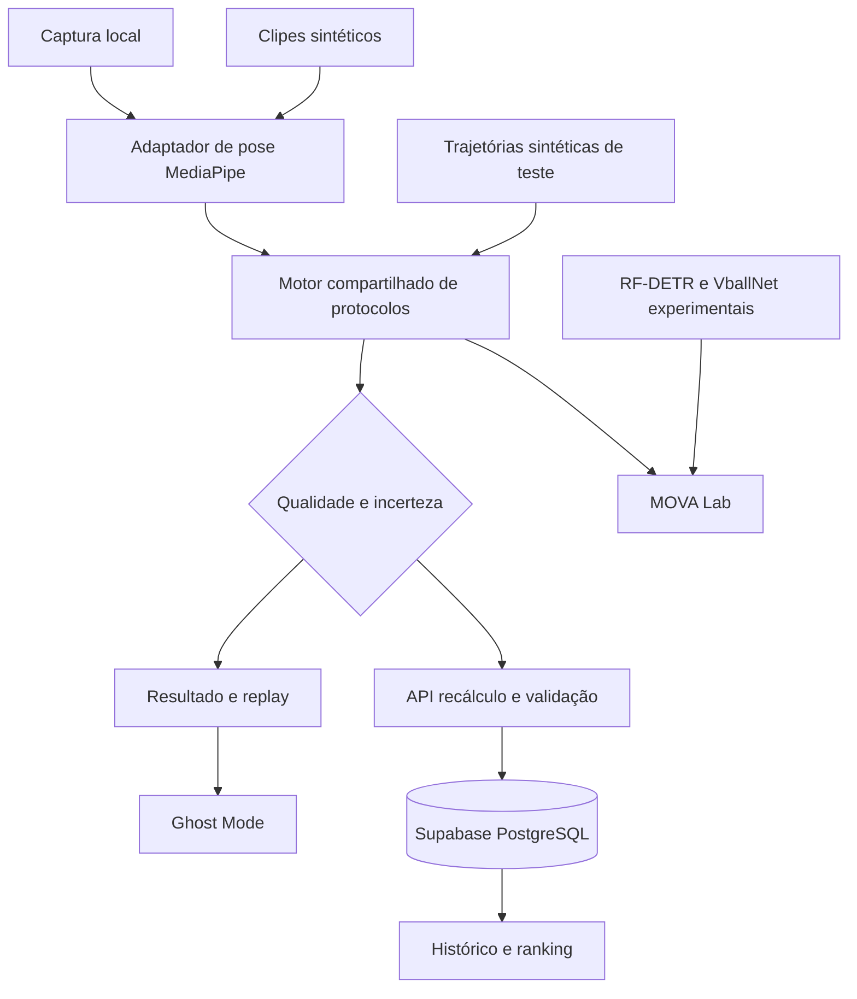

# MOVA Brasil — Plano mestre de desenvolvimento e entrega

> O jogo que acontece fora da tela. Todo movimento conta.
>
> Versão 1.0 — 24/11/2026 — Proposta operacional para execução pela equipe.

## 0. Referências e premissas

Este documento consolida o plano operacional, sem substituir a documentação original. Os requisitos do regulamento prevalecem; as tarefas são propostas, não evidências de implementação.

- [Projeto completo v4.1](MOVA_Brasil_Projeto_Completo_Hack_Brasil_2026.md)
- [Design e interface v1.0](MOVA_Brasil_Design_e_Interface.md)
- [Protótipo RF-DETR](https://github.com/Lucas-Andrade-Silva/hackasEsporteFilasOff/tree/teste/rfdetr-pose)
- [Protótipo de bola](https://github.com/Lucas-Andrade-Silva/hackasEsporteFilasOff/tree/teste/tracknet-bola)
- [Regulamento Hack Brasil](https://hackbrasil.com/regulamento), atualização de 18/11/2026, consultado em 24/11/2026, §§2–9.

| Marco | Data, horário de Brasília |
|---|---|
| Início do plano replanejado | 24/11/2026 |
| Jornada vertical | 25/11 |
| MVP público | 26/11 |
| Benchmark e diferenciais | 27/11 |
| Release candidate | 28/11 |
| Submissão antecipada | 29/11, meta 20h |
| Prazo oficial / congelamento | 30/11, 23h59 |
| Finalistas | 02/12 |
| Confirmação de presença | 04/12, 23h59 |
| Final presencial, São Paulo | 12/12 |
| Repositório público pelo menos até | 15/12 |

Premissas: quatro integrantes (papéis a definir), seis dias de execução de 24 a 29/11 inclusive, orçamento de infraestrutura sem gasto não autorizado. Confirmar disponibilidade real e mudanças de regulamento.

## 1. Objetivo e estado inicial

Maximizar a chance de vitória na trilha Saúde & bem-estar por meio de atividade física real, evolução mensurável, competição saudável e acesso democrático à avaliação esportiva. Público inicial: adultos de 18 a 24 anos, praticantes amadores de vôlei e basquete em atléticas, grupos e quadras públicas, inclusive usuários de Android de entrada. Recrutamento e descoberta de talentos são visão futura, não a função central da trilha. O comprador potencial é treinador/coordenador de grupos ou escolinhas; disposição a pagar ainda é hipótese.

| Referência auditada | Evidência | Limite |
|---|---|---|
| main d727ae715eb68f76d5b08eb0068c76390ba0ea67 | Projeto e design documentados, README vazio | Sem aplicação integrada nessa revisão |
| teste/rfdetr-pose 7a9179f1070d81d683780e94ee0616a7a84537ff | RF-DETR COCO-17, ByteTrack, One Euro, JSONL, MP4, CLI, Streamlit e testes | Sem medição validada de salto; sem teste móvel; faltam pontos específicos dos pés |
| teste/tracknet-bola 6dd7ceaf6fb64a50c4548065b682e88414c2dded | VballNet, TrackNetV3, YOLO, filtros e testes | Não é dependência do Core; rastreamento não equivale a métrica esportiva validada |

Os READMEs reportam 23,9 FPS de inferência de pose em RTX 3050 e, para o motor de bola, 90,5% de detecção e 5,4 px de erro mediano em um clipe específico contra referência de outro detector. Não foram reproduzidos nesta análise; não comprovam precisão de salto nem desempenho móvel. Repositório público, não fork, criado em 17/11; ainda é necessária auditoria de todo histórico, pesos, licenças e origem.

### Critérios competitivos

Quatro critérios de igual peso. Desempate: execução, depois impacto. Na final, avaliação começa do zero. Meta interna de banca simulada: 38/40 (10/9/9/10), não previsão.

| Critério | Evidência |
|---|---|
| Execução | URL pública, demo autônoma e jornada completa |
| Implementação | Pose, protocolos, matemática, segurança, testes e benchmark |
| Impacto | Problema e público, acessibilidade, feedback real, piloto como hipótese |
| Comunicação | Vídeo centrado no produto, Ghost Mode, transparência |

## 2. Escopo e critérios de aceite

P0: essencial; P1: diferencial após estabilidade P0; P2: opcional condicionado a capacidade; FUTURO: fora da submissão. Qualquer corte deve ser registrado com motivo e substituto.

| ID | P | Entrega | Aceite |
|---|---|---|---|
| F01 | 0 | PWA | HTTPS, responsiva, instalável quando suportado |
| F02 | 0 | Demo sintética | Sem cadastro/câmera, cálculo real, isolamento |
| F03 | 0 | Vôlei e basquete | Escolha de missão e esporte persistida |
| F04 | 0 | Missões | Protocolo, segurança e limites |
| F05 | 0 | Captura guiada | Permissões, enquadramento, timer, erros |
| F06 | 0 | Pose | Landmarks realmente inferidos e visualizados |
| F07 | 0 | Salto vertical | Medição calculada e versionada |
| F08 | 0 | Qualidade | Aceito, experimental ou rejeitado, com motivo |
| F09 | 0 | Resultado | Métrica, unidade, incerteza sustentada ou pendente |
| F10 | 0 | Passaporte | Histórico idempotente |
| F11 | 0 | Ranking | Só tentativas válidas, por grupo/protocolo |
| F12 | 0 | Privacidade | Sem vídeo real público; isolamento de sessões |
| F13 | 0 | MOVA Lab | Método, benchmark ou lacunas explícitas, limites |
| F14 | 1 | Ghost Mode | Comparação sincronizada ou lado a lado |
| F15 | 1 | Evolução | Baseline múltipla e incerteza |
| F16 | 1 | Participação | Percentual, período e regra definida |
| F17 | 1 | Conquistas | Sem penalizar descanso |
| F18 | 1 | Temas claro/escuro | Contraste e legibilidade |
| F19 | 2 | Painel treinador | Demo fictícia, sem dados reais |
| F20 | 2 | Biomecânica complementar | Validada ou explicitamente experimental |
| F21 | 2 | Replay de bola | Confiança, origem e estimativas |
| F22 | 2 | Salto com passada/alcance | Protocolo e benchmark específicos |
| F23–25 | futuro | Radar, recrutamento, app nativo | Roadmap pós-hackathon |

MOVA Lab elevado de P1 a P0 pela relevância científica; Ghost Mode é diferencial visual, não bloqueador. Fora de escopo: menores, feed público, chat com desconhecidos, diagnóstico, prescrição, apostas e nota universal de talento.

Jornada: início → esporte/missão → preparação segura → captura ou demo → processamento → resultado → Ghost/Passaporte → Copa MOVA → Lab.

Design: preservar #0E1A2B, #16263D, #C6F432, #4D8DFF, #FF7A1A, #FF5A5F, #F5F7FA; Barlow Condensed e Inter. Controles ≥48 px, informação nunca só por cor, segurança física, timer visual/sonoro opcional, estados vazios, rejeições com instrução, câmera negada, rede fraca, acessibilidade e legibilidade ao ar livre.

## 3. Arquitetura e contratos



- Next.js/TypeScript, Tailwind e componentes acessíveis, Canvas e gráficos leves; PWA com manifest, ícones e cache controlado.
- MediaPipe Pose Landmarker como candidato móvel, Web Worker se compatível, clipe curto se inferência contínua for lenta. Testar Lite/Full e versionar modelo/WASM/licença.
- Motor TypeScript puro compartilhado entre cliente e servidor; Python para pesquisa e benchmark. Evitar microserviços e GPU remota obrigatória.
- Supabase/PostgreSQL, Auth, RLS, API server-side, Vercel; verificar planos e quotas, não supor custo zero.
- Vitest, Playwright, Pytest, GitHub Actions, lockfiles, migrations e setup reproduzível.
- Preservar motores experimentais, integrar seletivamente após auditoria; as branches possuem versões diferentes do ball_engine. Não mesclar indiscriminadamente.

Estrutura alvo:

```text
src/app/{demo,missions,capture,results,leaderboard,passport,ghost,lab,api}
src/components/
src/contracts/
src/engine/{pose,protocols,biomechanics,quality,uncertainty,replay}
src/domain/{missions,rankings,groups,attempts}
src/workers/
src/lib/
pose_engine/                    # experimental
ball_engine/                    # experimental
fixtures/synthetic/
benchmarks/
supabase/migrations/
public/
tests/{unit,integration,e2e}
docs/{architecture,protocols,decisions,validation,privacy}
.github/workflows/
README.md
THIRD_PARTY_NOTICES.md
```

Contrato inicial a aprovar no dia 24:

```ts
type Sport = 'volleyball' | 'basketball';
type AttemptStatus = 'accepted' | 'experimental' | 'rejected';
type Landmark = { x: number; y: number; confidence: number; estimated: boolean };
type PoseFrame = {
  timestampMs: number; width: number; height: number; athleteCount: number;
  landmarks: Record<string, Landmark>;
};
type Measurement = {
  protocolId: string; protocolVersion: string; algorithmVersion: string;
  sport: Sport; metric: 'jump_height' | 'squat_repetitions';
  unit: 'cm' | 'repetitions'; value: number | null;
  uncertainty: number | null; uncertaintyMethod: string | null;
  status: AttemptStatus; effectiveFps: number | null; qualityFlags: string[];
  events: { name: 'takeoff' | 'apex' | 'landing'; timestampMs: number }[];
};
interface ExerciseProtocol {
  id: string; version: string;
  evaluate(frames: PoseFrame[]): Measurement;
}
```

Acordar coordenadas, escala, espelhamento, relógio monotônico, mapeamento COCO-17/MediaPipe, landmarks ausentes, confiança e estimativa. Não inventar pontos dos pés no COCO-17. Envelope inclui versão de esquema, origem sintética/real autorizada, sessão, fixture e chave idempotente. Se fallback de agachamento for ativado, estender eventos e critérios.

## 4. Motor de visão, qualidade e rankings

Protocolo inicial: salto parado, câmera fixa, corpo/chão visíveis, um adulto, espaço livre, aterrissagem no mesmo local. Bloqueio e rebote podem ter protocolos distintos se diferirem posições de braços. Máquina de estados: repouso → preparação → decolagem → voo → ápice → aterrissagem → estabilização.

- Baseline: h = 9,81 × t² / 8, assumindo alturas semelhantes do centro de massa na decolagem/aterrissagem.
- Complementar: ajustar y(t)=at²+bt+c ao quadril durante voo, com calibração de escala e perspectiva; quadril não é centro de massa. Usar gravidade para calibrar escala não constitui verificação física independente da própria gravidade.
- Comparar estimadores em benchmark. Não corrigir viés sem avaliação separada. A 30 FPS, um quadro adicional num voo de 0,5 s altera a estimativa em cerca de 4,2 cm; MAE de 3 cm é meta, não garantia.
- Medir timestamps reais, gaps, confiança, flags de estimativa e contatos dos pés quando observáveis. Incerteza considera resolução temporal, erro da referência, dispersão e viés. Se não calibrada, marcar pendente; não inventar margem.

| Condição | Ação |
|---|---|
| Corpo/pés cortados, cena ambígua, ausência de salto | Rejeitar e orientar |
| FPS baixo, timestamp irregular, câmera móvel | Experimental/rejeitado conforme protocolo |
| Pontos estimados/ocultos em fase crítica | Experimental/rejeitado |
| Múltiplos saltos, mudança de plano | Rejeitar fora do protocolo |
| Divergência, ajuste ruim, perspectiva | Experimental sem ranking |
| Todos os gates satisfeitos | Conferido pelo motor, não prova antifraude |

Limiar versionado e justificado por dados; não ajustado para favorecer a demo. Antifraude: sessão, limites, evidência, recálculo, idempotência e coerência física. Cliente controlado pelo usuário pode falsificar landmarks; não prometer autenticidade absoluta.

Ghost: alinhar pela decolagem, escala e eixos comparáveis, preservar diferença de altura, sinalizar estimados; bloquear conclusão se protocolos incompatíveis. Fallback lado a lado.

Rankings: desempenho = melhor marca aceita por grupo/protocolo/categoria; empates dentro da incerteza com regra determinística; evolução = ganho sobre múltiplas tentativas e além da incerteza combinada; participação = ativos/elegíveis no período e grupo mínimo definido. Primeira tentativa é registro, não baseline robusta. Rejeitadas e experimentais não pontuam.

## 5. Backend, privacidade e demonstração

| Entidade | Invariante |
|---|---|
| profiles | pseudônimo, faixa adulta, privado por padrão |
| groups/memberships | autorização e pertencimento |
| protocols/challenges | versão imutável, janela e limite |
| attempts | dono/sessão, protocolo/algoritmo, status, flags e chave idempotente única |
| pose_traces | mínimo necessário, retenção e exclusão |
| verification_events | trilha sem vídeo ou segredo |
| demo_sessions | namespace isolado, TTL e reset |
| leaderboard_entries | derivado apenas de tentativas aceitas |

API: iniciar sessão, submeter evidência, recuperar tentativa, histórico/ranking, excluir dados próprios e reset de demo. Servidor recalcula métrica, valida tamanho/timestamps/versões/ownership, nunca aceita score arbitrário. Persistência transacional e idempotente, RLS/grants mínimos, views seguras, segredos apenas server-side. Testes de acesso cruzado. Vídeo bruto não enviado por padrão nem registrado em logs; landmarks identificáveis também são dados pessoais. Preferir Ghost local e retenção mínima.

Demo pública e vídeo de submissão: somente dados sintéticos (§6.9). Testes reais privados e autorizados, sem publicação de vídeo/dados individuais. Consultar organização sobre captura real na final antes de realizar.

Fixtures: séries sintéticas com ground truth para matemática e rejeições; clipes de personagens sintéticos para inferência completa, documentar origem/licença. Fluxo principal: vídeo → MediaPipe → landmarks → motor → validação → resultado → ranking. Se clipe não for reconhecido, replay de landmarks explicitamente rotulado como pipeline parcial; consultar organização. Não fingir inferência nem usar score fixo. Perfis fictícios rotulados; tentativa calculada atualiza sessão, com reset e isolamento.

Cenários: D01 bloqueio válido; D02 rebote válido; D03 rejeição com motivo; D04 segunda tentativa/evolução; D05 atualização de ranking; D06 Lab. Verificar em janela anônima, sem câmera, conta ou intervenção humana.

## 6. Backlog executável

IDs para futuras issues; P=prioridade, h=horas-pessoa estimadas, dependências mínimas (trabalho antecipado pode usar contratos e mocks identificados). Tudo pendente de comprovação na main. Papéis não são atribuições nominais.

### A — IA, biomecânica e benchmark

| ID | P | h | Dep. | Tarefa / aceite |
|---|---|---:|---|---|
| CV01 | 0 | 2 | — | Auditar protótipos, origem, versões e testes |
| CV02 | 0 | 1 | — | Aprovar contrato de pose com BE01 e FE |
| CV03 | 0 | 3 | CV02 | Inferência web e overlay em fixture/aparelho |
| CV04 | 0 | 4 | CV02 | Fixtures/clipes e ground truth com PD08 |
| CV05 | 0 | 2 | CV03 | Timestamps efetivos e adaptação |
| CV06 | 0 | 2 | CV02 | Filtro testado, estimados explícitos |
| CV07 | 0 | 4 | CV05,CV06 | Máquina de estados e eventos |
| CV08 | 0 | 2 | CV07 | Tempo de voo, testes analíticos |
| CV09 | 0 | 4 | CV07 | Parábola e resíduos, limitar se instável |
| CV10 | 0 | 4 | CV07,CV08 | Gates, flags e casos inválidos |
| CV11 | 0 | 3 | CV08,CV09 | Incerteza e limitações |
| CV12 | 0 | 3 | CV08,CV10,BE01 | Mesmo motor cliente/servidor |
| CV13 | 0 | 6 | CV12,PD08 | Benchmark por aparelho, erros e rejeições |
| CV14 | 1 | 3 | CV12 | Dados de replay para Ghost |
| CV15 | 1 | 3 | CV01,CV13 | Comparar modelos com mesma referência |
| CV16 | 2 | 4 | CV01,G4 | Replay de bola experimental |

### B — Frontend e UX

| ID | P | h | Dep. | Tarefa / aceite |
|---|---|---:|---|---|
| FE01 | 0 | 2 | — | Scaffold PWA e build |
| FE02 | 0 | 3 | FE01 | Design system e componentes |
| FE03 | 0 | 3 | FE02 | Home e navegação |
| FE04 | 0 | 2 | FE03,BE01 | Seleção de esporte e missão |
| FE05 | 0 | 2 | FE04 | Preparação segura e instruções |
| FE06 | 0 | 4 | FE05 | Câmera, permissões, timer, parar tracks |
| FE07 | 0 | 3 | FE06,CV02 | Canvas, coordenadas e confiança |
| FE08 | 0 | 2 | FE06 | Processamento, progresso, timeout |
| FE09 | 0 | 3 | FE08,CV02 | Resultado, unidade, selo, retry |
| FE10 | 0 | 3 | BE10 | Passaporte e estado vazio |
| FE11 | 0 | 3 | BE09 | Ranking integrado |
| FE12 | 0 | 3 | FE09,CV04,BE11 | Demo sem conta/câmera |
| FE13 | 0 | 3 | CV11 | Lab, método e evidências |
| FE14 | 1 | 4 | FE09,CV14 | Ghost sincronizado ou lado a lado |
| FE15 | 1 | 2 | FE02 | Tema claro e contraste |
| FE16 | 0 | 3 | FE12 | Acessibilidade, mobile e teclado |
| FE17 | 0 | 4 | FE12 | Refinamento, estados e erros |

### C — Backend e DevOps

| ID | P | h | Dep. | Tarefa / aceite |
|---|---|---:|---|---|
| BE01 | 0 | 2 | — | Contratos API/domínio com CV02 |
| BE02 | 0 | 2 | — | Ambiente e segredos/quotas |
| BE03 | 0 | 3 | BE01,BE02 | Migrations, constraints e seeds |
| BE04 | 0 | 3 | BE03 | RLS/grants e acesso cruzado |
| BE05 | 0 | 3 | BE04 | Sessões/auth e fluxo privado adulto |
| BE06 | 0 | 3 | BE05 | Persistência de tentativas |
| BE07 | 0 | 4 | BE06,CV12 | Recálculo server-side |
| BE08 | 0 | 2 | BE06 | Idempotência e concorrência |
| BE09 | 0 | 3 | BE06,BE08 | Ranking derivado |
| BE10 | 0 | 2 | BE06 | Histórico por dono/sessão |
| BE11 | 0 | 3 | BE05 | Demo isolada, reset e TTL |
| BE12 | 0 | 2 | BE06 | Exclusão e retenção |
| BE13 | 0 | 3 | FE01 | Deploy e CI inicial |
| BE14 | 1 | 4 | BE09 | Evolução e participação |
| BE15 | 0 | 3 | BE07,BE11,BE13 | Segurança, logs e monitoramento |

### D — Produto, QA, pesquisa e pitch

| ID | P | h | Dep. | Tarefa / aceite |
|---|---|---:|---|---|
| PD01 | 0 | 1 | — | Auditoria de regras, histórico e licenças |
| PD02 | 0 | 1 | PD01 | Consultar organização sobre trilha/demo/final |
| PD03 | 0 | 2 | — | Recrutar voluntários adultos autorizados |
| PD04 | 0 | 4 | PD03 | Entrevistas de atletas, notas anonimizadas |
| PD05 | 0 | 5 | — | Entrevistas treinadores e atléticas |
| PD06 | 0 | 3 | — | Revisão de dados e fontes |
| PD07 | 1 | 3 | PD05 | Hipótese B2B/piloto |
| PD08 | 0 | 3 | — | Protocolo, referência, amostra e fixtures |
| PD09 | 0 | 5 | FE12 | Usabilidade e registro de falhas |
| PD10 | 0 | 2 | PD09 | Melhorias antes/depois documentadas |
| PD11 | 0 | 3 | — | README, setup, fontes, licenças |
| PD12 | 0 | 3 | PD06 | Roteiro com claims auditados |
| PD13 | 0 | 5 | G5,PD12 | Vídeo até três minutos |
| PD14 | 0 | 2 | PD13 | Formulário, links, aceite |
| PD15 | 0 | 3 | G5,PD12 | Banca simulada |

P0: A 40h + B 43h + C 38h + D 42h = 163 horas-pessoa. Capacidade com quatro pessoas × 8h produtivas × seis dias = 192h; margem 29h para integração, imprevistos e P1 selecionado. Estimativa, não garantia. P1 completo não cabe automaticamente. Se capacidade menor, cortar escopo; redistribuir conforme habilidades e carga, D auxilia fixtures/QA, C auxilia integração FE. Não sacrificar descanso, segurança ou honestidade.

Ritmo: sync curto 9h, integrar ao meio e fim do dia, PRs pequenos e revisão cruzada, main executável, comunicar bloqueio após 60–90 min, acompanhar tarefas aceitas e evidências (não linhas de código). Issues com ID, prioridade, dono, dependências, gate, aceite, estimativa e evidência. Milestones G1–G7.

## 7. Cronograma e caminho crítico

| Data | IA | Frontend | Backend | Produto | Gate |
|---|---|---|---|---|---|
| 24/11 | CV01–06 iniciados, pose e fixtures | FE01–05 | BE01–04, BE13 inicial | PD01–03, PD06, PD08 | G1 |
| 25/11 | CV07–10, medida inicial | FE06–09 | BE05–08 iniciados | PD04–05 e teste | G2 |
| 26/11 | CV10–12, benchmark inicial | FE10–13 | BE09–12, BE07 integrado | PD09, PD11, narrativa | G3 |
| 27/11 | CV13–14 se viável | FE13–14, FE16 | BE15, BE14 se viável | PD10, PD12 | G4 |
| 28/11 | Regressão e parâmetros | FE16–17 | CI, segurança e E2E | README, roteiro, ensaio | G5 |
| 29/11 | Validação final | Validação final | Release e links | PD13–15 | G6 |
| 30/11 | Contingência | Contingência | Contingência | Painel e aceite | G7 |

A tabela é sequência de marcos, não alocação rígida de horas.

- **G1 (24/11):** contrato v1, scaffold, CI, HTTPS, primeira inferência web e fixture. Se falhar, modelo leve/clipe curto.
- **G2 (25/11):** salto realmente calculado em condição controlada e tentativa persistida. Se inviável, avaliar imediatamente fallback de agachamento (repetições, não cm) com protocolo próprio; atualizar narrativa.
- **G3 (26/11):** demo pública, válido/rejeitado, histórico/ranking, jornada integrada. Cortar P1/P2 que bloqueiem.
- **G4 (27/11):** benchmark e limites publicados; Ghost simples se viável. Se erro alto, restringir protocolo e claims.
- **G5 (28/11):** release candidate, nenhum defeito crítico, checklist P0 verificado, freeze de features.
- **G6 (29/11):** 9–11h teste; 11–12h correções críticas; 13–15h gravação; 15–17h edição/upload; 17–18h revisão docs/licenças; 18–19h banca; 19–20h submissão; 20–21h verificar links e confirmação.
- **G7 (30/11):** margem de contingência, alvo interno freeze às 18h; prazo oficial 23h59. Confirmar versão enviada, commit e deploy; depois não alterar código até final autorizada.

Caminho crítico: contratos → inferência e fixtures → eventos/métrica/qualidade → integração API/UI → demo/benchmark → release → vídeo/submissão. FE e BE desenvolvem em paralelo por contrato. Pesquisa, recrutamento e docs começam no dia 24.

## 8. Validação e qualidade

Benchmark exploratório: buscar 8–12 adultos autorizados, 3–5 saltos por pessoa com descanso/segurança (24–60 tentativas), três dispositivos incluindo Android de entrada, 30/60 FPS quando possível. Referência independente deve medir a mesma grandeza (plataforma de força se disponível ou vídeo de alta velocidade com método de anotação); alcance da mão não equivale automaticamente à elevação do centro de massa. Separar calibração e avaliação por participante quando possível. Sem referência adequada, reportar verificação sintética, não validação empírica de precisão.

Registrar n, condições, método, aparelho, timestamps, versão, MAE (meta exploratória até 3 cm a 30 FPS), RMSE, mediana do erro absoluto, viés, dispersão, aceitação/rejeição, FPS efetivo e latência; reportar cobertura e erros sem esconder rejeições. Publicar metodologia e agregados autorizados, nunca vídeos pessoais. Amostra pequena não comprova generalização.

Produto: buscar 10–15 atletas entrevistados, 3–5 treinadores, 2–3 atléticas/escolinhas, 5–10 testes de uso, 2 interessados em piloto e 3 melhorias. Medir conclusão, tempo até primeira missão (meta <2 min), compreensão de margem/erros, intenção de retorno. Registrar dados reais e objeções; não fabricar entrevistas, cartas ou retenção. Métrica norte futura: missões em pelo menos dois dias distintos por semana. Validar dor atual, método de medição, frequência, comprador e preço.

| Área | Casos mínimos |
|---|---|
| Matemática | Ground truth, 30/60/120 FPS, jitter, gaps, valores impossíveis |
| Pose/protocolo | Nenhum atleta, múltiplos, oclusão, pés cortados, sem salto, câmera móvel |
| Incerteza | Divergência, ausência de calibração, status experimental |
| Dados | Duplicação, concorrência, payload inválido, rollback |
| Ranking | Rejeitadas excluídas, empate, grupos/protocolos separados, baseline |
| Segurança | Score adulterado, sessão expirada, acesso cruzado, isolamento |
| UX | Câmera negada, modelo falha, timeout, rede fraca, retry e vazio |
| Mobile | Android de entrada, orientação, luz, toque, parar câmera |
| E2E | Demo anônima, resultado, ranking, histórico, reset, rejeição |
| Release | Build reproduzível, janela anônima, URL direta, refresh, vídeo |

CI: lint, typecheck, unitários, build, smoke E2E; Python experimental separado. Teste com modelo real além de mocks. Evidências ligadas ao SHA; bugs com severidade, reprodução e dono. Zero falhas críticas conhecidas de privacidade, integridade, medição enganosa e acesso à demo.

Definition of Done: implementação integrada, aceite cumprido, testes aplicáveis aprovados, estados de erro, demo verificável, documentação e evidência, segurança/licenças revisadas. Mock não conta como integração.

## 9. GitHub e infraestrutura

- main estável; branches curtas feat/pose-engine, feat/jump-protocol, feat/mobile-app, feat/backend, feat/demo, feat/ghost-mode, feat/mova-lab, test/benchmark conforme necessidade.
- Auditar todos os commits, pesos, assets e datasets, especialmente código vendored TrackNetV3. §6.2 exige origem na mensagem do commit que copia código aberto preexistente; consultar organização se histórico não conforme, sem reescrever história sem decisão explícita.
- Preview/produção, migrations, seeds sintéticos, variáveis, quotas, logs sem PII. Teste externo e não habilitar gasto não autorizado.
- README: objetivo, demo, setup, arquitetura, testes, benchmark, real vs experimental, limitações, fontes, privacidade, licenças e roadmap.
- Identificar SHA entregue e deploy correspondente; tag interna antes do prazo. Manter demo no ar durante avaliação; não alterar código no congelamento. Evitar deploy automático de branch não relacionada sobre URL submetida.

## 10. Riscos e contingência

| Risco | Gravidade | Mitigação |
|---|---|---|
| Inelegibilidade/histórico/licença | Crítica | PD01/CV01, consultar organização antes de integrar |
| Dados reais em demo | Crítica | Sintéticos, auditoria de assets/logs |
| Trilha | Crítica | Atividade física central, consulta |
| Salto instável | Crítica | G2, baseline simples, fallback agachamento validado |
| Android lento | Alta | Lite/clipe curto, worker/cache, medir aparelho |
| Sintético não reconhecido | Alta | Produzir dia 24; replay parcial rotulado |
| Benchmark ruim/sem referência | Alta | Publicar limites, restringir claims |
| Banco indisponível | Alta | Demo local isolada e rotulada, não alegar ranking remoto |
| Fraude/acesso cruzado | Alta | Recálculo, RLS, testes, reconhecer cliente não confiável |
| Escopo e conflitos | Alta | Contratos, PRs pequenos, gates |
| Ghost instável | Média | Lado a lado |
| Bola imprecisa | Baixa no Core | Experimental |
| Vídeo atrasado | Alta | Roteiro antecipado e gravação dia 29 |

Cortar: recrutamento/radar → bola → painel treinador → protocolos novos → conquistas/participação avançada → temas/animações → Ghost avançado. Simplificar autenticação/UX se necessário preservando privacidade. Não cortar demo funcional, medida real (ou fallback validado), rejeição, histórico/ranking essencial, Lab honesto e segurança.

## 11. Comunicação e entrega

| Tempo de vídeo | Conteúdo |
|---|---|
| 0:00–0:15 | Problema, público, fonte e ano |
| 0:15–0:30 | MOVA e proposta de valor |
| 0:30–1:10 | Demo sintética, processamento real |
| 1:10–1:25 | Resultado, qualidade e ranking |
| 1:25–1:45 | Ghost/comparação |
| 1:45–2:10 | Arquitetura, benchmark e limites |
| 2:10–2:30 | Impacto, feedback e acessibilidade |
| 2:30–2:45 | Negócio como hipótese e roadmap |
| 2:45–2:55 | Encerramento |

Perguntas: HomeCourt (foco local e vôlei, acessível), IA própria (modelos abertos, contribuição nos protocolos/integração/qualidade), precisão (amostra/erro/limites), fraude (camadas não infalíveis), saúde (sem claim clínico), receita (hipótese), defensabilidade (rede e histórico autorizado como potencial, não ativo comprovado).

Submissão: nome, frase, descrição, trilha, links de todos os repositórios, demo funcionando, vídeo ≤3 min sem login e aceite do representante. Última versão dentro do prazo vale. Guardar confirmação.

Pós-submissão:
- 01/12: preparar apresentação e perguntas fora do repositório congelado.
- 02/12: conferir classificação e orientações.
- Até 04/12, 23h59: confirmar presença e logística/documentos de todos se finalista.
- 05–09/12: slides, ensaios, revisão de impacto, sem alterações de código.
- 10–11/12: banca simulada, verificar demo congelada, contingência.
- 12/12: retomar desenvolvimento apenas no local e quando autorizado, conforme agenda oficial; apresentar. Não depender do dia para completar P0.
- Até 15/12: manter repositório público.

## 12. Checklist final

- [ ] Elegibilidade e inscrição da equipe verificadas.
- [ ] Histórico, origem, licenças e assets auditados.
- [ ] Trilha e dados sintéticos em conformidade.
- [ ] HTTPS público, demo anônima isolada e resetável.
- [ ] Missão de vôlei e basquete.
- [ ] Inferência real ou replay parcial explicitamente rotulado.
- [ ] Medida calculada e protocolo versionado.
- [ ] Rejeição com motivo e orientação.
- [ ] Histórico idempotente e ranking válido.
- [ ] Ghost ou alternativa comparativa.
- [ ] MOVA Lab com evidências, incerteza e limites.
- [ ] Segurança física, acessibilidade e privacidade.
- [ ] Benchmark e lacunas documentados.
- [ ] Unitários, integração, E2E e teste mobile.
- [ ] RLS, ownership, idempotência, exclusão e isolamento.
- [ ] Nenhuma chave, dado pessoal ou vídeo real exposto.
- [ ] README, setup, fontes, licenças e roadmap.
- [ ] Vídeo público sem login, até três minutos.
- [ ] Banca simulada e revisão cruzada dos links.
- [ ] Submissão confirmada, SHA e deploy registrados.
- [ ] Congelamento respeitado e presença confirmada se finalista.

## 13. Decisões pendentes e próximos passos

Confirmar responsáveis nominais, horas reais, código local não enviado, acessos GitHub/deploy/banco, Android de entrada, equipamento de referência, voluntários adultos, posição da organização sobre trilha/clipes/captura na final, nome final e licenciamento.

Ações imediatas: 1) responsáveis e capacidade; 2) consulta organização; 3) auditoria de origem; 4) transformar backlog em issues/milestones; 5) contratos CV02/BE01; 6) scaffold FE01; 7) ambientes BE02/BE13; 8) MediaPipe e fixtures; 9) integração vertical; 10) evidências G1.

**Regra de execução:** jornada demonstrável desde o primeiro dia, frentes paralelas com integração frequente, expansão somente após estabilidade do núcleo. Tecnologia real, útil, verificável e comunicada com clareza.
