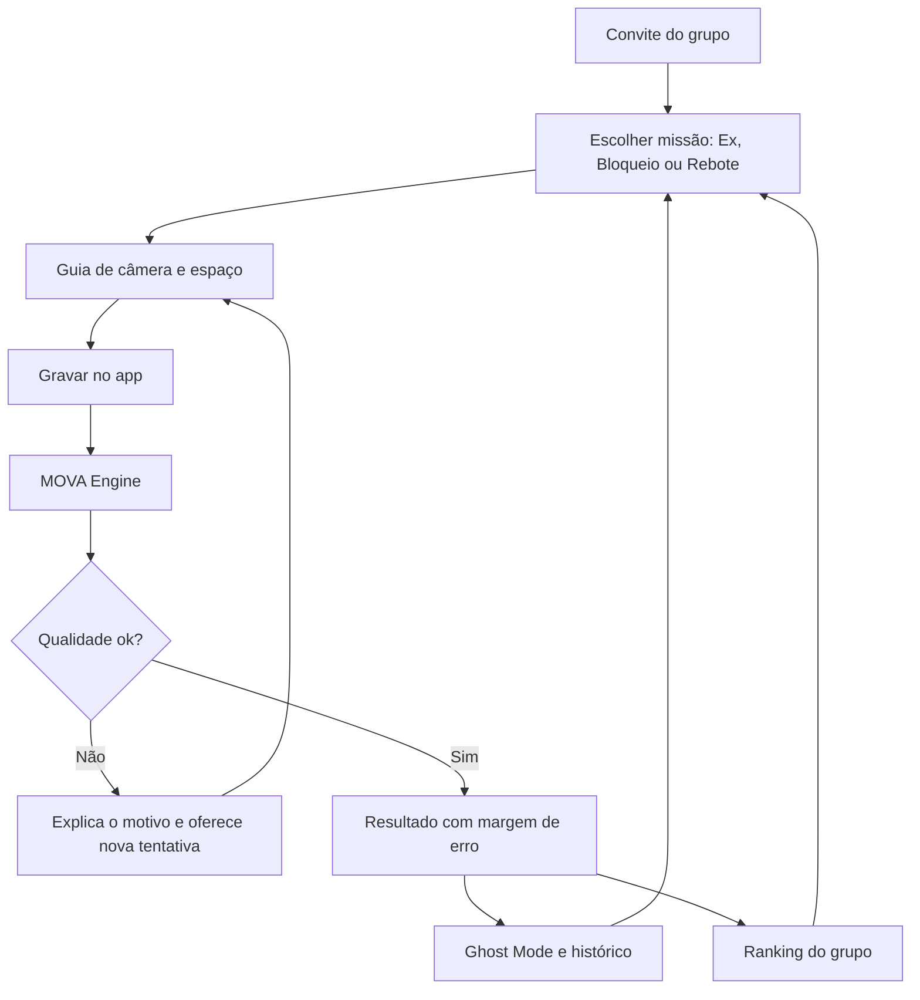
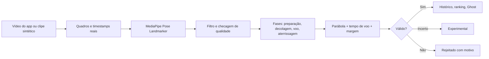
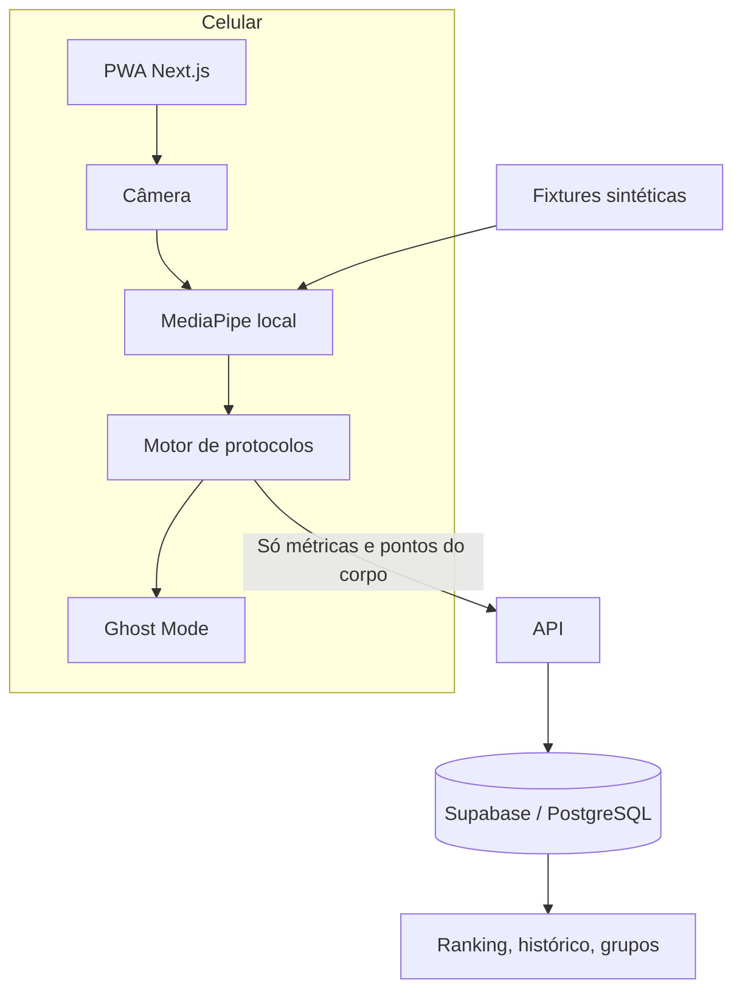

# MOVA Brasil: projeto completo e plano de competição

> **O jogo que acontece fora da tela.**
> **Todo movimento conta. Todo talento merece uma chance.**

| Campo | Definição |
|---|---|
| Versão | 4.1: provas detalhadas, pipeline como referência e design em documento separado |
| Data | 19/11/2026 |
| Nome de trabalho | MOVA Brasil (antes Peneira Brasil). Nome final em aberto |
| Competição | Hack Brasil 2026, trilha **Saúde & bem-estar** (proposta) |
| Prazo | Submissão em 30/11/2026, 23h59 (Brasília). Final em 12/12/2026, São Paulo |
| Foco inicial | **Vôlei e basquete.** Depois: futebol, natação, tênis, tênis de mesa e atletismo |
| Estado | Proposta. Nada implementado, medido ou contratado ainda |

**Legenda:** **[DADO]** fonte externa · **[CÁLCULO]** conta nossa a partir de dado · **[HIPÓTESE]** suposição a validar · **[META]** objetivo interno · **[FUTURO]** fora do MVP.

## Sumário

1. [Resumo executivo](#1-resumo-executivo)
2. [Problema e evidências](#2-problema-e-evidências)
3. [Público-alvo e cliente ideal](#3-público-alvo-e-cliente-ideal)
4. [Mercado: TAM, SAM e SOM](#4-mercado-tam-sam-e-som)
5. [Proposta de valor e concorrência](#5-proposta-de-valor-e-concorrência)
6. [Funcionalidades: Core, Ampliado e Extra](#6-funcionalidades-core-ampliado-e-extra)
7. [Regras dos módulos](#7-regras-dos-módulos)
8. [Jornada](#8-jornada)
9. [Motor de visão computacional](#9-motor-de-visão-computacional)
10. [Arquitetura e dados](#10-arquitetura-e-dados)
11. [Design e interface](#11-design-e-interface)
12. [Segurança, privacidade e inclusão](#12-segurança-privacidade-e-inclusão)
13. [Modelo de negócio](#13-modelo-de-negócio)
14. [Validação e métricas](#14-validação-e-métricas)
15. [Hack Brasil: regras, júri, demo e pitch](#15-hack-brasil-regras-júri-demo-e-pitch)
16. [Plano de execução](#16-plano-de-execução)
17. [Riscos e pendências](#17-riscos-e-pendências)
18. [Checklist de entrega](#18-checklist-de-entrega)
19. [Fontes](#19-fontes)

---

## 1. Resumo executivo

O MOVA é um app de desafios esportivos que usa a câmera do celular para medir movimentos reais, como o salto, e transformá-los em ranking entre amigos, evolução pessoal e, no futuro, visibilidade para clubes.

**Como funciona:** a pessoa escolhe um desafio, apoia o celular, grava dentro do app e recebe a medida na hora. Depois compete com o grupo, compara com a tentativa anterior (Ghost Mode) e constrói um histórico (Passaporte).

**Por que vôlei e basquete:**
- No futebol já existem CUJU e Footbao no Brasil.
- No vôlei não encontramos app brasileiro de medição por câmera para o atleta.
- No basquete existe o HomeCourt, que é global e vende no Brasil em reais, mas não é brasileiro e não tem foco em descoberta de talentos no país (seção 5.2).
- As duas modalidades dependem do mesmo gesto, **o salto**. Um motor só atende as duas.

**Tese:** entra pelo jogo, prova valor pela evolução e se expande pelas oportunidades. Não depende de clubes para ser útil no primeiro dia.

| Módulo | O que faz |
|---|---|
| MOVA Engine | Mede o movimento pela câmera e decide se a tentativa é válida |
| Missões | Desafios curtos de vôlei e basquete |
| Copa MOVA | Ranking de desempenho, de evolução e de grupo |
| Ghost Mode | Compara visualmente a tentativa atual com a anterior |
| Passaporte | Histórico com protocolo e nível de verificação |
| MOVA Lab | Mostra como medimos, o erro e os limites |
| Radar | Oportunidades esportivas públicas [FUTURO] |

**Meta da competição:** uma prova que funciona de verdade, uma demo que o jurado usa sozinho, sem cadastro, e evidência técnica medida.

---

## 2. Problema e evidências

**Problema:** Quem joga vôlei ou basquete de forma amadora quase nunca sabe medir a própria evolução. E quem tem talento fora dos grandes centros raramente é visto.

| Indicador | Valor | Fonte |
|---|---|---|
| Adultos insuficientemente ativos | 40,3% | [DADO] IBGE, PNS 2019 [F03] |
| Escolares de 13 a 17 anos ativos | 30,6% (58,4% insuficientemente ativos) | [DADO] IBGE, PeNSE 2024 [F04] |
| Pessoas de 15+ que praticaram algum esporte | 38,8 milhões | [DADO] IBGE, PNAD 2015 [F19] |
| Vôlei, basquete e handebol entre os praticantes | 2,9%; **8,8% na faixa de 15 a 17 anos**; 3,9% na faixa de 18 a 24 | [DADO] PNAD 2015, Tabelas 4 e 6 [F19] |
| Pessoas que **pararam** de praticar vôlei, basquete ou handebol | **3,5 milhões, 84,4% mulheres** | [DADO] PNAD 2015 [F19] |
| Motivo mais citado para parar | Falta de tempo (51,0%) | [DADO] PNAD 2015 [F19] |
| Efeito da gamificação na atividade física de jovens | Pequeno, mas significativo (SMD 0,15; 16 ensaios, 7.472 jovens) | [DADO] Wang et al., 2025 [F05] |

**Leitura:**
1. Vôlei e basquete são **esportes de jovens**: o peso deles entre quem tem 15 a 17 anos é três vezes a média.
2. Têm um público que o futebol não tem. Entre os praticantes, 57% são mulheres, contra 5,5% no futebol (PNAD 2015, Tabela 5).
3. Existe uma base enorme de ex-praticantes, a maioria mulheres, que é público para reativação.

**Limite:** os dados da PNAD são de 2015 e juntam vôlei, basquete e handebol numa só categoria. Não há dado separado mais recente: **não encontrado**.

---

## 3. Público-alvo e cliente ideal

### 3.1 Estatísticas do público

| Dado | Valor | Fonte |
|---|---|---|
| Sexo dos praticantes de vôlei, basquete e handebol | 57,0% mulheres, 43,0% homens | [DADO] PNAD 2015, Tabela 5 [F19] |
| Onde praticam | 79,8% em instalação esportiva (43,4% gratuita, 36,4% paga) | [DADO] PNAD 2015 [F19] |
| Estudantes no ensino superior | 10,2 milhões (2024) | [DADO] Censo da Educação Superior 2024 [F21] |
| Usuários de internet (10+) | 84%, ou 159 milhões | [DADO] TIC Domicílios 2024 [F20] |
| Acesso à internet **só pelo celular** | 60% no geral; 86% nas classes D e E | [DADO] TIC Domicílios 2024 [F20] |
| Planos pré-pagos (dados limitados) | 57%; 69% nas classes D e E; 66% no Nordeste | [DADO] TIC Domicílios 2024 [F20] |
| Celular mais vendido no Brasil (1º sem. 2026) | Galaxy A07 (linha de entrada) | [DADO] Counterpoint [F28] |

**Consequências para o produto:**
- **Celular primeiro e app leve.** Para muita gente, o celular é o único acesso.
- **Pouco consumo de dados.** O vídeo não sobe para o servidor por padrão.
- **Funcionar em aparelho de entrada**, a 30 fps.
- Comunicação que **não seja só masculina**, ao contrário dos apps de futebol.

### 3.2 Cliente ideal (ICP)

O MOVA tem **dois clientes**: quem usa e quem paga. Definimos um de cada.

**Usuário ideal (quem usa, de graça):**

| Atributo | Definição |
|---|---|
| Quem | Jovem de **18 a 24 anos** que joga **vôlei ou basquete** de forma amadora |
| Onde | Atlética universitária, time de amigos, quadra pública, escolinha |
| Aparelho | Android de entrada, plano pré-pago |
| Dor | Não sabe se está evoluindo. Quer se comparar com os amigos e ser visto |
| Gatilho de entrada | Convite de um amigo ou do time para um desafio |
| Por que 18 a 24 e não 15 a 17 | O regulamento exige equipe 18+, e a proteção de menores (ECA Digital) pede controles que não cabem no MVP. Menores entram na fase 2 [FUTURO] |

**Comprador ideal (quem paga) [HIPÓTESE]:**

| Atributo | Definição |
|---|---|
| Quem | **Treinador ou coordenador** de escolinha, atlética universitária ou projeto social de vôlei ou basquete |
| Tamanho | Uma ou mais turmas de 10 a 30 atletas |
| Dor | Acompanhar a evolução física da turma sem equipamento caro nem planilha |
| O que compra | Gestão de turmas, relatório de evolução, desafios internos, selo "Assinado" |
| Por que ele | Concentra muitos usuários de uma vez, o que resolve a aquisição, e tem orçamento próprio |
| A validar | Disposição a pagar e preço: **não encontrado**. Validar com 5 a 10 entrevistas |

**Fora do ICP inicial:** clubes profissionais e federações (fase 3), escolas com menores (fase 2), pacientes em reabilitação (fora do escopo).

**Persona:** Júlia, 20 anos, joga vôlei na atlética da faculdade em Fortaleza, tem um Galaxy A e plano pré-pago. Quer saber se o salto dela melhorou desde o começo do semestre e entra no app pelo desafio "Bloqueio da semana" que o técnico da atlética criou. (Persona ilustrativa.)

---

## 4. Mercado: TAM, SAM e SOM

**Aviso:** não existe pesquisa pública com o tamanho exato deste mercado. Os números abaixo são **estimativas montadas a partir de dados públicos**, cada uma com o cálculo aberto. Não são previsão de receita.

### 4.1 Em pessoas (usuários)

| Nível | Definição | Cálculo | Resultado |
|---|---|---|---|
| **TAM** | Brasileiros de 15+ que praticam ou já praticaram vôlei, basquete ou handebol | [CÁLCULO] Praticantes: 38,8 mi × 2,9% ≈ 1,1 mi. Mais 3,5 mi de ex-praticantes [F19] | **≈ 4,6 milhões** (base 2015, inclui handebol) |
| **SAM** | A parte que acessa a internet e pode usar o app | [CÁLCULO] 4,6 mi × 84% (usuários de internet, TIC 2024) [F20] | **≈ 3,9 milhões** |
| **SOM** | A parte que podemos alcançar em 3 anos | [HIPÓTESE] 1% a 2% do SAM | **≈ 39 mil a 78 mil usuários** |

### 4.2 Em receita (ordem de grandeza)

| Nível | Cálculo | Resultado anual |
|---|---|---|
| **TAM B2C** | [CÁLCULO] 3,9 mi (SAM) × R$ 23,90/mês × 12. Preço de referência: assinatura mensal do HomeCourt no Brasil [F22] | ≈ R$ 1,1 bilhão/ano. **Teto teórico**: supõe que todos pagariam |
| **SAM B2C realista** | [HIPÓTESE] 3,9 mi × 2% pagantes × R$ 14,90/mês × 12. Conversão de referência entre 1,4% e 2,6% [F26] | ≈ R$ 14 milhões/ano |
| **SOM B2C** | [HIPÓTESE] 39 mil a 78 mil × 2% × R$ 14,90 × 12 | ≈ R$ 140 mil a R$ 280 mil/ano |
| **SOM B2B** | [HIPÓTESE] 50 a 150 escolinhas ou atléticas × R$ 199/mês × 12 | ≈ R$ 120 mil a R$ 360 mil/ano |

**Leitura honesta:**
- O mercado em pessoas é grande, mas a receita por usuário no Brasil é baixa.
- Por isso o modelo é **grátis para o atleta e pago por organizadores e, depois, por clubes e marcas**.
- O canal B2B também tem um teto conhecido: **179,3 mil escolas de educação básica** (Censo Escolar 2024 [F27]) e **10,2 milhões de universitários** [F21]. Quantas escolas têm quadra: **não encontrado** no dado nacional.

---

## 5. Proposta de valor e concorrência

### 5.1 Valor por público

- **Atleta:** descobre quanto salta, vê se está evoluindo e compete com os amigos, sem equipamento.
- **Treinador:** acompanha a turma inteira pelo celular, com relatório de evolução.
- **Clube e federação [FUTURO]:** acesso, com autorização, a resultados com protocolo e selo de verificação.

**Princípios:** movimento real, não tempo de tela · evolução vale tanto quanto ranking · toda medida mostra sua margem de erro · privacidade por padrão · grátis para o atleta · cada modalidade entra com protocolo próprio, nunca com uma "nota de talento".

### 5.2 Concorrência com foco em vôlei e basquete

| Concorrente | Esporte | O que faz | Ameaça | Fonte |
|---|---|---|---|---|
| **HomeCourt** | Basquete | Arremesso, drible e salto por câmera; desafios; NBA Global Scout. Vende no Brasil: R$ 23,90/mês ou R$ 204,90/ano | **Alta no basquete.** Global, em reais. Português: **não confirmado** | [F07], [F22] |
| TryoutPlayers | Vôlei | IA analisa vídeo de treino e gera plano. Foco em universidades dos EUA | Baixa no Brasil | [F29] |
| iSPORTiSTiCS | 36 modalidades | Análise de vídeo para equipes e transmissões | Baixa: atende clubes, não o atleta | [F29] |
| CUJU, Footbao | Futebol | Desafios, ranking e peneira por IA | Fora do foco inicial | [F09] |
| JUMP!, My Jump, Uplift | Salto genérico | Medem salto pelo celular; alguns têm ranking | Média: medem, mas sem comunidade nem esporte brasileiro | Pesquisa anterior |

**Vantagem defensável:** o modelo de pose é replicável. O que não se copia rápido é a rede de treinadores que validam resultados, os grupos já ativos e o histórico de dados autorizados.

**Lições de projetos premiados** (Imagine Cup, NASA Space Apps [F10–F11]): tecnologia sofisticada com benefício humano claro, um núcleo funcional, evidência reproduzível e um momento visual memorável. Não aumentar o escopo para imitar vencedores.

---

## 6. Funcionalidades: Core, Ampliado e Extra

### 6.1 Visão geral por etapa

| Etapa | Quando | Objetivo | Público | Custo de infraestrutura |
|---|---|---|---|---|
| **Core** | Hackathon (até 30/11/2026) | Provar que a medição funciona e engaja | Jurados e demo | **R$ 0** (planos grátis) |
| **Ampliado** | Piloto (1 a 6 meses depois) | Provar retenção com grupos reais | 5 a 10 grupos adultos de vôlei e basquete | **≈ US$ 65/mês + US$ 124 no 1º ano** |
| **Extra** | Escala (6 a 24 meses) | Provar receita e abrir para clubes | Escolinhas, atléticas, menores com proteção, clubes | **Variável**; custos jurídicos: **não encontrado** |

### 6.2 Core (MVP do hackathon)

| Funcionalidade | Vôlei | Basquete | Critério de aceite | Prioridade |
|---|---|---|---|---|
| **Salto vertical parado** medido pela câmera | "Bloqueio" | "Rebote" | O vídeo passa pelo motor e gera a altura de verdade | P0 |
| Captura guiada | ✓ | ✓ | Enquadramento, permissão e erros tratados | P0 |
| Controle de qualidade | ✓ | ✓ | Tentativa válida, experimental ou rejeitada, com motivo | P0 |
| Resultado e histórico | ✓ | ✓ | Ligado ao protocolo e à tentativa, sem duplicar | P0 |
| Ranking do grupo | ✓ | ✓ | Atualiza só com tentativas válidas | P0 |
| Modo Demonstração | ✓ | ✓ | Sem login, sem câmera, com dados sintéticos processados de verdade | P0 |
| Privacidade básica | ✓ | ✓ | Nenhum vídeo real exposto; demo isolada | P0 |
| Ghost Mode 2D | ✓ | ✓ | Duas tentativas sobrepostas com dados do motor | P1 |
| MOVA Lab | ✓ | ✓ | Protocolo, erro medido e limites publicados | P1 |
| Desafio coletivo | ✓ | ✓ | Ranking de participação proporcional do grupo | P1 |

**Custo do Core** [DADO]:
- MediaPipe: grátis ([F14]).
- Supabase grátis: 500 MB de banco, 50 mil usuários ativos por mês, 1 GB de arquivos ([F23]).
- Vercel Hobby: grátis ([F24]).
- PWA, então não precisa de loja.
- **Total: R$ 0.** O custo real é o tempo da equipe: 4 pessoas por cerca de 12 dias.

### 6.3 Ampliado (piloto)

| Funcionalidade | Detalhe |
|---|---|
| **Salto com passada** | "Ataque" no vôlei, "Bandeja" no basquete. Exige enquadramento maior |
| Alcance estimado | Altura alcançada = alcance em pé + salto. Usa a parábola para calibrar a escala [HIPÓTESE técnica a validar] |
| Painel do treinador | Turmas, evolução, exportação |
| Selo "Assinado" | Treinador cadastrado confirma a marca |
| Temporadas e conquistas | Desafios semanais variados, para não cansar |
| Ranking por trimestre de nascimento e por evolução | Corrige o viés de idade relativa ([pesquisa de papers](../papers_visao_computacional_peneira.md)) |
| App nativo Android | Câmera a 120 fps quando o aparelho permitir |
| Integridade do app | Play Integrity e App Attest |

**Custo do Ampliado** [DADO, preço de tabela]:
- Supabase Pro: US$ 25/mês ([F23]).
- Vercel Pro: US$ 20 por pessoa por mês; 2 pessoas = US$ 40 ([F24]).
- Google Play: US$ 25, pago uma vez ([F25]).
- Apple Developer: US$ 99/ano ([F25]).
- **Total: ≈ US$ 65/mês + US$ 124 no primeiro ano.**
- Não inclui salários, marketing, domínio nem impostos.

### 6.4 Extra (escala)

| Funcionalidade | Detalhe | Condição |
|---|---|---|
| Vitrine para clubes e federações | Busca por modalidade, região e idade, com opt-in | Parceria e verificação institucional |
| Menores de 15 a 17 anos | É a faixa em que vôlei e basquete mais pesam (8,8%) | Consentimento do responsável e conformidade com a ECA Digital |
| Agilidade lateral | Deslocamento de defesa (basquete) e de bloqueio (vôlei) | Protocolo e validação |
| Medidas com bola | Arremesso (basquete), toque e manchete (vôlei) | Detector de bola; o modelo de pose não vê a bola |
| Radar de oportunidades | Peneiras, projetos e competições públicas | Fontes verificáveis |
| Desafios patrocinados | Marca patrocina um desafio, com prêmio | Sem publicidade direcionada a menores |
| Novas modalidades | Futebol, natação, tênis, tênis de mesa, atletismo | Um protocolo por modalidade |

**Custo do Extra:** armazenar vídeo só para quem pedir para ser visto, revisão jurídica (LGPD e ECA Digital), suporte e moderação. Preços: **não encontrado**. A Play Integrity tem limite de 10 mil pedidos por dia no plano padrão.

### 6.5 Fora de todas as etapas

Feed aberto de vídeos, chat entre desconhecidos, apostas, blockchain, diagnóstico de saúde, "nota universal de talento", modelo de IA treinado do zero.

---

## 7. Regras dos módulos

### 7.1 Missões
Uma missão define: exercício, protocolo, número limitado de tentativas, janela de tempo e alternativa mais leve. Há pontos limitados por dia, dias de descanso e nenhuma penalidade por pausa. A segurança vem antes do recorde.

### 7.2 Copa MOVA: três rankings

| Ranking | Regra | Proteção |
|---|---|---|
| Desempenho | Melhor marca válida no mesmo protocolo e categoria | Empate dentro da margem de erro conta como empate |
| Evolução | Ganho sobre a linha de base (média de várias tentativas) | Ganho menor que a margem de erro não conta |
| Grupo | Percentual de membros ativos no período | Tamanho mínimo de grupo; regras definidas antes de começar |

Exemplos ilustrativos:
- **Evolução:** linha de base de 30 cm e nova marca de 36 cm dão +6 cm (+20%), que só conta se superar a margem de erro.
- **Grupo:** 8 de 10 membros ativos (80%) vencem 15 de 20 (75%).

### 7.3 Ghost Mode
Esqueletos 2D de duas tentativas, sobrepostos e alinhados pela decolagem, em duas cores, com play/pause e as fases do salto marcadas. Se os protocolos não forem comparáveis, o app avisa e não conclui nada. Plano B: as duas tentativas lado a lado.

### 7.4 Passaporte e níveis de confiança

| Selo | Como se obtém | Vale para |
|---|---|---|
| Gravado | Captura feita no app | Histórico pessoal |
| Conferido | O motor aprovou a qualidade | Rankings |


O Passaporte não tem nota de talento nem previsão de carreira.

### 7.5 Recrutamento [FUTURO]
- Opt-in do atleta.
- Só instituições verificadas.
- Contato sempre intermediado; nunca mensagem direta de adulto desconhecido para menor.
- Convite não é contratação.

---

## 8. Jornada



As telas, seus estados vazios e de erro e o desenho de cada uma estão em [MOVA_Brasil_Design_e_Interface.md](MOVA_Brasil_Design_e_Interface.md).

**Histórias P0:**
- Como atleta, quero escolher o desafio do meu esporte e entender como fazer.
- Quero saber se a câmera está bem posicionada.
- Quero ver meu resultado e se ele é válido.
- Quero ver meu histórico e o ranking do grupo.

---

## 9. Motor de visão computacional

> Detalhes e fontes: `../tecnologias_peneira_brasil.md` e `../papers_visao_computacional_peneira.md`.

### 9.1 Provas por etapa

Cada prova é um **protocolo próprio**: gesto, posição da câmera, métrica, regras de validade e versão. Uma prova só sobe de etapa quando passa no benchmark (seção 14). A ordem abaixo vai da mais fácil para a mais difícil de construir.

**Visão geral**

| # | Prova | Vôlei | Basquete | Métrica | Precisa de bola? | Etapa | Dificuldade |
|---|---|---|---|---|---|---|---|
| 1 | Salto vertical parado | Bloqueio | Rebote | Altura do salto (cm) | Não | **Core** | Baixa |
| 2 | Salto com passada | Ataque | Bandeja | Altura do salto com aproximação (cm) | Não | Ampliado | Média |
| 3 | Alcance | Alcance de ataque e de bloqueio | Alcance no aro | Altura máxima da mão (cm) | Não | Ampliado | Média |
| 4 | Agilidade lateral | Deslocamento de bloqueio | Deslize defensivo | Tempo entre duas linhas (s) | Não | Extra | Média |
| 5 | Mecânica do gesto | Braço do ataque | Arremesso (joelho, cotovelo, soltura) | Ângulos e consistência entre tentativas | Não | Extra | Média |
| 6 | Acerto de arremesso | — | Cesta ou erro | % de acerto | Sim | Extra | Alta |
| 7 | Saque em zona-alvo | Saque | — | Acertos na zona marcada | Sim | Extra | Alta |
| 8 | Contagem de fundamentos | Toque e manchete | — | Repetições válidas | Sim | Extra | Alta |

**Detalhe de cada prova**

**1. Salto vertical parado (Bloqueio / Rebote) · Core**
- **Gesto:** pés paralelos, contramovimento livre, saltar o mais alto possível e aterrissar no mesmo lugar. Mãos livres no bloqueio; braços estendidos no rebote.
- **Câmera:** apoiada, de lado ou de frente, parada, com o corpo inteiro e os pés no quadro.
- **Como medimos:** parábola do quadril como método principal e tempo de voo como segunda opinião (9.2).
- **Rejeita quando:** pés fora do quadro, mais de uma pessoa, câmera mexendo, fps efetivo baixo, trajetória incompatível com a gravidade, divergência alta entre os dois métodos.
- **Evidência:** é a prova com mais estudos de validação por câmera (Webering et al., 2021; Aderinola et al., 2023).
- **Risco:** precisão a 30 fps. **Plano B:** agachamento (seção 16).

**2. Salto com passada (Ataque / Bandeja) · Ampliado**
- **Gesto:** 2 a 3 passadas de aproximação e salto. No vôlei, passada de ataque; no basquete, bandeja sem bola ou com bola.
- **Câmera:** de lado e mais longe, para caber a corrida e o salto. Exige mais espaço.
- **Como medimos:** mesmo cálculo do salto parado, aplicado só à fase de voo. A decolagem precisa ser detectada no meio do movimento.
- **Rejeita quando:** a corrida sai do quadro, o atleta muda de distância da câmera (perspectiva), a decolagem não é clara.
- **Evidência:** **não encontramos** estudo validado de salto com passada em quadra por câmera de celular. É lacuna de pesquisa e oportunidade.
- **Risco:** enquadramento e perspectiva. **Plano B:** registrar como "experimental" até o benchmark.

**3. Alcance · Ampliado**
- **Gesto:** primeiro, braço estendido em pé junto a uma referência; depois, salto com a mão no ponto mais alto.
- **Como medimos:** alcance em pé + altura do salto. A escala vem da parábola (a gravidade dá cm por pixel) ou de uma referência conhecida no quadro, como a altura da rede ou do aro. [HIPÓTESE técnica a validar]
- **Rejeita quando:** a mão sai do quadro, a referência não aparece, a escala diverge entre os dois métodos.
- **Por que importa:** no vôlei e no basquete, o que decide o lance é onde a mão chega, não só quanto o corpo sobe.
- **Risco:** a pose estima mal a ponta dos dedos. **Plano B:** usar o pulso e informar a diferença.

**4. Agilidade lateral · Extra**
- **Gesto:** deslocamento lateral entre duas marcas no chão, ida e volta, sem cruzar as pernas.
- **Câmera:** de frente, parada, com as duas marcas no quadro.
- **Como medimos:** o tempo entre o quadril cruzar a primeira e a segunda marca. [CÁLCULO] A 30 fps, cada quadro vale cerca de 33 ms, o que é a resolução da medida.
- **Rejeita quando:** marcas fora do quadro, atleta sai da linha, cruzamento de pernas detectado.
- **Evidência:** cronometragem por câmera a 30 fps já é usada em apps de mercado (pesquisa anterior da equipe). Estudo específico de deslocamento de vôlei ou basquete: **não encontrado**.
- **Risco:** perspectiva e espaço físico.

**5. Mecânica do gesto · Extra**
- **Gesto:** arremesso (basquete) ou braço do ataque (vôlei), filmado de lado.
- **Como medimos:** ângulos de joelho, quadril, ombro e cotovelo nos momentos-chave (carga, soltura, pico) e a variação entre tentativas.
- **O que entrega:** consistência e comparação com a própria tentativa anterior (Ghost Mode). **Não** dá nota de "certo ou errado": não existe gesto ideal único para todos os corpos.
- **Risco:** profundidade em vídeo 2D e roupas largas escondendo articulações.

**6. Acerto de arremesso · Extra**
- **Gesto:** série de arremessos de um ponto marcado.
- **Como medimos:** detector de bola e de aro (RF-DETR, licença Apache 2.0 nos tamanhos principais) e regra de cesta: a bola passa por dentro do aro de cima para baixo.
- **Evidência:** há repositórios abertos e um guia da Roboflow como referência. Precisão em quadra brasileira: **não medida**.
- **Risco:** é a prova mais copiada (o HomeCourt já faz). Só vale se for barata de construir.

**7. Saque em zona-alvo · Extra**
- **Gesto:** saque para uma zona marcada na quadra adversária.
- **Atalho:** em vez de rastrear a bola no ar (TrackNet), detectar só **onde ela cai** em relação à zona. É bem mais simples.
- **Risco:** a quadra inteira precisa caber no quadro; bola pequena e rápida.

**8. Contagem de fundamentos (toque e manchete) · Extra**
- **Gesto:** toques ou manchetes seguidos, sem deixar a bola cair.
- **Como medimos:** detector de bola + pose dos braços para classificar o fundamento e contar.
- **Risco:** distinguir toque de manchete exige um classificador treinado com vídeos nossos. Base de dados pública para isso: **não encontrada**.

**Critério para uma prova mudar de etapa**
1. Benchmark contra referência (fita métrica, cronômetro ou contagem manual), com erro e viés publicados no MOVA Lab.
2. Testada em pelo menos 3 aparelhos, um deles Android de entrada.
3. Taxa de rejeição conhecida e motivos de rejeição que o usuário entende.
4. Protocolo escrito e versionado.


### 9.2 Cálculo do salto

- **Método principal: parábola do quadril.** Ajusta a trajetória do quadril durante o voo. A gravidade calibra a escala, sem calibrar a câmera (Webering et al., 2021; Aderinola et al., 2023, ICC de 0,84 a 0,99).
- **Segunda opinião: tempo de voo**, com `h = 9,81 × t² / 8`.
  - [CÁLCULO] A 30 fps, um quadro errado muda a altura em cerca de 4 cm num salto de 0,5 s. A 120 fps, cerca de 1 cm.
  - Se os dois métodos divergirem muito, a tentativa vira "experimental".
- **Antifraude físico:** a parábola tem que ser compatível com g = 9,81 m/s². Vídeo acelerado, cortado ou montado não passa.
- **Correção:** estudos indicam que o MediaPipe tende a **subestimar** a altura. O fator de correção sai do nosso benchmark.

### 9.3 Pipeline de referência

> **Ponto de partida, não regra.** Este fluxo descreve uma forma possível de medir o salto vertical. A equipe pode trocar, remover ou reordenar qualquer bloco conforme o benchmark, a prova e o tempo disponível.



**Checagens de qualidade sugeridas:** corpo inteiro e pés visíveis, uma pessoa só, câmera parada, fps efetivo medido (não o solicitado), confiança dos pontos e coerência com a gravidade.

**O que pode mudar:**
- **Modelo de pose:** MediaPipe, RTMPose, MoveNet ou outro que vença no benchmark.
- **Cálculo:** só parábola, só tempo de voo, os dois, ou outro método.
- **Onde roda:** no aparelho ou no servidor.
- **Checagens:** entram, saem ou mudam de ordem conforme os erros reais.
- **Provas com bola:** acrescentam um detector de objetos antes ou ao lado da pose.

**O que convém manter, qualquer que seja o fluxo:** a medida carrega a versão do algoritmo e a margem de erro, e tentativa sem qualidade não entra no ranking.

### 9.4 Contrato do motor (proposta)

```ts
type AttemptStatus = 'accepted' | 'experimental' | 'rejected';
type Measurement = {
  protocolId: string; protocolVersion: string; algorithmVersion: string;
  sport: 'volei' | 'basquete';
  metric: 'jump_height'; unit: 'cm';
  value: number | null; uncertainty: number | null;
  status: AttemptStatus; effectiveFps: number | null;
  qualityFlags: string[];
  events: { name: 'takeoff' | 'apex' | 'landing'; timestampMs: number }[];
};
interface ExerciseProtocol {
  id: string; version: string;
  validateCapture(frames: PoseFrame[]): QualityReport;
  evaluate(frames: PoseFrame[]): Measurement;
}
```

---

## 10. Arquitetura e dados



| Camada | Core | Ampliado e Extra |
|---|---|---|
| App | Next.js + TypeScript, PWA | React Native / Expo com câmera a 120 fps |
| Visão | MediaPipe Pose Landmarker (web), em web worker | MediaPipe nativo; RTMPose como plano B |
| Backend | Supabase (Postgres, auth, regras por linha) | Supabase Pro |
| Deploy | Vercel | Vercel Pro |
| Integridade | Sessão e idempotência | Play Integrity e App Attest |
| Vídeo | **Não guardado** | Guardado só com opt-in e autorização |


**Entidades:**
- `users`: pseudônimo, faixa etária, esporte.
- `groups` e `memberships`.
- `protocols` (imutável por versão) e `challenges`.
- `attempts`: status, métrica, `quality_flags`, idempotência.
- `pose_traces`: retenção limitada.
- `leaderboard_entries`: derivado das tentativas.
- `verification_events`.
- `consent_records` [Extra].

**Regras de dados:**
- O servidor nunca aceita pontuação escrita direto pelo cliente.
- O ranking é recalculado a partir das tentativas válidas.
- A demo fica isolada e marcada como sintética.

**Repositório:** `src/engine` (protocolos, qualidade, replay), `src/domain` (ranking, desafios), `fixtures/synthetic`, `tests`, `docs` (arquitetura, protocolos, benchmark, privacidade, decisões, fontes). Novo repositório, sem código privado anterior.

---

## 11. Design e interface

Marca, paleta, tipografia, usabilidade, telas e momentos-chave da interface estão em documento próprio: **[MOVA_Brasil_Design_e_Interface.md](MOVA_Brasil_Design_e_Interface.md)**.

---

## 12. Segurança, privacidade e inclusão

**Antifraude em camadas:**
1. Captura só no app.
2. Checagem física pela gravidade.
3. Checagem de cena (pés visíveis, uma pessoa).
4. Limite de tentativas.
5. Selo de treinador [Ampliado].
6. Integridade do aparelho [Ampliado].

Nada disso impede toda fraude, e não vamos dizer que impede.

**Privacidade (LGPD e ECA Digital [F16–F17]):**
- O MVP é só para adultos e a demo usa dados sintéticos.
- O vídeo é processado no aparelho e não é guardado.
- Perfis são privados por padrão.
- Coletamos o mínimo de dados.
- Pontos do corpo ligados a um perfil **são dado pessoal**.
- Menores, só na etapa Extra: consentimento do responsável, sem vídeo público, sem contato direto, sem rolagem infinita e sem publicidade direcionada.

**Segurança física:**
- O salto é opcional e o número de tentativas é limitado.
- O app orienta espaço livre e piso não escorregadio, e pede para parar se houver dor.
- Não diagnostica nem prescreve.

**Justiça do ranking:**
- Filtro por sexo, idade e trimestre de nascimento.
- Ranking de evolução ao lado do absoluto.
- Teste do motor em pessoas de diferentes tons de pele e tipos de corpo, com o resultado publicado no MOVA Lab.

---

## 13. Modelo de negócio

| Cliente | Paga por | Etapa |
|---|---|---|
| Atleta | Nada no básico. Premium opcional [HIPÓTESE] | Core → Ampliado |
| Escolinhas, atléticas, projetos | Painel de turmas, relatórios, selo | **Ampliado: primeiro cliente pagante** |
| Marcas | Desafios patrocinados | Extra |
| Clubes e federações | Busca autorizada e testes próprios | Extra |
| Governo e programas | Atividade física e mapa de talentos | Longo prazo, sem contrato presumido |

**Referências de preço:**
- HomeCourt no Brasil: R$ 23,90/mês ou R$ 204,90/ano para o atleta [F22].
- Preço para instituições: **não encontrado**. Os R$ 199/mês usados no SOM B2B (seção 4) são hipótese a validar em entrevistas.

**Crescimento:** amigos → grupos ativos → treinadores → mais grupos. Quando houver base verificada, os clubes entram. Cada fase só começa com evidência de retenção, adoção e um primeiro encaminhamento real.

---

## 14. Validação e métricas

**Métrica norte:** usuários que completam missões em **pelo menos dois dias diferentes por semana**.

| Experimento | Meta [META] |
|---|---|
| Benchmark de salto contra fita métrica | MAE de até 3 cm a 30 fps; registrar o viés e o fator de correção |
| Dispositivos | Pelo menos 3, incluindo um Android de entrada |
| Casos inválidos | Reproduzíveis, com taxa de rejeição publicada |
| Diversidade | Pessoas de tons de pele, sexos e corpos diferentes, se autorizado |
| Tempo até a primeira missão | Menos de 2 minutos |
| Entrevistas | 3 a 5 treinadores de vôlei e basquete; 2 a 3 atléticas ou escolinhas |
| Iterações | 3 melhorias documentadas, com antes e depois |

```text
MAE = soma(|estimado - referência|) / n
Taxa de rejeição = tentativas rejeitadas / tentativas analisadas
```

**Roteiro de entrevista com treinadores:**
1. Como acompanha a evolução hoje?
2. Mede salto? Com quê?
3. O que faria seus atletas voltarem ao app?
4. Quem decide a compra e quanto pagaria?

Não fabricar entrevistas nem cartas de intenção.

---

## 15. Hack Brasil: regras, júri, demo e pitch

### 15.1 Regras que eliminam [F01–F02]
- Equipe de 1 a 4 pessoas, todas com 18 anos ou mais.
- Repositório **novo e público**, criado depois de 04/11 às 21h, sem código privado anterior.
- **Demo de saúde só com dados sintéticos** (item 6.9).
- Vídeo de até 3 minutos, sem login.
- Submissão até 30/11, 23h59.
- Congelamento de código entre a submissão e a final.
- Repositório público até 15/12.

### 15.2 Critérios (25% cada, notas de 0 a 10; mínimo de 20/40 para a final)

| Critério | O que mostrar |
|---|---|
| Execução técnica | Fluxo completo e demo autônoma |
| Implementação técnica | Motor, protocolo, testes, benchmark |
| Impacto | Dados do IBGE, foco em jovens e mulheres no vôlei, acessibilidade |
| Comunicação | Vídeo claro, momento do salto, limites ditos com honestidade |

### 15.3 Modo Demonstração (P0)
Link HTTPS, sem cadastro nem câmera. O roteiro:
1. Escolher vôlei ou basquete.
2. O clipe sintético é processado pelo **mesmo motor**.
3. Aparecem o esqueleto, as fases e o resultado.
4. O ranking atualiza.
5. Ghost Mode.
6. MOVA Lab.

Inclui um caso rejeitado. Um número fixo no código não é processamento.

### 15.4 Vídeo de 3 minutos

| Tempo | Conteúdo |
|---|---|
| 0:00–0:20 | Problema: entre jovens de 15 a 17 anos que praticam esporte, 8,8% escolhem vôlei, basquete ou handebol (PNAD 2015), e não encontramos app brasileiro que meça a evolução deles |
| 0:20–1:20 | Demo: salto processado, resultado, ranking |
| 1:20–1:50 | Ghost Mode e evolução |
| 1:50–2:20 | Benchmark e limites (MOVA Lab) |
| 2:20–3:00 | Impacto, próximos passos e frase final |

### 15.5 Perguntas difíceis

| Pergunta | Resposta |
|---|---|
| E o HomeCourt? | É de basquete, global e pago. Somos brasileiros, vôlei e basquete, grátis para o atleta, rodamos em Android de entrada e o foco é comunidade e descoberta local |
| A IA é própria? | O modelo de pose é aberto. A contribuição é protocolo, qualidade, parábola, antifraude e produto |
| Quão preciso é? | Mostramos nosso benchmark: amostra, erro e limites |
| Como evitam fraude? | Em camadas, sem prometer fraude zero |
| Isso melhora a saúde? | A literatura mostra efeito pequeno da gamificação; não fazemos alegação clínica |
| O que impede a cópia? | Rede de treinadores, grupos ativos e dados autorizados |

### 15.6 Pendências com a organização (`oi@hackbrasil.com`)
1. O projeto cabe em Saúde & bem-estar?
2. Pode haver captura ao vivo de um integrante adulto na final?
3. Clipes sintéticos processados pelo mesmo motor são aceitos?

---

## 16. Plano de execução

| Data | Entrega | Decisão |
|---|---|---|
| 18/11 | Repositório, regras, MediaPipe rodando, fixtures | Repositório válido |
| 19/11 | Prova de medição do salto | Salto ou plano B (agachamento) |
| 20–21/11 | Captura, protocolo, qualidade, resultado | Fluxo P0 completo |
| 22–23/11 | Persistência, ranking, histórico | Sem duplicatas |
| 24/11 | Ghost Mode | Cortar se instável |
| 25/11 | Modo Demonstração | Jurado usa sozinho |
| 26/11 | Benchmark e MOVA Lab | Evidência publicada |
| 27–28/11 | Correções, design final, README | Versão candidata |
| 29/11 | Vídeo, banca simulada, submissão antecipada | Links testados |
| 30/11 | Margem final até 23h59 | Envio |

| Papel | Responsabilidade |
|---|---|
| Visão computacional | Motor, parábola, qualidade, benchmark |
| Backend | Banco, permissões, ranking, deploy |
| Frontend e design | Captura, telas, demo, acessibilidade |
| Produto e pitch | Entrevistas, fontes, vídeo, testes |

**Pontos de corte:**
- Salto instável até 19/11: passar para agachamento.
- Fluxo instável até 21/11: congelar o resto.
- Ghost Mode difícil: tentativas lado a lado.
- Prazo curto: entregar antes de adicionar.

---

## 17. Riscos e pendências

| Risco | Gravidade | Mitigação |
|---|---|---|
| Repositório inválido ou dados reais na demo | Crítica | Auditoria e dados só sintéticos |
| Medição imprecisa a 30 fps | Alta | Parábola, segunda opinião, margem visível, plano B |
| HomeCourt no basquete | Alta | Diferencial local; vôlei como modalidade sem concorrente encontrado |
| Enquadramento na trilha | Alta | Atividade física como centro; e-mail à organização |
| Baixa retenção | Alta | Desafios variados e grupos |
| Exposição de menores | Crítica | MVP só para adultos |
| Escopo excessivo | Alta | Core, Ampliado e Extra com pontos de corte |
| Alegações sem prova | Alta | Toda afirmação com fonte ou marcada como hipótese |

**Pendências:**
- Precisão própria.
- Preço B2B.
- Português no HomeCourt.
- Dados separados de vôlei e de basquete.
- Escolas com quadra.
- Marca (INPI, domínio).
- Respostas da organização.

---

## 18. Checklist de entrega

- [ ] Equipe elegível (18+) e repositório novo e público, com commits no prazo.
- [ ] Trilha Saúde & bem-estar e descrição coerente.
- [ ] Demo só com dados sintéticos, HTTPS, sem login.
- [ ] Salto medido de ponta a ponta, com válido e rejeitado.
- [ ] Ranking e histórico consistentes, sem duplicatas.
- [ ] Benchmark e MOVA Lab publicados.
- [ ] Checklist de design cumprido ([MOVA_Brasil_Design_e_Interface.md](MOVA_Brasil_Design_e_Interface.md)).
- [ ] Vídeo de até 3 minutos, público.
- [ ] README: o que funciona, o que é simulação, roadmap, licenças e fontes.
- [ ] Envio antes de 30/11 às 23h59; congelamento respeitado.

---

## 19. Fontes

| ID | Fonte | Uso |
|---|---|---|
| F01 | [Hack Brasil, regulamento](https://hackbrasil.com/regulamento) | Regras (versão de 09/11/2026) |
| F02 | [Hack Brasil, site](https://hackbrasil.com/) | Cronograma e trilhas |
| F03 | [IBGE, PNS 2019](https://biblioteca.ibge.gov.br/visualizacao/livros/liv101764.pdf) | Adultos inativos |
| F04 | [IBGE, PeNSE 2024](https://agenciadenoticias.ibge.gov.br/agencia-sala-de-imprensa/2013-agencia-de-noticias/releases/46171-5-edicao-da-pense-meninas-sao-as-maiores-vitimas-de-violencia-sexual) | Escolares ativos |
| F05 | [Wang et al., *JMIR Serious Games* 2025](https://games.jmir.org/2025/1/e68151/PDF) | Gamificação em jovens |
| F07 | [HomeCourt, Global Scout](https://homecourt.ai/faq/globalscout) | Concorrente de basquete |
| F09 | CUJU e Footbao (pesquisa anterior da equipe) | Concorrentes de futebol |
| F10 | [Imagine Cup, vencedores](https://imaginecup.microsoft.com/pt-br/winners) | Lições |
| F11 | [NASA Space Apps 2024](https://www.spaceappschallenge.org/nasa-space-apps-2024/awards/global-winners/) | Lições |
| F14 | [MediaPipe Pose Landmarker](https://ai.google.dev/mediapipe/solutions/vision/pose_landmarker) | Motor de pose |
| F16 | [LGPD](https://www.planalto.gov.br/ccivil_03/_ato2015-2018/2018/lei/l13709.htm) | Privacidade |
| F17 | [ECA Digital, Lei 15.211/2025](https://www.planalto.gov.br/ccivil_03/_ato2023-2026/2025/lei/l15211.htm) | Menores |
| F19 | [IBGE, PNAD 2015: Práticas de Esporte e Atividade Física](https://biblioteca.ibge.gov.br/visualizacao/livros/liv100364.pdf), Tabelas 4, 5 e 6 | Vôlei, basquete e handebol; sexo; idade; ex-praticantes |
| F20 | [Cetic.br, TIC Domicílios 2024](https://cetic.br/media/docs/publicacoes/2/20250512115624/tic_domicilios_2024_resumo_executivo.pdf) | Internet e celular |
| F21 | [Censo da Educação Superior 2024 (via Bahia Notícias)](https://www.bahianoticias.com.br/noticia/308858-brasil-registra-10-milhoes-de-estudantes-no-ensino-superior-e-ead-supera-cursos-presenciais) | Universitários; conferir no Inep |
| F22 | [HomeCourt na App Store Brasil](https://apps.apple.com/BR/app/id1258520424) | Preço em reais |
| F23 | [Supabase, preços 2026 (Jetadmin)](https://www.jetadmin.io/blog/supabase-pricing-2026-guide-to-plans-limits-and-real-world-costs/) | Custos; conferir no site oficial |
| F24 | [Vercel, plano Pro](https://vercel.com/docs/plans/pro-plan) | Custos |
| F25 | [Taxas da Apple e do Google Play (SplitMetrics)](https://splitmetrics.com/blog/google-play-apple-app-store-fees/) | Custos de loja |
| F26 | [RevenueCat, State of Subscription Apps](https://www.revenuecat.com/state-of-subscription-apps-2025) | Conversão para pagante |
| F27 | [MEC, Censo Escolar 2024](https://www.gov.br/mec/pt-br/centrais-de-conteudo/infograficos/censo-escolar/documentos/censo-escolar-2024.pdf) | 179,3 mil escolas (número citado na imprensa; PDF não aberto) |
| F28 | [Oficina da Net / Counterpoint](https://www.oficinadanet.com.br/samsung/72725-nem-galaxy-s-a07-foi-o-celular-mais-vendido-do-brasil-no-1o-semestre) | Celular mais vendido |
| F29 | [Lance, TryoutPlayers](https://www.lance.com.br/volei/equipes-universitarias-dos-eua-usarao-tecnologia-brasileira.html) · [Google for Startups, iSPORTiSTiCS](https://startup.google.com/intl/pt-BR_ALL/stories/isportistics/) | Concorrência no vôlei |

**Documentos da equipe:** `MOVA_Brasil_Design_e_Interface.md` (design e interface).

**Pesquisas internas da equipe:** `../tecnologias_peneira_brasil.md` (stack e antifraude), `../papers_visao_computacional_peneira.md` (estudos científicos), `../mescla_aiscout_gymrats_homecourt.md` (modelo de produto), `../ranking_desafios_video_viabilidade.md` (viabilidade e concorrentes).

---

*MOVA Brasil, versão 4.1, 19/11/2026. A versão 3.0 completa está no histórico do git (commit 7e3972e).*
