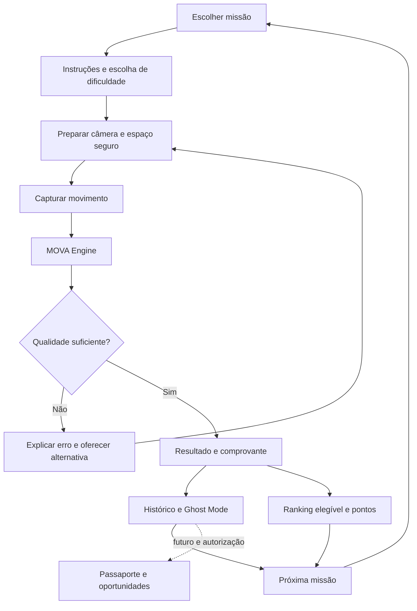
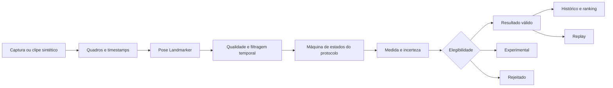
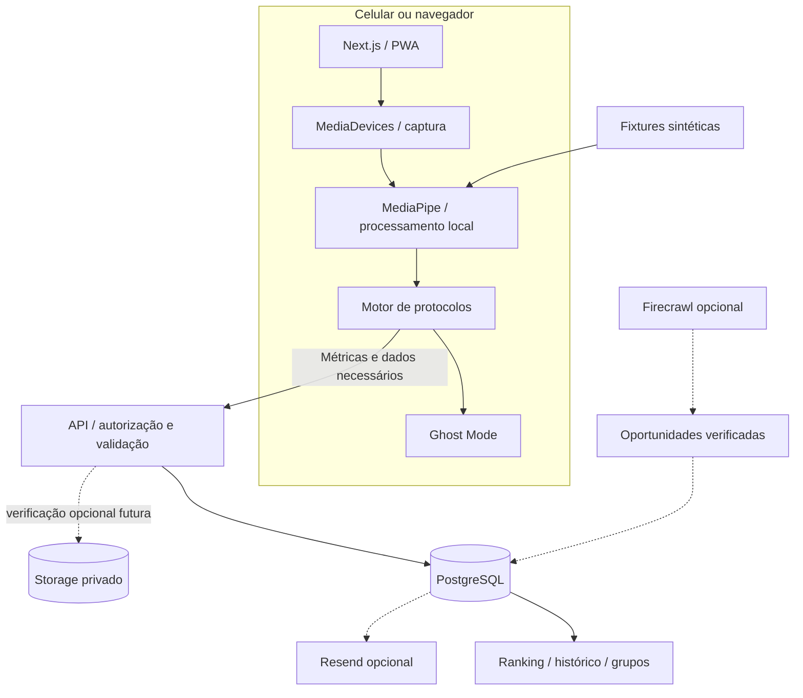
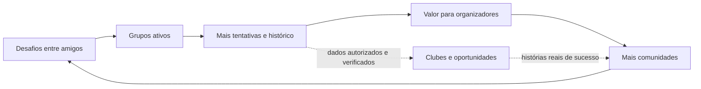

# MOVA Brasil — Projeto completo e plano de competição

> **O jogo que acontece fora da tela.**  
> **Todo movimento conta. Todo talento merece uma chance.**  
> **Transformamos movimento em progresso. E progresso em oportunidades.**

| Campo | Definição |
|---|---|
| Versão | 3.0 — consolidação estratégica final |
| Data de referência | 17/11/2026 |
| Nome de trabalho | MOVA Brasil (anteriormente Peneira Brasil) |
| Competição | Hack Brasil 2026 — hackbrasil.com |
| Trilha proposta | Saúde & bem-estar |
| Prazo de submissão | 30/11/2026, 23h59, horário de Brasília |
| Final presencial | 12/12/2026, São Paulo, condicionada à classificação |
| Escopo | Visão de produto, PRD preliminar, arquitetura, validação e plano competitivo |
| Estado | Proposta consolidada; implementação, métricas e parcerias ainda não auditadas |

## Como interpretar este documento

- **[REGRA]**: obrigação ou condição do regulamento oficial vigente, atualizado em 09/11/2026, reconferido em 17/11/2026. Em caso de divergência, vale a versão oficial mais recente.
- **[EVIDÊNCIA EXTERNA]**: estudo, dado público ou funcionalidade de referência; não é resultado do MOVA.
- **[PROPOSTA]**: decisão recomendada pelas análises, ainda sujeita à aprovação e execução pela equipe.
- **[META]**: objetivo experimental, não indicador já alcançado nem requisito oficial.
- **[PENDENTE]**: hipótese ou fato que ainda precisa ser confirmado.
- **[FUTURO]**: visão de expansão, não promessa de funcionalidade na submissão.

O documento consolida os arquivos `hack_brasil_2026_pesquisa_completa.md` (29/10/2026), `mescla_aiscout_gymrats_homecourt.md` (17/11/2026), a análise da ideia original, a reformulação MOVA Brasil e a auditoria competitiva subsequente. As regras antigas conflitantes foram identificadas e substituídas pelas vigentes. Nenhum código foi inspecionado, nenhum teste foi executado e nenhuma parceria foi estabelecida nesta consolidação.

## Sumário

1. [Resumo executivo](#1-resumo-executivo)
2. [Evolução da ideia](#2-evolução-da-ideia)
3. [Problema, evidências e público](#3-problema-evidências-e-público)
4. [Proposta de valor e posicionamento](#4-proposta-de-valor-e-posicionamento)
5. [Concorrência e referências premiadas](#5-concorrência-e-referências-premiadas)
6. [Experiência e jornada do produto](#6-experiência-e-jornada-do-produto)
7. [Módulos e regras de negócio](#7-módulos-e-regras-de-negócio)
8. [MVP e critérios de aceite](#8-mvp-e-critérios-de-aceite)
9. [Motor de visão computacional](#9-motor-de-visão-computacional)
10. [Arquitetura e dados](#10-arquitetura-e-dados)
11. [Segurança, confiança, privacidade e inclusão](#11-segurança-confiança-privacidade-e-inclusão)
12. [Modelo de negócio e crescimento](#12-modelo-de-negócio-e-crescimento)
13. [Validação, benchmark e métricas](#13-validação-benchmark-e-métricas)
14. [Regulamento e estratégia do Hack Brasil](#14-regulamento-e-estratégia-do-hack-brasil)
15. [Experiência do júri e MOVA Lab](#15-experiência-do-júri-e-mova-lab)
16. [Pitch, vídeo e final](#16-pitch-vídeo-e-final)
17. [Plano de execução e gestão](#17-plano-de-execução-e-gestão)
18. [Riscos, decisões e pendências](#18-riscos-decisões-e-pendências)
19. [Checklist e banca simulada](#19-checklist-e-banca-simulada)
20. [Materiais de submissão](#20-materiais-de-submissão)
21. [Fontes e rastreabilidade](#21-fontes-e-rastreabilidade)
22. [Conclusão](#22-conclusão)

---

## 1. Resumo executivo

O MOVA Brasil é uma plataforma gamificada de atividade física e desenvolvimento esportivo que utiliza a câmera de um celular para transformar movimentos reais em resultados mensuráveis, desafios sociais, evolução individual e, futuramente, oportunidades esportivas.

A pessoa escolhe uma missão, executa um movimento seguindo um protocolo, grava dentro do aplicativo, recebe uma avaliação automática e acompanha seu histórico. Pode competir com amigos, superar marcas anteriores e contribuir para sua equipe independentemente do seu nível inicial de habilidade.

O produto combina três mecanismos já observados no mercado: engajamento social (GymRats), avaliação por câmera (HomeCourt) e descoberta de talentos (aiScout). A proposta brasileira amplia a experiência para iniciantes e praticantes amadores, cria competições coletivas e mantém o recrutamento como uma evolução opcional do passaporte esportivo.

**Tese central:** o produto entra pelo jogo, comprova valor pela evolução e se expande pelas oportunidades. Não depende de clubes, sensores especializados ou de uma rede social já popular para oferecer valor inicial.

| Pilar | Módulo | Valor |
|---|---|---|
| Prática recorrente | Missões MOVA | Motivar movimento fora da tela |
| Tecnologia central | MOVA Engine | Converter movimentos em métricas e verificar qualidade |
| Evolução visual | Ghost Mode | Comparar tentativas e perceber o próprio progresso |
| Comunidade | Copa MOVA | Desafios individuais e coletivos |
| Histórico | Passaporte MOVA | Registro estruturado de resultados e sua confiabilidade |
| Oportunidades | Radar MOVA | Encontrar projetos, competições e seletivas |
| Transparência | MOVA Lab | Tornar testes, protocolos e limitações verificáveis |

**Estratégia de competição:** entregar uma prova esportiva realmente funcional, uma demo autônoma com dados sintéticos, rankings e histórico consistentes, evidências técnicas e um replay comparativo memorável. Segundo exercício, radar e integrações são condicionais. O marketplace de clubes é futuro.

**Condição de sucesso:** a versão submetida precisa funcionar sem a equipe ao lado, respeitar as regras eliminatórias e diferenciar claramente o que é implementado do que é roadmap. A meta interna de 36/40 é uma ambição de qualidade, não previsão de nota ou vitória.

## 2. Evolução da ideia

| Estágio | Proposta | Problema identificado | Evolução |
|---|---|---|---|
| Original | Vídeos esportivos gravados no app, rankings e futuros convites de clubes | Rede social depende de audiência; proibir edição não elimina fraude | Testes padronizados e verificação gradual |
| Peneira Brasil | Combinação GymRats + HomeCourt + aiScout | Foco profissional estreito e dependência de recrutadores | Produto útil antes da entrada dos clubes |
| MOVA Brasil | Olimpíada digital permanente, passaporte e Ghost Mode | Medir habilidade isolada não garante atividade recorrente | Missões, colaboração, segurança e validação |
| MOVA 3.0 | Jogo de movimento, evolução e oportunidades | Necessidade de comprovar execução e impacto para a banca | Demo sem cadastro, MOVA Lab, protocolos, benchmark e pontos de corte |

A publicação de vídeos não desaparece como possibilidade de produto. Ela deixa de ser o mecanismo principal e passa a ser um registro privado e opcional para verificação, com compartilhamento autorizado conforme a finalidade. Para o MVP, priorizam-se métricas e trajetórias corporais em vez de um feed de vídeos.

O conceito de Peneira Brasil pode permanecer como nome de um módulo futuro de descoberta de talentos, sujeito à decisão de marca. MOVA Brasil é um nome de trabalho; pesquisa de disponibilidade no INPI, domínio e lojas de aplicativos está pendente.

## 3. Problema, evidências e público

### 3.1 Problema central

A prática esportiva e o desenvolvimento de habilidades dependem de acesso a espaços, orientação, equipamentos, comunidades e oportunidades. Pessoas iniciantes ou fora dos grandes centros podem enfrentar mais barreiras para treinar e perceber sua evolução. Muitos aplicativos oferecem registro manual, conteúdo de treino ou competição entre pessoas já ativas, mas isso não resolve necessariamente a necessidade de experiências de movimento simples, socialmente motivadoras e mensuráveis.

A pergunta do MOVA é: **como utilizar a tecnologia que já está nas mãos das pessoas para incentivar a prática física e reduzir barreiras ao desenvolvimento esportivo?**

Exemplo ilustrativo: dois jovens com habilidades semelhantes podem ter oportunidades distintas se um vive perto de centros de treinamento e o outro não. Uma avaliação remota não substitui treinamento, infraestrutura ou olheiros, mas pode facilitar o acompanhamento e o acesso à informação.

### 3.2 Fundamentação brasileira

| Fonte | Indicador | Interpretação e limite |
|---|---|---|
| IBGE, PNS 2019 [F03] | 40,3% dos adultos insuficientemente ativos | Menos de 150 min/semana nos domínios considerados pela pesquisa; dado histórico, não estimativa de 2026 |
| IBGE, PeNSE 2024, divulgada em 2026 [F04] | 30,6% dos escolares de 13–17 anos ativos; 58,4% insuficientemente ativos; 9,7% inativos | População e critério distintos da PNS; não comparar diretamente ou somar os percentuais como universo exaustivo |
| Revisão de gamificação [F05] | 36 ensaios, 10.079 adultos; diferença média de cerca de 489 passos/dia em favor da gamificação | Benefício pequeno em estudos de outros aplicativos; não comprova eficácia do MOVA |

Os dados comprovam relevância do problema e fundamentam a hipótese de engajamento. Não demonstram que o produto aumenta atividade física, evita doenças ou melhora a saúde de seus usuários. Isso exigirá estudos próprios adequados.

### 3.3 Segmentação

| Público | Necessidade | Papel no plano |
|---|---|---|
| Adultos 18+, iniciantes e praticantes amadores | Motivação, desafios simples, progresso visível | Público inicial proposto para piloto e produto |
| Grupos de amigos e comunidades universitárias | Competição social e participação | Canal inicial de aquisição |
| Treinadores, professores, escolinhas e academias | Acompanhamento e organização de grupos | Validação do problema e clientes potenciais |
| Escolares e jovens atletas | Oportunidades e desenvolvimento | Expansão após controles de proteção de menores |
| Responsáveis legais | Segurança e controle de compartilhamento | Participação obrigatória conforme contexto jurídico futuro |
| Clubes e federações | Resultados comparáveis, triagem de interessados | Mercado profissional futuro |
| Projetos sociais e governos | Acesso e incentivo à atividade física | Possíveis clientes/parceiros institucionais, não comprovados |

**Persona inicial proposta:** jovem adulto que gostaria de se movimentar mais, não possui equipamento especializado e sente dificuldade em manter uma rotina sozinho.

**Jobs to be done:** “Quando tenho pouco tempo ou motivação para praticar, quero um desafio simples com feedback e companhia, para perceber que estou evoluindo sem precisar ser um atleta de alto rendimento.”

**Não usuários iniciais:** pacientes buscando diagnóstico, reabilitação ou prescrição clínica; menores sem estrutura jurídica e operacional apropriada; recrutadores sem verificação.

## 4. Proposta de valor e posicionamento

### 4.1 Posicionamento

O MOVA transforma a câmera do celular em uma arena de movimento. A atividade ocorre no mundo físico, e o aplicativo fornece feedback, contexto social e histórico. O usuário não precisa ser o melhor para participar ou vencer por evolução e colaboração.

- **Para a pessoa:** desafios, feedback objetivo, comparação consigo mesma e grupos de amigos.
- **Para o organizador:** acompanhamento de atividades, metas coletivas e relatórios de progresso.
- **Para instituições esportivas:** futuramente, resultados com protocolo, origem e níveis de verificação.
- **Para a sociedade:** potencial de acesso a experiências de movimento de baixo custo e oportunidades esportivas.

O diferencial pretendido não é ser o primeiro aplicativo de visão computacional esportiva. É combinar prática recorrente, medição transparente, competição inclusiva, privacidade e oportunidades brasileiras, começando por uma aplicação útil sem clube cadastrado.

### 4.2 Princípios de produto

1. Movimento real, não tempo de tela.
2. Progresso pessoal tem valor independentemente do ranking.
3. Medição precisa de protocolo, qualidade e incerteza.
4. Nenhum incentivo a volume ilimitado de exercícios, humilhação ou pressão diária.
5. Privacidade por padrão; exposição profissional é opcional e verificada.
6. Acesso básico gratuito para praticantes, como hipótese de negócio.
7. Tecnologia não substitui profissionais de esporte ou saúde.
8. Novas modalidades entram por protocolos específicos, não por uma nota universal de talento.

### 4.3 Identidade e comunicação

- Nome de trabalho: **MOVA Brasil**; nome curto: MOVA.
- Slogan principal: **O jogo que acontece fora da tela.**
- Slogan de impacto: **Todo movimento conta. Todo talento merece uma chance.**
- Tagline de negócio: **Transformamos movimento em progresso. E progresso em oportunidades.**
- Verbos da marca: Jogue. Evolua. Conquiste.
- Direção visual proposta: verde escuro, lima, branco e neutros; alta legibilidade; linguagem esportiva moderna sem incentivar estereótipos corporais.
- Evitar alegações como “IA infalível”, “descobre qualquer talento”, “previne doenças”, “funciona em qualquer celular”, “primeiro do Brasil” ou “ranking nacional representativo” sem evidências.

## 5. Concorrência e referências premiadas

### 5.1 Modelos que inspiram o produto

| Referência | Mecanismo observado | Adaptação MOVA | Limite |
|---|---|---|---|
| GymRats [F06] | Grupos temporários e contínuos, regras de pontos, check-ins, equipes | Desafios e turmas; pontos por participação e evolução | Não copiar check-in por foto como prova de desempenho |
| HomeCourt [F07] | Treino por câmera, desafios, medição, NBA Global Scout | Motor esportivo, histórico e exposição voluntária | Não alegar a mesma precisão ou parceria |
| aiScout [F08] | Testes remotos, avaliações específicas, triagem para clubes | Passaporte verificado, testes institucionais futuros | IA mede habilidade; humano decide |
| CUJU [F09] | Avaliação e descoberta esportiva, foco no futebol | Entender concorrência e evitar disputa frontal inicial | Números de mercado precisam de fonte datada |
| Footbao [F09] | Perfis, vídeos e oportunidades ligadas ao futebol | Referência para a proposta original de publicação | Não construir feed aberto no MVP |
| Strava | Histórico, competição e comunidades | Evolução longitudinal e grupos | Diferentes tipos de atividade e instrumentação |
| Duolingo | Missões e progressão gamificada | Jornada de desafios simples | Evitar pressão por streaks e métricas artificiais |

O material de mescla registra a evolução do HomeCourt para o NBA Global Scout. Isso demonstra a existência desse caminho em outro negócio, não garante que o MOVA consiga reproduzi-lo. Também aponta o caso aiScout na Índia (7.000 testes, 400 convocações, 19 aprovações, conforme fonte Intel): a oportunidade não equivale à contratação.

### 5.2 Lacunas e vantagem defensável

- O algoritmo de pose é replicável. A vantagem pretendida está nos protocolos, qualidade, dados autorizados e histórico, experiência coletiva e distribuição institucional.
- Concorrentes também oferecem IA, gamificação e scouting; não afirmar exclusividade sem auditoria completa.
- Começar por capacidades físicas comuns a diversas modalidades pode evitar competir inicialmente com ecossistemas de futebol já estabelecidos.
- Validar se iniciantes percebem valor e se grupos organizados adotam o produto; sem essas evidências, a diferenciação é apenas hipótese.

### 5.3 Projetos premiados e lições competitivas

| Caso | Reconhecimento | Lição para o MOVA |
|---|---|---|
| Argus | Campeão Imagine Cup 2025 [F10] | Tecnologia sofisticada com benefício humano compreensível |
| From Your Eyes | Campeão Imagine Cup 2024 [F10] | Impacto e proposta comercial podem coexistir |
| 42 QuakeHeroes | Melhor uso de tecnologia, NASA Space Apps 2024 [F11] | Profundidade técnica e processamento especializado |
| Eco-Metropolis | Projeto premiado por inspiração, NASA Space Apps 2024 [F11] | Gamificação conectada a dados e impacto real |
| WonkaLift | Categoria Pure Imagination, Hacklytics 2026, conforme análise anterior | Escopo de poucos movimentos pode demonstrar uma plataforma |
| BOXercise | Top 3 geral, GunnHaX 2024, conforme análise anterior | O corpo como interface torna a experiência memorável |
| Google Solution Challenge | Referência de critérios, não um vencedor individual [F12] | Testes, feedback, iteração e comunicação de impacto |

Os dois primeiros vencedores e os resultados da NASA foram reconferidos em fontes oficiais. WonkaLift e BOXercise são referências das análises anteriores, não reconferidas diretamente nesta exportação. Os exemplos não constituem uma amostra controlada de vencedores e perdedores. Não existe fórmula comprovada de vitória.

**Aplicação prática:** um problema específico, um núcleo funcional, um diferencial visual, evidências reproduzíveis e comunicação clara. Não aumentar escopo para imitar vencedores.

## 6. Experiência e jornada do produto

### 6.1 Fluxo principal



1. A pessoa entra em um desafio existente ou cria um grupo.
2. Escolhe uma prova adequada ao seu nível, com instruções e alternativas.
3. Apoia o celular em superfície estável; vê enquadramento e requisitos de captura.
4. Inicia uma sessão interna. O sistema não aceita vídeos arbitrários da galeria no fluxo normal competitivo.
5. O motor estima pontos corporais, reconhece fases e mede o resultado.
6. A tentativa é aceita, classificada como experimental ou rejeitada com motivo específico.
7. Um resultado válido atualiza o histórico e, conforme elegibilidade, a classificação.
8. O usuário compara tentativas, vê progresso e participa de outra missão em outro dia.
9. No futuro, pode compartilhar o passaporte com instituição verificada ou consultar oportunidades públicas.

### 6.2 Histórias de usuário

| ID | História | Prioridade |
|---|---|---|
| US01 | Como iniciante, quero escolher um desafio e entender como realizar o movimento | P0 |
| US02 | Como participante, quero ver se a câmera está bem posicionada antes da captura | P0 |
| US03 | Como participante, quero receber um resultado com explicação de sua validade | P0 |
| US04 | Como participante, quero acompanhar meu histórico e minha melhor marca | P0 |
| US05 | Como membro de um grupo, quero ver ranking de resultados comparáveis | P0 |
| US06 | Como jurado, quero testar o processamento sem cadastro nem câmera | P0 |
| US07 | Como participante, quero comparar visualmente uma tentativa anterior e a atual | P1 |
| US08 | Como organizador, quero acompanhar a participação proporcional da equipe | P1 |
| US09 | Como jurado técnico, quero ver protocolo, casos de teste e limitações | P1 |
| US10 | Como participante, quero encontrar oportunidades esportivas verificáveis | P2 |
| US11 | Como treinador, quero validar um resultado de modo supervisionado | Futuro |
| US12 | Como atleta, quero decidir quem pode acessar meus resultados | Futuro / privacidade básica P0 |
| US13 | Como recrutador verificado, quero buscar interessados em uma modalidade | Futuro |

### 6.3 Telas recomendadas

| Tela | Conteúdo principal | Estado vazio/erro |
|---|---|---|
| Home | Missão em destaque, botão de iniciar e acesso à demo | Mostrar primeiro desafio e como funciona |
| Missões | Protocolo, instruções, alternativas, grupo e período | Sem missões: sugerir desafio inicial |
| Captura | Câmera, esqueleto, status de enquadramento, iniciar/parar | Sem câmera: explicação e modo sintético separado |
| Resultado | Métrica, unidade, qualidade e ação seguinte | Rejeição explicada sem criar resultado competitivo |
| Ranking | Desempenho, evolução, participação, categoria | Poucos participantes: não afirmar percentil nacional |
| Passaporte | Histórico, recordes, protocolo e verificações | Primeira tentativa como linha de base |
| Ghost Mode | Replay, duas tentativas sincronizadas, métricas | Sem histórico: mostrar como obter próxima tentativa |
| Copa MOVA | Missão coletiva, integrantes e participação | Grupo pequeno: indicar elegibilidade |
| MOVA Lab | Protocolo, benchmark, falhas e metodologia | Métrica não medida: exibir “pendente” |
| Radar | Oportunidades com fonte, prazo e verificação | Nenhuma oportunidade: não inventar resultados |
| Privacidade | Configurações e explicação de dados | Exclusão e acesso conforme capacidades implementadas |

### 6.4 Exemplo ilustrativo de experiência

Uma pessoa adulta entra por convite de amigos e faz um desafio de salto. Sua marca experimental é 28 cm. Em uma semana, realiza outra captura válida e obtém 34 cm. O Ghost Mode compara as fases de movimento; o histórico informa a diferença de 6 cm apenas se superar o limiar de incerteza. Ela sobe no ranking de evolução, mesmo que outro participante continue sendo o melhor em desempenho absoluto. Os valores são sintéticos, não resultados próprios do projeto.

Expansão futura: uma adolescente do interior recebe convite de uma turma, tem resultado supervisionado por professor e, com as autorizações e verificações aplicáveis, pode compartilhar dados com uma federação ou se inscrever em uma seletiva. Não é uma jornada habilitada no MVP adulto.

## 7. Módulos e regras de negócio

### 7.1 Missões MOVA

O núcleo comportamental do produto. Uma missão define exercício, protocolo, duração ou quantidade limitada, instruções, janela, critérios de sucesso e possibilidade de adaptação. Não é uma prescrição clínica ou um treino individualizado.

Proposta de mecanismos: autonomia (escolher), competência (feedback), conexão (grupo) e recompensa (conquista). Pontos limitados por período, dias de descanso, alternativas e nenhuma penalidade por pausa. Uma tentativa pode ser inválida sem punir o usuário. Segurança e participação têm precedência sobre recordes.

### 7.2 MOVA Engine

Camada independente da interface que recebe quadros de vídeo, extrai landmarks, reconhece estados, calcula métricas e decide qualidade. Cada exercício define contrato de entrada, versão de protocolo, unidade, critérios de validade, limites e tipos de erro. Ver detalhes técnicos na seção 9.

### 7.3 Copa MOVA

Temporadas com desafios semanais, grupos contínuos e missões com prazo. Futuramente, competições entre escolas, cidades e comunidades. Primeiro, grupos pequenos e ativos; não lançar ranking nacional vazio ou representar a amostra como população brasileira.

Três classificações independentes:

| Ranking | Regra proposta | Proteção |
|---|---|---|
| Desempenho | Melhor resultado válido dentro de um mesmo protocolo e categoria | Considerar incerteza, limites e empates |
| Evolução | Mudança absoluta e percentual exibidas separadamente em relação à linha de base | Linha de base de múltiplas tentativas; não premiar ganho menor que erro; evitar manipulação inicial |
| Participação/coletivo | Pontos por missão concluída em dias distintos; proporção de membros ativos no grupo | Limites de pontuação, tamanho mínimo de grupo, não premiar repetições ilimitadas |

**Exemplo de regra de evolução:** baseline de 30 cm e nova marca de 36 cm = +6 cm e +20%. Se a incerteza observada não permitir distinguir essas marcas, não registrar recorde competitivo. Baseline e limiares serão parametrizados após testes. O ganho percentual não deve ser o único critério de ordenação.

**Exemplo de classificação coletiva:** grupo A com 8 de 10 integrantes ativos = 80%; grupo B com 15 de 20 = 75%. Exigir grupos mínimos e definir a janela antes de iniciar. Os valores são ilustrativos.

Conquistas: primeira missão, recorde pessoal confiável, participação em dias distintos, colaboração. Não utilizar apostas, prêmios aleatórios pagos ou mecanismos que promovam excessos.

### 7.4 Ghost Mode

Replay da tentativa anterior comparada à atual por meio de esqueletos 2D. Não depende de avatar 3D, geração de vídeo ou reconhecimento facial.

- Extrair e persistir trajetória de pontos necessários, com timestamps e qualidade.
- Alinhar início, transições e fases equivalentes; preservar a duração real para análise temporal.
- Normalizar posição e escala para visualização, sem tratar pixels como centímetros.
- Mostrar duas cores, legenda, play/pause, fases e medidas na unidade original.
- Se capturas/protocolos não forem comparáveis, apresentar aviso e não concluir evolução.
- Comparação com outra pessoa é futura, sujeita a consentimento; preferência por comparação pessoal.

Versão P1: replay 2D sincronizado. Alternativa se houver atraso: reproduzir duas tentativas lado a lado com eventos marcados. Uma animação pré-fabricada sem dados processados não deve ser apresentada como funcional.

### 7.5 Passaporte MOVA

Histórico longitudinal de habilidades específicas, resultados válidos, datas, unidades, protocolos, qualidade e níveis de verificação. Não contém uma nota universal de talento ou prognóstico de carreira.

Exemplo sintético:

| Campo | Valor |
|---|---|
| Perfil | Atleta demonstrativo |
| Protocolo | Salto vertical v1 |
| Resultado anterior | 28 cm |
| Resultado atual | 34 cm |
| Diferença | +6 cm (ilustrativa) |
| Histórico | 2 tentativas válidas |
| Verificação | Automática experimental / conforme protocolo |
| Compartilhamento | Privado por padrão |

Níveis propostos de confiança:

| Nível | Evidência | Uso |
|---|---|---|
| Gravado | Captura iniciada no app | Histórico e prática pessoal |
| Conferido | Protocolo e controle automático de qualidade | Classificação compatível, sem alegação de identidade comprovada |
| Assinado | Revisão de treinador/professor verificado, idealmente supervisionada | Vitrine profissional autorizada, futuro |
| Presencial | Teste repetido com supervisão institucional | Avaliação presencial, decisão fora do app |

### 7.6 Radar MOVA — condicional no hackathon

Central de oportunidades públicas: projetos gratuitos, centros esportivos, bolsas, eventos, competições, peneiras e seletivas. Valor imediato sem depender de clubes cadastrados.

Campos: título, modalidade, instituição, cidade/UF, categoria, requisitos, prazo, URL original, data de coleta/verificação, situação e status de revisão. Não inferir oportunidade ativa quando a fonte não informa. Exibir fonte e orientar confirmação junto ao organizador.

Fluxo opcional: Firecrawl coleta de páginas públicas permitidas → extração estruturada → deduplicação → revisão → filtros → alertas opt-in com Resend. Evitar coleta de dados pessoais, violação de termos ou spam. Não usar informação de saúde ou resultado físico sensível para publicidade.

### 7.7 Recrutamento — futuro

Atleta opta por aparecer para instituições verificadas; menores exigem proteções específicas. Clube filtra resultados, define testes específicos e convida para avaliação. Contato institucional intermediado; nada de mensagens privadas de adultos desconhecidos para menores. Olheiros e treinadores decidem, não a IA. Convite não significa contratação ou promessa de carreira.

## 8. MVP e critérios de aceite

### 8.1 Matriz de prioridades definitiva

| Prioridade | Funcionalidade | Esforço relativo | Critério de aceite |
|---|---|---|---|
| P0 | Um exercício funcional | Alto | Entrada de movimento gera métrica calculada de verdade |
| P0 | Captura guiada | Médio | Enquadramento, iniciar/parar, permissão e erro tratáveis |
| P0 | Controle de qualidade | Médio | Casos válidos e inválidos seguem caminhos diferentes |
| P0 | Resultado e histórico | Médio | Resultado vinculado a protocolo e tentativa; persistência consistente |
| P0 | Ranking | Médio | Atualiza após tentativa elegível, exclui inválidas e duplicatas |
| P0 | Modo Demonstração | Baixo/médio | Sem login, câmera ou dados reais; processamento verdadeiro |
| P0 | Privacidade e segregação | Médio | Nenhum vídeo real de terceiro exposto; demo não interfere em produção |
| P0 | Entrega e documentação | Médio | Demo, vídeo, GitHub, licenças, testes e fontes conferidos |
| P1 | Ghost Mode | Médio | Comparação de duas tentativas reais do motor, com dados sintéticos na demo |
| P1 | MOVA Lab | Baixo/médio | Protocolo e resultados medidos, falhas e limitações acessíveis |
| P1 | Desafio coletivo | Médio | Regra proporcional, pontuação limitada e grupo isolado |
| P2 | Segundo exercício | Médio | Mesmo contrato de motor, protocolo distinto |
| P2 | Radar com Firecrawl | Médio | Oportunidades verificáveis, fontes e prazos |
| P2 | Resend | Baixo | Alertas autorizados, opt-out e registro de envio |
| Futuro | Verificação institucional, clubes, escolas completas | Alto | Depende de parcerias e conformidade |

P0 bloqueia entrega. P1 diferencia se P0 estiver estável. P2 somente se não prejudicar testes, vídeo e segurança. Prioridades reconciliam a reformulação com a auditoria final: o Radar deixa de ser indispensável; MOVA Lab e experiência do jurado ganham prioridade.

### 8.2 Fora do MVP

Feed aberto de vídeos, chat, pagamentos, loja, marketplace completo, ranking nacional real, integração profunda com clubes, múltiplos apps nativos, rastreamento avançado de bola, antifraude infalível, diagnóstico ou prescrição de saúde, modelo proprietário de IA treinado do zero. Não implementar blockchain ou chatbot apenas para parecer inovador.

### 8.3 Definição de pronto (Definition of Done)

Uma funcionalidade só é considerada pronta se implementada de ponta a ponta, reproduzível, testada em casos de erro, compatível com o protocolo documentado e segura no ambiente em que é exposta. Deve haver evidência no código e na demo. Se for simulada, precisa estar explicitamente identificada como simulação. Testes sintéticos podem comprovar comportamento do algoritmo, não validar automaticamente precisão biomecânica em pessoas reais.

## 9. Motor de visão computacional

### 9.1 Escolha das provas

| Prova | Potencial visual | Complexidade | Risco/limite | Decisão |
|---|---|---|---|---|
| Salto vertical | Muito alto | Média | Tempo de voo e postura; impacto físico | Principal, condicionado à precisão |
| Agachamento controlado | Alto | Baixa/média | Ângulos, perspectiva e mobilidade | Alternativa ou segundo protocolo |
| Elevação de braços sentado | Médio | Baixa/média | Exige validação de acessibilidade | Expansão proposta |
| Salto horizontal | Alto | Média | Calibração espacial | Futuro; referência escolar PROESP-Br |
| Agilidade lateral | Alto | Média | Área, perspectiva e tempo | Futuro |
| Corrida | Alto | Alta | Percurso, distância e câmera | Futuro |
| Embaixadinhas/arremesso | Muito alto | Alta | Rastreamento de bola | Futuro |

A prova deve ser escolhida pelo desempenho observado, não apenas pela estética. Se o salto for instável até 19/11, migrar para contagem de movimentos controlados. Nenhum exercício é universalmente seguro ou acessível.

**Correção de pesquisa:** o PROESP-Br utiliza salto horizontal no teste de potência de membros inferiores discutido na pesquisa, não salto vertical. Não aplicar normas ou percentis de um protocolo a outro. Referência metodológica deve ser conferida no manual vigente [F15].

### 9.2 Salto vertical por tempo de voo

Modelo físico simplificado:

```text
h = g × t² / 8
h_cm = 100 × 9,81 × t² / 8
```

`t` é o tempo de voo em segundos e `g` é a aceleração gravitacional aproximada. A relação supõe trajetória balística e alturas comparáveis do centro de massa na decolagem e aterrissagem; diferenças de postura podem distorcer a estimativa.

Exemplo de 0,50 s → 30,66 cm. Um erro total de um quadro na duração a 30 FPS pode produzir resultado entre cerca de 26,7 e 34,9 cm (modelo idealizado). A 60 FPS a faixa cai para aproximadamente 28,6–32,7 cm. Erros reais podem ser maiores, principalmente se as duas fronteiras temporais forem imprecisas.

A literatura sobre My Jump sustenta viabilidade da avaliação por vídeo em condições específicas [F13]. Não permite afirmar que o MOVA tem igual validade. A referência independente deve ser apropriada, como análise manual de vídeo em alta frequência ou equipamento de avaliação disponível, sob regras e autorizações aplicáveis.

### 9.3 Pipeline proposto



MediaPipe Pose Landmarker é uma opção de modelo já disponível, com 33 landmarks corporais [F14]. MoveNet é alternativa; nenhum treinamento de modelo próprio é indispensável. A contribuição técnica do MOVA consiste em protocolo, análise temporal, qualidade, comparação, integração e validação.

Implementação sugerida:

1. Solicitar permissão de câmera apenas quando necessário; não solicitar microfone sem finalidade.
2. Capturar lado do corpo, corpo inteiro, pés e superfície estável conforme protocolo validado.
3. Obter timestamps reais e monitorar quadros perdidos; não confiar no FPS solicitado.
4. Estimar pose e selecionar landmarks necessários (quadril, joelhos, tornozelos, calcanhares, pés etc.).
5. Filtrar ruído sem eliminar ou deslocar eventos relevantes; tratar baixa confiança e oclusão.
6. Identificar fases do salto: pronto, contramovimento, decolagem, voo e aterrissagem; definir critérios e tolerâncias testáveis.
7. Calcular tempo de voo, altura estimada, unidade e indicadores de qualidade.
8. Rejeitar ou classificar experimental capturas inadequadas; persistir somente resultado elegível no ranking.
9. Gerar comprovante e replay com dados minimizados.

### 9.4 Agachamento controlado

Alternativa técnica: identificar ciclos por estados de movimento e ângulos/posições relativas de quadril e joelhos, com critérios de entrada, saída, duração e confiança. Usar histerese e tempo mínimo para evitar contagem dupla. Os limiares devem ser experimentais e definidos com orientação de profissional qualificado quando houver uso real. Não prescrever profundidade universal, diagnosticar execução ou inferir lesão. Diferenciar “movimento detectado pelo protocolo” de “técnica correta”.

### 9.5 Qualidade e estados de saída

| Estado | Condição | Efeito |
|---|---|---|
| Aceito | Enquadramento, timestamps, pose e fases atendem ao protocolo validado | Histórico e ranking elegível |
| Experimental | Alguma incerteza impede comparação confiável | Feedback informativo, sem ranking competitivo |
| Rejeitado | Captura incompleta, pés fora, movimento incorreto para o protocolo, falha técnica | Explicar motivo; oferecer nova tentativa ou alternativa |

Não chamar a confiança do modelo de pose de “probabilidade de acerto” da medida sem calibração. Guardar `quality_flags`, frequência efetiva, duração e versão do algoritmo. Empates e recordes devem respeitar a resolução do método.

### 9.6 Interface conceitual do motor (proposta, não código implementado)

```ts
type AttemptStatus = 'accepted' | 'experimental' | 'rejected';
type Measurement = {
  protocolId: string;
  protocolVersion: string;
  algorithmVersion: string;
  metric: string;
  unit: 'cm' | 'count' | 's';
  value: number | null;
  status: AttemptStatus;
  effectiveFps: number | null;
  qualityFlags: string[];
  uncertainty: number | null; // somente se estimada/validada
  events: { name: string; timestampMs: number }[];
};
interface ExerciseProtocol {
  id: string;
  version: string;
  validateCapture(frames: PoseFrame[]): QualityReport;
  evaluate(frames: PoseFrame[]): Measurement;
}
```

`PoseFrame` e `QualityReport` são tipos a definir; este trecho documenta o contrato pretendido, não um módulo executável. Para exercícios com objetos, adicionar detectores específicos; não supor que pose humana mede bola.

## 10. Arquitetura e dados

### 10.1 Arquitetura recomendada



Processamento local prioritário reduz necessidade de transmitir vídeo e pode reduzir latência e custo. Não equivale a ausência de coleta, anonimização ou segurança automática. Em dispositivos lentos, deve haver detecção de capacidade, fallback seguro ou recusa explícita. Resultados calculados no cliente podem ser adulterados; não são prova profissional por si só.

| Camada | Recomendação | Alternativa/observação |
|---|---|---|
| Frontend | Next.js, TypeScript, PWA responsiva | Web primeiro; não prometer suporte offline pleno |
| Captura | MediaDevices, MediaRecorder quando necessário | HTTPS, permissões e navegador compatível |
| Visão | MediaPipe Pose Landmarker | MoveNet; web worker para não bloquear UI se necessário |
| API | Next.js API/route handlers | FastAPI/Python se houver necessidade comprovada |
| Persistência | PostgreSQL | Convex ou outro backend se fizer sentido; não trocar stack por prêmio |
| Auth/storage | Supabase ou solução equivalente | Simplificar autenticação da demo; storage privado para futura validação |
| Deploy | Vercel ou serviço equivalente | Estabilidade e HTTPS |
| Busca pública | Firecrawl, opcional | Fontes selecionadas manualmente como fallback |
| Notificação | Resend, opcional | Não bloquear o núcleo |
| Engenharia | Devin, copilotos e agentes, opcionais | Revisão humana, testes e rastreabilidade |

### 10.2 Modelo de dados proposto

| Entidade | Campos essenciais | Observação |
|---|---|---|
| `users` | id, pseudônimo, faixa etária quando necessária, preferências | Minimizar dados e controlar acesso |
| `groups` | id, nome, tipo, owner, tamanho, visibilidade | Privado por padrão |
| `memberships` | user_id, group_id, role, status | Verificar participação e autorização |
| `protocols` | id, versão, nome, unidade, regras, versão de algoritmo | Imutável por versão |
| `challenges` | id, group_id, protocol_id/version, início, fim, regras | Definir critérios antes de começar |
| `attempts` | id, user_id, challenge_id, protocol, timestamp, status, métricas, quality_flags | Identificador único e idempotência |
| `pose_traces` | attempt_id, timestamps, landmarks necessários, versão | Retenção limitada; não presumir anonimização |
| `leaderboard_entries` | challenge_id, user_id, score, attempt_id, categoria | Derivado de tentativas elegíveis |
| `verification_events` | attempt_id, nível, revisor, timestamp, motivo | Futuro; histórico auditável |
| `opportunities` | fonte, instituição, modalidade, cidade, categoria, prazo, verificação | P2 |
| `consent_records` | finalidade, versão, titular, status, data | Futuro, conforme base legal e finalidade |
| `audit_events` | ação, entidade, timestamp, resultado | Sem log desnecessário de imagens ou segredos |

Não armazenar ranking como única fonte de verdade; recalcular a partir de tentativas validadas quando necessário. Restringir leituras/escritas por proprietário, associação de grupo e papel. Banco deve impedir registro duplicado por tentativa/chave de idempotência. O servidor não deve confiar em valores arbitrários ou aceitar alteração direta de pontuação pelo cliente. Resultados de demo devem ficar isolados por sessão e marcados como sintéticos.

### 10.3 Fluxos de API sugeridos

| Operação | Finalidade |
|---|---|
| `GET /protocols` | Obter protocolos e versões disponíveis |
| `GET /challenges` | Listar desafios autorizados |
| `POST /attempts/session` | Criar sessão e vincular a protocolo |
| `POST /attempts/:id/complete` | Registrar tentativa, qualidade e resultado permitido |
| `GET /challenges/:id/leaderboard` | Retornar classificação comparável |
| `GET /me/passport` | Consultar histórico autorizado |
| `GET /attempts/:id/replay` | Buscar dados mínimos para replay |
| `POST /demo/session` | Inicializar ambiente isolado e sintético |
| `GET /lab` | Metodologia, resultados e casos de teste |

São propostas de interface, não endpoints já desenvolvidos. Implementar somente os necessários para o escopo. Separar modo demo do ambiente de operação e impedir que fixture seja submetida como resultado competitivo real.

### 10.4 Requisitos não funcionais

- Carregamento de modelo e mensagens de progresso; cancelar ou recuperar sessão quando houver falha.
- Interface responsiva, navegável por teclado, contraste e instruções claras.
- Testes de fluxo, motor puro, ranking, persistência, permissões e casos inválidos.
- Controle de concorrência, duplicatas e retries.
- Logs sem dados pessoais desnecessários, métricas de latência e erro.
- Configuração por variáveis de ambiente; `.env.example` sem valores secretos.
- Modelo, biblioteca, fixtures e ativos com licença adequada e origem registrada.
- Demo pública sem exigir instalação ou cadastro, disponível durante avaliação.
- Não fazer mudanças automáticas de versão/deploy no período congelado.

### 10.5 Estrutura recomendada de repositório

```text
mova-brasil/
  README.md
  LICENSE
  .env.example
  docs/
    architecture.md
    protocols.md
    benchmark.md
    privacy.md
    demo.md
    decisions.md
    sources.md
  src/
    app/
    components/
    engine/
      protocols/
      quality/
      replay/
    domain/
      rankings/
      challenges/
    server/
  fixtures/
    synthetic/
  tests/
    unit/
    integration/
    e2e/
  migrations/
```

Não copiar código privado anterior ao evento. Registrar criação do repositório, commits, licenças e origem de código aberto conforme regulamento. A estrutura é sugestão para novo código, não instrução para importar código antigo.

## 11. Segurança, confiança, privacidade e inclusão

### 11.1 Antifraude e comprovante

A captura dentro do aplicativo dificulta edição comum e upload da galeria, mas não impede filmagem de uma tela, substituição de participante, adulteração do cliente ou manipulação do movimento. Não declarar “sem chance de fraude”.

Mitigações graduais: identificador de sessão, regras de captura, validação de qualidade, detecção de anomalias, limites de tentativas, validação no servidor quando viável, auditoria e supervisão humana futura. Não utilizar reconhecimento facial ou biometria invasiva no MVP. Instruções aleatórias e verificação de presença são hipóteses futuras, não provas absolutas.

Comprovante: ID, protocolo/versionamento, timestamp, método, unidade, resultado, status, qualidade, nível de verificação. Assinatura de servidor pode proteger integridade do registro, não comprovar identidade nem autenticidade física. Blockchain é desnecessária.

### 11.2 Privacidade e menores

A LGPD e o ECA Digital [F16–F17] exigem análise conforme dados, finalidade, faixa etária e exposição. A expansão para menores demanda desenho específico; piloto adulto não garante dispensa se houver acesso provável de crianças/adolescentes. Coordenadas de pose, vídeos e resultados associados a perfis podem constituir dados pessoais; remover o rosto não assegura anonimização.

| Controle | MVP | Futuro |
|---|---|---|
| Demo com dados sintéticos | Obrigatório para a competição | Ambiente separado |
| Perfis privados | Sim | Sim |
| Coleta mínima | Sim | Revisão contínua |
| Acesso a vídeos reais | Desabilitado na demo | Privado, finalidade específica |
| Exclusão e retenção | Política definida; implementar controles viáveis | Processos auditáveis e direitos dos titulares |
| Verificação de clubes | Não habilitar recrutamento | Verificação institucional |
| Contato com menores | Não disponibilizar | Intermediado, protegido, conforme lei |
| Aferição etária e supervisão | Avaliar antes de operação pública | Controles adequados à legislação |
| Publicidade direcionada a menores | Não | Respeitar restrições legais, sem perfilamento proibido |

Revisar base legal, aviso de privacidade, acesso, exclusão, segurança, compartilhamento, transferência internacional e retenção antes de lançar produto real. Não usar dados de pacientes ou dados pessoais reais de terceiros na demo. A captura ao vivo de integrantes adultos e testes privados com participantes reais precisam de esclarecimento específico da organização em razão do item 6.9.

### 11.3 Segurança física e comportamental

- Movimento opcional, sem coerção, competição por exaustão ou recompensas por repetir ilimitadamente.
- Orientar espaço livre, câmera estável e interrupção em caso de desconforto; não prometer que a análise substitui treinador.
- Permitir desafios compatíveis com diferentes capacidades e dias de descanso.
- Não inferir aptidão médica, diagnosticar lesões ou prescrever tratamento.
- Não humilhar pessoas por marcas, peso, corpo, idade ou incapacidade de participar.
- Rankings privados e moderação em expansões sociais. Sem feed aberto no MVP.
- Não identificar “potencial de talento” por uma única medida; maturação, técnica e acesso ao treino influenciam resultados.

### 11.4 Acessibilidade e equidade

Testar Android de entrada, navegadores móveis e desktop, iluminação e rede limitada. Instruções textuais e visuais, contraste, navegação por teclado, mensagens de erro acionáveis, não depender só de cor, alternativas de exercício e de visualização. Categorias e protocolos diferentes não precisam competir diretamente entre si. Evitar prometer funcionamento universal antes de testes. A demo sintética oferece acesso a jurados que não podem executar movimentos.

## 12. Modelo de negócio e crescimento

### 12.1 B2B2C proposto

| Cliente | Benefício | Momento |
|---|---|---|
| Praticantes | Desafios, evolução, passaporte básico gratuito | Inicial |
| Grupos de amigos | Desafios privados e sociais | Inicial |
| Escolinhas e academias | Gestão de grupos e evolução | Primeiro mercado B2B a validar |
| Escolas | Turmas, acompanhamento e relatórios | Expansão com requisitos de menores |
| Clubes e federações | Busca autorizada e testes institucionais | Futuro |
| Marcas | Desafios patrocinados adequados à legislação | Futuro; sem publicidade direcionada proibida |
| Governo/projetos sociais | Programas de atividade física e inclusão | Longo prazo, sem contrato presumido |

Não cobrar do atleta pelo acesso básico é hipótese estratégica de inclusão. Receitas de organizadores, instituições e patrocinadores devem ser validadas com compradores reais; não há preço comprovado. Não implementar pagamentos para o hackathon.

Exemplo hipotético de receita: 50 instituições × R$ 199/mês + 10 clubes × R$ 999/mês = R$ 19.940/mês (R$ 239.280 anualizados). Não é forecast, tração, ARR contratada ou preço validado; exclui custos, impostos, suporte e cancelamentos.

### 12.2 Distribuição e efeito de rede



Resolver o problema de dois lados: o produto oferece valor antes da chegada de clubes. Escolinhas, academias, comunidades universitárias e grupos organizados permitem aquisição concentrada. Começar com um desafio e uma comunidade; expansão territorial somente após atividade suficiente.

Fases: (1) jogo e retenção; (2) grupos/instituições e vitrine autorizada; (3) clubes verificados e seletivas; (4) modalidades adicionais e rede nacional. Passagem de fase condicionada a evidências de retorno, adoção, qualidade e primeiro encaminhamento real. Não inventar metas nacionais ou TAM/SAM/SOM; faltam dados de mercado específicos.

### 12.3 Custos e sustentabilidade

Se 10.000 usuários realizarem 8 capturas mensais de 12 MB, o volume novo seria 960 GB/mês, antes de replicação, tráfego, retenção e processamento. É cenário hipotético para fundamentar processamento local e armazenamento minimizado.

Custos a medir: inferência local ou servidor, banco, storage, CDN, e-mail, suporte, moderação e revisão institucional. Custo por tentativa válida e custo por grupo ativo são indicadores úteis. Não armazenar vídeos permanentemente por padrão. Não afirmar escalabilidade para milhões sem teste de carga e capacidade operacional.

## 13. Validação, benchmark e métricas

### 13.1 Hierarquia de evidências

| Nível | Evidência necessária | Situação |
|---|---|---|
| Problema | IBGE, literatura, entrevistas | Dados externos obtidos; entrevistas próprias pendentes |
| Funcionamento | Testes do motor, ranking, demo e falhas | Pendente de execução |
| Usabilidade | Taxa de conclusão e feedback | Pendente de autorização/execução |
| Impacto comportamental | Retorno às missões em dias distintos | Hipótese, não comprovada |
| Negócio | Interesse institucional e disposição a pagar | Hipótese, não comprovada |

### 13.2 Benchmark técnico

1. Definir protocolo, referência independente, unidade, condições e critérios antes do teste.
2. Usar dataset sintético autorizado para demo e testes permitidos; documentar origem, licença e limitações. Movimentos sintéticos precisam efetivamente passar pelo algoritmo. Testes de landmarks sintéticos avaliam lógica, não toda a percepção por câmera; distinguir camadas.
3. Separar exemplos usados para ajustar limiares dos exemplos de avaliação. Não excluir falhas sem informar critérios e taxa de rejeição.
4. Medir erro absoluto médio (MAE), mediana, erro máximo, viés, taxa de aceitação/rejeição, latência, FPS efetivo e estabilidade por dispositivo. Se houver dados suficientes, avaliar concordância e repetibilidade, não só correlação.
5. Registrar casos de erro: oclusão, corpo fora do quadro, iluminação, queda de frames, múltiplas pessoas, interrupção, repetição indevida, protocolo incorreto.
6. Apresentar resultados e limitações no README e MOVA Lab, com scripts/fixtures reproduzíveis.

```text
MAE = soma(|estimado_i - referência_i|) / n
Taxa de rejeição = tentativas rejeitadas / tentativas analisadas
Taxa de conclusão = primeiras missões concluídas / pessoas que iniciaram
```

| Experimento | Meta proposta | Observação |
|---|---|---|
| Motor | 50 tentativas de referência | Dados e procedimentos permitidos; não equivale a estudo clínico |
| Salto | MAE até 3 cm como objetivo experimental | Só promover ranking se precisão e resolução forem adequadas |
| Dispositivos | Pelo menos 3 | Incluir celular de menor desempenho |
| Falhas | Casos válidos e inválidos reproduzíveis | Mostrar taxa de rejeição e motivo |
| Usabilidade | 5–10 avaliadores adultos, se autorizado | Medir conclusão e fricções; sem exposição de dados reais |
| Tempo para primeira missão | Menos de 2 minutos | Meta interna |
| Entrevistas | 3–5 professores/treinadores e 2–3 instituições esportivas | Não alegar parceria sem aceite |
| Iteração | 3 melhorias documentadas | Antes/depois e motivo |
| Retorno | Observar segunda sessão e retorno semanal | 30% é hipótese inicial da análise, não benchmark validado |
| Radar (se implementado) | 10 oportunidades públicas verificáveis | Não comprometer o P0 |

### 13.3 Experimentos com usuários

Antes de coletar imagens ou métricas físicas de pessoas, confirmar com a organização a possibilidade de testes privados, apresentação agregada e eventual captura ao vivo. Entrevistas sobre problema, preferências, dificuldades e disposição a pagar podem ser feitas sem coletar imagens ou dados físicos. Usar consentimento e minimização conforme aplicável. Não fabricar entrevistas, avaliações ou cartas de intenção.

Roteiro de entrevista: como mantém a rotina? O que faz desistir? Como acompanha evolução? Que ferramentas usa? Competição ajuda ou desmotiva? Que limitações de dispositivo, espaço e acessibilidade existem? Qual utilidade para seu grupo? O que faria voltar? Para comprador: quem decide, qual processo substitui, que evidência é necessária e haveria disposição a testar/pagar?

### 13.4 Métrica norte

**Usuários que concluem missões de movimento em pelo menos dois dias distintos da semana.**

Indicadores complementares: ativação, conclusão, retorno D7, sessões válidas por pessoa, diversidade de dispositivos, evolução acima da incerteza, latência, erro e taxa de rejeição, participação coletiva, interesse institucional, oportunidades consultadas e encaminhamentos reais. Definir janela, denominador e amostra. Não confundir uso do app com cumprimento das recomendações de atividade física do IBGE/OMS.

## 14. Regulamento e estratégia do Hack Brasil

### 14.1 Regras atualizadas e mudanças frente ao dossiê de outubro

Fonte oficial [F01–F02], versão de 09/11/2026. A síntese não substitui a leitura integral.

| Tema | Regra vigente / ação |
|---|---|
| Equipe | 1–4 pessoas elegíveis, 18+, uma equipe e uma submissão por time |
| Inscrição | Gratuita, pelo site/painel; composição alterável até o prazo |
| Repositório | Novo e público no GitHub, criado após 04/11 às 21h; commits posteriores a esse momento |
| Trabalho anterior | Ideias anteriores permitidas; código privado anterior não pode ser copiado; exceção para código aberto público anterior, com licença e origem, sem histórico importado |
| Ferramentas | Livres; Firecrawl, Resend, Devin e outras não são obrigatórias nem dão preferência |
| Trilha | Uma única, foco principal; enquadramento é elegibilidade, não critério pontuado |
| Dados | Demo de saúde com dados sintéticos; sem exposição de dados pessoais reais de terceiros |
| Submissão | Até 30/11, 23h59 BRT; nome, frase, descrição, trilha, repo(s), demo, vídeo e aceite |
| Vídeo | Até 3 minutos, sem login, mostrando produto funcionando |
| Idioma | Português ou inglês, sem vantagem de nota |
| Avaliação | Demo, código e vídeo; jurados não obrigados a instalar ou executar |
| Finalistas | Até cinco elegíveis por trilha, mínimo 20/40; vagas remanescentes podem ser redistribuídas |
| Final | 12/12, São Paulo; classificação geral, notas reiniciadas |
| Congelamento | Sem alteração de código/commits após encerramento e antes do início da final; manutenção sem mudança de código; desenvolvimento recomeça no local conforme regras |
| Acesso | Repositório público e acessível ao menos até 15/12; licença deve permitir avaliação |
| IP | Time mantém propriedade; licença promocional dos materiais do projeto conforme item 11 |
| Presença | Todos os integrantes, salvo exceção comprovada e aceita; documento oficial; despesas próprias |
| Premiação | Mais de R$ 2 milhões anunciados em dinheiro e benefícios; não equivalem a dinheiro integral |

O dossiê de 29/10 apontava ferramentas obrigatórias, Resend em condições diferentes, vídeo incerto, pesos indefinidos e resultado em 15/12. Esses pontos foram superados. A premiação em dinheiro da Convex é de US$ 6 mil no total (US$ 3 mil, 2 mil e 1 mil aos três primeiros); créditos e oportunidades têm condições específicas. Não integrar patrocinador apenas por causa de prêmio. A premiação não é fundamento da viabilidade comercial.

### 14.2 Trilha

**Saúde & bem-estar** é a recomendação. O regulamento inclui atividade física, mas exige que problema e público pertençam efetivamente à trilha. Um marketplace de scouting com um recurso de saúde acessório pode não se enquadrar. O MOVA deve centrar a experiência em atividade física recorrente, feedback, evolução e inclusão, deixando recrutamento como expansão.

Não vender como diagnóstico, prescrição ou substituto de profissional. O júri decide o enquadramento definitivo; solicitar esclarecimento sobre item 6.9 antes de utilizar capturas de pessoas reais.

### 14.3 Critérios e estratégia

| Critério | Peso | Evidência a apresentar |
|---|---:|---|
| Execução técnica | 25% | Fluxo funcional completo, demo autônoma, erros tratados |
| Implementação técnica | 25% | Arquitetura, código, protocolo, testes, qualidade, decisões |
| Impacto | 25% | Problema brasileiro, público, acessibilidade, feedback e métricas |
| Comunicação | 25% | Vídeo claro, demo memorável, fontes e limites |

Notas de 0–10 por critério e total de até 40 por jurado, com média dos avaliadores. Em empate: execução técnica, impacto e depois maioria do júri. A fase online define classificação; a final avalia novamente do zero. As primeiras posições gerais são disputadas entre trilhas. Não há critério independente de número de integrações ou monetização.

### 14.4 Duas etapas, dois objetivos

**Online:** ser compreendido sem contato com equipe, superar projetos da trilha, cumprir condições. Vídeo de três minutos, demo sem login, README de leitura rápida, benchmark e repositório válido.

**Final:** demonstrar novamente, dominar a arquitetura e defender precisão, impacto, diferenciação, segurança e riscos. Não depender de desenvolver o núcleo no dia da final. Formato, horários e regras específicas chegam aos finalistas.

### 14.5 Mentoria e comunicação oficial

Discord e lives são opcionais e não pontuam. Usar mentoria para revisar PRD, arquitetura, testes, validação e pitch; não pedir tratamento privilegiado. No Discord, canal `#pedir-mentoria`. Contato oficial: `oi@hackbrasil.com`. Pedir respostas escritas para dúvidas eliminatórias; verificar novidades até a entrega.

Perguntas prioritárias:

- Na trilha Saúde & bem-estar, uma captura temporária de movimento de integrante adulto, processada localmente e sem armazenamento, é permitida na demo presencial? E na demo pública?
- Testes privados com adultos e apresentação de resultados agregados são permitidos sob item 6.9? Quais condições e evidências?
- Clipes sintéticos processados pelo mesmo motor em ambiente separado são aceitáveis? Há requisitos adicionais?
- O enquadramento de uma plataforma de atividade física gamificada, com descoberta esportiva futura, é adequado à trilha?
- Qual será o formato da final, tempo de apresentação, infraestrutura e regras de desenvolvimento no local?

Até resposta expressa, abordagem conservadora: demo pública e apresentação com dados sintéticos, sem dados físicos reais; entrevistas sem coleta de métricas corporais. A autorização de um participante não substitui as regras da competição.

## 15. Experiência do júri e MOVA Lab

### 15.1 Modo Demonstração — P0

Link HTTPS direto, sem cadastro, sem instalação, sem exigir câmera ou exercício. Landing page com problema, frase de valor, botão “Experimentar demonstração” e acesso à tecnologia. Dados sintéticos claramente identificados, isolados por sessão.

Roteiro interativo: escolher prova → processar clipe sintético permitido pelo mesmo motor → exibir pose e fases → resultado → ranking atualizado → histórico → Ghost Mode (se pronto) → MOVA Lab. Incluir um caso de captura inválida. Um valor hardcoded não é processamento de movimento; não apresentar como tal.

| Tempo alvo | Resultado da interação |
|---|---|
| 10 s | Entender proposta e público |
| 30 s | Iniciar uma missão sintética |
| 60 s | Observar processamento e resultado |
| 90 s | Entender histórico e competição |
| 120 s | Explorar evidências técnicas e impacto |

Teste em janela anônima, celular e desktop, rede diferente. Caso algum recurso dependa de login no fluxo normal, a demo precisa de acesso isolado. Evitar segredos compartilhados e dados de usuários reais. O backup é vídeo de processamento já executado, não falsa demonstração ao vivo.

### 15.2 MOVA Lab — P1 de alto retorno

Página ou seção simples do README com metodologia e transparência:

- Motor de pose e versão; protocolo, algoritmo e unidade.
- FPS efetivo, latência, erro, viés, repetibilidade e taxa de rejeição, quando medidos.
- Dispositivos, condições, tamanho de amostra, referência e origem de fixtures.
- Caso válido, caso inválido e explicação; comparação visual de movimento.
- Diferença entre dado sintético, medição própria e resultado de estudo externo.
- Limitações e próximos passos; reprodução de testes.

Campos não medidos devem aparecer como pendentes ou indisponíveis, não números fictícios. No MVP, um Markdown com resultados e links pode substituir uma página elaborada.

### 15.3 README recomendado

1. Nome, frase de apresentação, problema, público e trilha.
2. Link de demo e vídeo; instruções para jurado testar em poucos cliques.
3. O que funciona / o que é simulação / roadmap.
4. Arquitetura, stack, motor de protocolos e decisões.
5. Instalação, variáveis, scripts e ambiente sintético.
6. Benchmark, metodologia, resultados reais, limitações e testes.
7. Segurança, privacidade, licenças, origem de ativos e dados.
8. Histórico de desenvolvimento dentro do período permitido e responsáveis.
9. Referências e créditos de terceiros.

## 16. Pitch, vídeo e final

### 16.1 Narrativa

Problema brasileiro concreto → oportunidade de usar a câmera para estimular movimento → demonstração do núcleo → progresso visual e competição inclusiva → evidência técnica → visão de adoção e oportunidades. Não gastar a maior parte do vídeo em mercado futuro. Mostrar a funcionalidade antes de detalhar o modelo comercial.

### 16.2 Vídeo de até 3 minutos

| Tempo | Conteúdo |
|---|---|
| 0:00–0:20 | Problema, dado IBGE pertinente ao público e frase de valor |
| 0:20–0:40 | MOVA e missão; explicar a captura sintética na demo |
| 0:40–1:20 | Processamento real, pose, resultado, qualidade e ranking |
| 1:20–1:50 | Histórico, Ghost Mode e participação/evolução |
| 1:50–2:15 | Impacto, acessibilidade e oportunidades futuras |
| 2:15–2:40 | Arquitetura, benchmark e limitações verificáveis |
| 2:40–3:00 | Visão e encerramento |

Priorizar duração ligeiramente inferior ao limite para evitar arredondamento. Legendas, som inteligível, resolução legível, sem login e link testado. Se Ghost Mode ou Radar não estiverem implementados, reduzir essa parte e identificar roadmap. Não mostrar gravações de pessoas reais sem esclarecimento da regra.

### 16.3 Pitch sugerido (adaptar ao que realmente funcionar)

> O Brasil é apaixonado por esportes, mas gostar de esporte e ter acesso à prática e às oportunidades são coisas diferentes. A Pesquisa Nacional de Saúde de 2019 identificou que 40,3% dos adultos brasileiros eram insuficientemente ativos.
>
> Criamos o MOVA Brasil: o jogo que acontece fora da tela.
>
> A proposta é transformar a câmera de um celular em uma ferramenta de desafios de movimento. A pessoa realiza uma missão, recebe uma avaliação do movimento, acompanha sua evolução e compete com amigos.
>
> Aqui, você não precisa ser o melhor atleta para vencer. Pode vencer evoluindo, participando e ajudando sua equipe.
>
> [Demonstrar o movimento sintético, o processamento real, o resultado e sua classificação. Mostrar a comparação visual se estiver pronta. Apresentar os resultados medidos e limites do motor.]
>
> Cada tentativa pode construir um passaporte esportivo. No futuro, com autorização e resultados verificados, essa evolução pode aproximar pessoas de projetos, treinadores, clubes e federações.
>
> Não queremos substituir profissionais. Queremos reduzir barreiras para que mais pessoas encontrem valor no movimento e tenham oportunidades de evoluir.
>
> MOVA Brasil. Transformamos movimento em progresso. E progresso em oportunidades.

### 16.4 Final presencial

Momento memorável: processamento de movimento, classificação mudando e comparação de duas tentativas. Se a organização autorizar expressamente captura de integrante adulto ao vivo, preparar sessão segura e temporária. Caso contrário, utilizar clipe sintético permitido, processado na hora. Não convidar jurado a realizar exercício físico para o pitch.

Plano A: demo online estável, conta/demo isolada, dataset sintético local. Plano B: execução local com mesmos recursos, se permitida. Plano C: vídeo de backup mostrando processamento real e falhas tratadas. Levar carregadores, adaptadores, dispositivo de reserva, cabo e apresentação exportada. Verificar requisitos específicos da final. Ensaio de transições e resposta a falhas de rede/modelo/permissão.

### 16.5 Perguntas difíceis do júri

| Pergunta | Resposta defensável |
|---|---|
| Qual a diferença de HomeCourt/CUJU? | Foco em atividade física recorrente, iniciantes, competição coletiva e histórico multiesportivo; diferenciação ainda em validação |
| A IA é própria? | Modelo de pose existente; contribuição em protocolo, eventos, qualidade, métricas, replay e integração |
| Quão preciso é? | Mostrar benchmark próprio, amostra, referência, erro e limites; não herdar precisão de estudos de terceiros |
| Por que rejeitar resultado? | Captura inválida não deve entrar em ranking; qualidade é parte do produto |
| Como impedem fraude? | Não impedimos toda fraude; confiança gradual, validação e futura supervisão |
| Por que não começar pelo futebol? | Escopo complexo e concorrência; capacidades físicas comuns facilitam foco inicial |
| Isso melhora a saúde? | Hipótese de engajamento sustentada por literatura, não efeito clínico comprovado |
| Quem usa se nenhum clube entrar? | Pessoas e grupos interessados em desafios e evolução já obtêm valor |
| Como ganhar dinheiro? | Licenciamento B2B2C como hipótese, a validar com instituições |
| Como proteger menores? | MVP adulto; expansão exige controles próprios, privacidade e conformidade jurídica |
| Funciona em celulares baratos? | Mostrar dispositivos efetivamente testados; não prometer cobertura universal |
| O que impede cópia? | Protocolos, dados autorizados, confiança, UX e distribuição; não o modelo isolado |
| Como escalar? | Processamento local e minimização de vídeo reduzem parte dos custos; medir gargalos e fraude |
| Por que escolher essa trilha? | Atividade física é o núcleo da experiência; oportunidades são expansão |
| O que não está pronto? | Declarar exatamente roadmap, limitações e pendências |

## 17. Plano de execução e gestão

### 17.1 Cronograma sugerido a partir de 17/11

| Data | Entrega | Gate/decisão |
|---|---|---|
| 18/11 | Auditoria de repo, regras, motor de pose, fixtures | Repositório válido; origem de dados e dependências |
| 19/11 | Prova de medição e escolha do exercício | Salto confiável ou fallback agachamento |
| 20–21/11 | Captura, protocolo, controle de qualidade e resultado | Fluxo P0 completo |
| 22–23/11 | Persistência, ranking e histórico | Resultados válidos atualizam sem duplicatas |
| 24/11 | Ghost Mode | Comparação simples e consistente; cortar se instável |
| 25/11 | Modo Demonstração | Jurado testa sem ajuda, câmera ou login |
| 26/11 | Benchmark, MOVA Lab e teste de dispositivos | Evidências e limitações documentadas |
| 27/11 | Validação permitida, correções; P2 se houver folga | Sem falhas críticas |
| 28/11 | UX, segurança, README, revisão de regras | Release candidata pronta |
| 29/11 | Vídeo, banca simulada, submissão antecipada | Links públicos e avaliação reproduzível |
| 30/11 | Margem para contingências e versão final até 23h59 | Aceite e commit final registrados |
| 02/12 | Anúncio de finalistas | Confirmar classificação e instruções |
| 04/12 | Limite 23h59 para confirmar presença | Logística e equipe |
| 05–11/12 | Ensaios, roteiro e slides | Sem commits/alterações de código |
| 12/12 | Final em São Paulo | Seguir regras específicas; desenvolvimento só no local conforme autorizado |
| Até 15/12 | Manter repositórios públicos | Preservar condições de elegibilidade |

Datas oficiais sujeitas a comunicação da organização. Datas de desenvolvimento são metas propostas, não cronograma já contratado.

### 17.2 Divisão para quatro pessoas

| Papel | Responsabilidade |
|---|---|
| Engenharia de visão | Motor, protocolos, qualidade, benchmark, replay |
| Backend | Dados, permissões, ranking, idempotência, deploy |
| Frontend/UX | Captura, telas, demo, acessibilidade, tratamento de erros |
| Produto/QA/comunicação | Escopo, pesquisa, entrevistas, testes, fontes, vídeo e pitch |

Em equipes menores, combinar responsabilidades e eliminar P2/P1 não essenciais. Todos devem entender a arquitetura e regras; revisão cruzada de código e segurança. Alinhar titularidade, divisão de prêmios, custos e presença na final.

### 17.3 Pontos de corte

- Salto instável até 19/11: trocar para agachamento/contagem de movimentos controlados.
- Fluxo principal instável até 21/11: congelar novas funcionalidades secundárias.
- Ghost Mode complexo: replay lado a lado, sem avatar ou normalização sofisticada não validada.
- Radar atrasado: retirar da entrega funcional e mostrar apenas roadmap identificado.
- MOVA Lab atrasado: publicar resultados e metodologia no README.
- Auth atrasada: simplificar demo isolada, sem sacrificar permissões.
- Dúvida sobre dados reais: utilizar somente sintéticos na demo e solicitar esclarecimento.
- Vídeo longo: cortar visão futura e integrações primeiro, não funcionamento e evidência.
- Prazo próximo: finalizar e entregar antes de adicionar escopo; não alterar código durante congelamento.

## 18. Riscos, decisões e pendências

| Risco | Gravidade | Mitigação / decisão |
|---|---|---|
| Desclassificação por repo antigo | Crítica | Auditar criação, commits, forks, origem, licença |
| Demo com dados não permitidos | Crítica | Sintéticos e esclarecimento do item 6.9 |
| Enquadramento insuficiente | Alta | Atividade física como função central |
| Medição imprecisa | Alta | Benchmark e fallback de exercício |
| FPS/dispositivo insuficiente | Alta | Timestamps, detecção e rejeição; testes heterogêneos |
| Ranking injusto | Alta | Protocolo, baseline, erro, empates, limites |
| Fraude | Alta | Confiança gradual, validação e supervisão futura |
| Exposição de menores/falso olheiro | Crítica | MVP adulto, sem recrutamento real, controles futuros |
| Lesão ou competição excessiva | Alta | Missões limitadas, alternativas, orientação, sem prescrição |
| Baixa retenção | Alta | Testar ciclos de retorno, grupo e variação |
| Falta de parceiros | Alta | Valor sem clubes, entrevistas e piloto |
| Custos de vídeo | Média/alta | Processamento local, retenção e métricas |
| Demo indisponível | Alta | Teste independente, vídeo e fallback |
| Escopo excessivo | Alta | P0/P1/P2 e pontos de corte |
| Código congelado alterado | Crítica | Bloquear deploys/commits e automações após prazo |
| Alegações não sustentadas | Alta | Fonte, amostra, status e limites para cada afirmação |
| Marca indisponível | Média | Pesquisa jurídica pós-validação ou antes do lançamento |

Decisões tomadas nas análises sem aprovação explícita da equipe: nome MOVA Brasil, foco em atividade física, público adulto inicial, salto como prova condicional, Ghost Mode, Copa MOVA, MOVA Lab, PWA, processamento local/híbrido, B2B2C e prioridades. São recomendações; registrar decisão final de produto em `docs/decisions.md`.

Pendências: precisão própria; compatibilidade; resultados experimentais; retenção; interesse comercial; licenças de fixtures e ativos; autorização para captura/testes reais; enquadramento definitivo; estado do repo; disponibilidade da marca; composição da equipe; júri, concorrentes e formato específico da final. Nenhuma probabilidade de vitória é estimável de forma confiável com esses dados.

## 19. Checklist e banca simulada

### 19.1 Conformidade eliminatória

- [ ] Equipe inscrita, elegível e com 1–4 integrantes.
- [ ] Repo(s) público(s), novo(s), criados após 04/11 21h BRT.
- [ ] Todos os commits dentro do período permitido; sem fork/histórico anterior.
- [ ] Código anterior, dependências e ativos licenciados; origem registrada.
- [ ] Trilha Saúde & bem-estar e descrição coerente.
- [ ] Demo de saúde com dados sintéticos; nenhuma exposição de dados reais de terceiros.
- [ ] Vídeo de até 3 min, público sem login, demonstrando produto funcionando.
- [ ] Demo HTTPS e repositório acessíveis; licença permite leitura, execução e teste.
- [ ] Formulário completo, aceite e última versão enviados antes de 30/11 23h59.
- [ ] Revisão final do regulamento e comunicações oficiais.

### 19.2 Execução técnica

- [ ] Motor de um exercício funciona de ponta a ponta.
- [ ] Captura guiada e controle de qualidade.
- [ ] Resultado, unidade, protocolo, histórico e ranking consistentes.
- [ ] Capturas inválidas excluídas do ranking; duplicatas tratadas.
- [ ] Modo Demo sintético realmente processa o movimento sem cadastro.
- [ ] Erros de permissão, câmera, modelo, dispositivo e rede tratados.
- [ ] Teste em navegador anônimo, mobile e desktop.
- [ ] Backup de demo e vídeo de funcionamento real.

### 19.3 Implementação técnica

- [ ] Arquitetura e decisões documentadas; separação de motor e domínio.
- [ ] Testes unitários, integração e fluxo principal reproduzíveis.
- [ ] Protocolo/versionamento, eventos, qualidade e incerteza documentados.
- [ ] Benchmark com origem, amostra, condições e limitações.
- [ ] Ghost Mode consistente ou alternativa identificada.
- [ ] MOVA Lab ou documentação equivalente com resultados medidos.
- [ ] Permissões, banco, segredos, licenças e isolamento de demo revisados.
- [ ] README com setup, fixtures e instruções sem segredos.

### 19.4 Impacto

- [ ] Público inicial e problema específico.
- [ ] Dados brasileiros com fontes, ano e população corretos.
- [ ] Entrevistas/feedback permitidos registrados.
- [ ] Melhorias decorrentes de feedback documentadas.
- [ ] Métrica norte e indicadores com denominadores.
- [ ] Acessibilidade, segurança física e privacidade previstas.
- [ ] Retenção e negócio identificados como hipóteses quando não validados.
- [ ] Estratégia de adoção e continuidade sem dependência de clubes.

### 19.5 Comunicação

- [ ] Proposta explicável em uma frase.
- [ ] Vídeo com funcionamento real nos primeiros minutos, dentro de 3 min.
- [ ] Dados sintéticos e projeções identificados.
- [ ] Comparação concorrencial sem alegações de exclusividade.
- [ ] Demo de resultado válido e rejeição, quando possível.
- [ ] Banca simulada com avaliadores externos e perguntas difíceis.
- [ ] Roteiro de final e plano de contingência.

### 19.6 Final e pós-submissão

- [ ] Disponibilidade, custos e documentos dos integrantes.
- [ ] Confirmação de presença até 04/12, caso classificado.
- [ ] Formato e instruções oficiais da final verificados.
- [ ] Bloqueio de commits e mudanças de código durante congelamento.
- [ ] Demo mantida no ar sem alteração de código.
- [ ] Equipamentos, backups e ensaios preparados.
- [ ] Repositório público ao menos até 15/12.

### 19.7 Banca simulada

| Critério | Nota 0–10 | Evidência | Próxima melhoria |
|---|---|---|---|
| Execução técnica | A preencher | | |
| Implementação técnica | A preencher | | |
| Impacto | A preencher | | |
| Comunicação | A preencher | | |
| Total /40 | A preencher | | |

Meta interna sugerida: 36/40, exigindo justificativa independente de cada nota. O mínimo oficial 20/40 não garante classificação. Priorizar correções de execução técnica e impacto em caso de empate estratégico, mas não negligenciar os outros critérios de igual peso.

## 20. Materiais de submissão

### 20.1 Nome, frase e resumo

**Nome:** MOVA Brasil  
**Frase:** O jogo que acontece fora da tela.  
**Trilha:** Saúde & bem-estar (proposta).

**Resumo sugerido:** Plataforma gamificada de desenvolvimento esportivo que transforma a câmera do celular em uma ferramenta de desafios de movimento, permitindo acompanhar evolução, competir de forma inclusiva e construir um passaporte esportivo. A visão é aproximar pessoas de oportunidades esportivas por meio de resultados transparentes e compartilhamento autorizado.

### 20.2 Descrição completa sugerida

O MOVA Brasil propõe uma experiência de atividade física em que a pessoa utiliza a câmera de um dispositivo compatível para realizar desafios esportivos, receber métricas de movimento e acompanhar a própria evolução. A plataforma valoriza desempenho, progresso e participação coletiva, permitindo que iniciantes e atletas amadores encontrem motivação para se movimentar independentemente de sua posição no ranking.

O MOVA Engine combina visão computacional, protocolos de avaliação e controle de qualidade. O Ghost Mode pretende tornar a evolução visível por meio da comparação de tentativas. O passaporte esportivo organiza o histórico de resultados com unidades, protocolos e níveis de confiança.

A visão de longo prazo inclui oportunidades esportivas públicas, escolas, treinadores, clubes e federações, com acesso autorizado e verificado. O projeto não busca substituir profissionais nem determinar o potencial de talento com uma única medida. Sua missão é reduzir barreiras à prática esportiva e ao desenvolvimento físico.

**Antes de enviar:** adaptar o texto ao estado do MVP; trocar “pretende” por “implementa” somente se a função estiver comprovadamente pronta; especificar funcionalidades demonstradas, métricas próprias e limites. Não alegar parceiros, usuários ou resultados inexistentes.

### 20.3 Solicitação de esclarecimento à organização (modelo, não enviada)

Assunto: Enquadramento e demonstração de projeto de atividade física — item 6.9

Olá, equipe Hack Brasil!

Estamos desenvolvendo o MOVA Brasil, uma plataforma gamificada de atividade física que utiliza visão computacional para avaliar movimentos, apresentar progresso e organizar desafios. Pretendemos concorrer na trilha Saúde & bem-estar e utilizar dados sintéticos na demonstração pública.

Gostaríamos de confirmar se o item 6.9 permite, na final presencial, a captura temporária de movimento de um integrante adulto da equipe, com processamento local e sem armazenamento ou exposição de dados pessoais de terceiros. Também gostaríamos de entender se testes privados com adultos e apresentação de resultados agregados, sem imagens ou dados identificáveis, são permitidos.

Caso não sejam, utilizaremos exclusivamente movimentos sintéticos processados pelo mesmo algoritmo. Esse formato de demonstração é adequado à trilha? Há alguma condição adicional que precisamos atender?

Obrigado!

### 20.4 Artefatos finais

| Material | Status |
|---|---|
| Repositório(s) público(s) | Preencher |
| Demo HTTPS | Preencher |
| Vídeo sem login | Preencher |
| README e benchmark | Preencher |
| Descrição e trilha | Revisar antes de enviar |
| Registro de licenças e fontes | Preencher |
| Registro de submissão e commit | Preencher |
| Roteiro e slides para final | Preparar se classificado |

## 21. Fontes e rastreabilidade

### 21.1 Materiais internos de origem

- `hack_brasil_2026_pesquisa_completa.md` — dossiê de 29/10/2026, usado como contexto histórico; suas regras de outubro não prevalecem sobre a atualização de 09/11.
- `mescla_aiscout_gymrats_homecourt.md` — pesquisa de 17/11/2026, modelo de produto, referências, confiança, jornadas e fases.
- Conversa do projeto: análise da ideia original, reformulação para MOVA Brasil e auditoria estratégica. Os elementos de produto, escopo, cronograma e metas experimentais são consolidados dessas recomendações.
- Relatórios `aiscout_origem_e_investimentos.md`, `ranking_desafios_video_viabilidade.md` e `peneira_olimpica_spec.md` foram mencionados no arquivo de mescla, mas não estavam disponíveis como arquivos independentes nesta consolidação; não foram tratados como fontes diretamente inspecionadas.

### 21.2 Referências externas

| ID | Fonte e link | Uso |
|---|---|---|
| F01 | [Hack Brasil — Regulamento](https://hackbrasil.com/regulamento) | Atualização 09/11/2026, reconferida em 17/11; especialmente itens 5, 6, 7, 8 e 9 |
| F02 | [Hack Brasil — site oficial e FAQ](https://hackbrasil.com/) | Cronograma, painel, mentoria, trilhas e benefícios |
| F03 | [IBGE — Pesquisa Nacional de Saúde 2019](https://biblioteca.ibge.gov.br/visualizacao/livros/liv101764.pdf) | Adultos insuficientemente ativos |
| F04 | [IBGE — PeNSE 2024, divulgação de resultados](https://agenciadenoticias.ibge.gov.br/agencia-sala-de-imprensa/2013-agencia-de-noticias/releases/46171-5-edicao-da-pense-meninas-sao-as-maiores-vitimas-de-violencia-sexual) | Atividade física de estudantes |
| F05 | [Revisão sistemática de gamificação e atividade física](https://pubmed.ncbi.nlm.nih.gov/39764571/) | Evidência externa, não eficácia do MOVA |
| F06 | [GymRats — grupos](https://intercom.help/gymratsapp/en/articles/10542102-group-types-challenges-clubs), [funcionalidades](https://gymrats.app/features), [check-in](https://help.gymrats.app/en/articles/10542136-how-to-record-a-check-in), [preços](https://gymrats.app/pricing) | Engajamento e grupos, fontes do arquivo de mescla |
| F07 | [HomeCourt — Global Scout](https://homecourt.ai/faq/globalscout), [NBA — parceria](https://pr.nba.com/nba-partnership-nex-team-homecourt-app), [Adidas](https://www.homecourt.ai/adidas), [App Store](https://apps.apple.com/us/app/homecourt-basketball-training/id1258520424), [combine virtual](https://medium.com/nex-team/nba-draft-combine-goes-virtual-with-homecourt-c43a830e3daf) | Avaliação, desafios, patrocínio e scouting |
| F08 | [Intel — ai.io/aiScout](https://www.intel.com/content/www/us/en/newsroom/news/intel-powered-aiio-strikes-ai-success.html), [AGBI — aiScout](https://www.agbi.com/ai/2026/10/saudi-backed-tech-firm-uses-ai-to-scout-next-ronaldo/) | Referência de scouting e caso Índia |
| F09 | CUJU e Footbao — concorrentes analisados na conversa anterior e mencionados no arquivo de mescla | Referências competitivas; números de mercado e reportagem específica não reconferidos nesta exportação |
| F10 | [Microsoft — vencedores Imagine Cup](https://imaginecup.microsoft.com/pt-br/winners) | Argus e From Your Eyes |
| F11 | [NASA — vencedores Space Apps 2024](https://www.nasa.gov/learning-resources/stem-engagement-at-nasa/nasa-international-space-apps-challenge-announces-2024-global-winners/), [lista de vencedores](https://www.spaceappschallenge.org/nasa-space-apps-2024/awards/global-winners/) | 42 QuakeHeroes, Eco-Metropolis e referências de competição |
| F12 | [Google — Solution Challenge](https://developers.google.com/community/gdsc-solution-challenge) | Referência de critérios e aprendizado; verificar versão aplicável |
| F13 | [My Jump — estudo de validação citado na pesquisa](https://www.ncbi.nlm.nih.gov/pmc/articles/PMC6193468/) | Método por vídeo e limites de generalização |
| F14 | [MediaPipe Pose Landmarker](https://developers.google.com/edge/mediapipe/solutions/vision/pose_landmarker?tab=Web) | Estimativa de pose e 33 landmarks |
| F15 | PROESP-Br — manual de aplicação e avaliação, UFRGS | Protocolo de salto horizontal; consultar edição oficial antes de usar normas |
| F16 | [Lei 13.709/2018 — LGPD](https://www.planalto.gov.br/ccivil_03/_ato2015-2018/2018/lei/l13709.htm) | Proteção de dados pessoais |
| F17 | [Lei 15.211/2025 — ECA Digital](https://www.planalto.gov.br/ccivil_03/_ato2023-2026/2025/lei/l15211.htm), [cartilha Demarest citada no arquivo de mescla](https://www.demarest.com.br/wp-content/uploads/2026/03/Cartilha-ECA-Digital_V2.pdf) | Proteção de crianças e adolescentes; análise jurídica antes de produção |
| F18 | [Firecrawl](https://firecrawl.dev/), [Resend](https://resend.com/), [Cognition](https://cognition.ai/) | Tecnologias opcionais |

Os links F01, F02, F03, F04, F05, F10, F11 e F14 foram localizados/reconferidos nesta consolidação. Os demais incluem referências provenientes dos materiais anteriores e endereços de referência; nem todos foram reabertos. Para afirmações detalhadas, consultar as fontes primárias e registrar versão/data. Dados de mercado, critérios de exercícios, normas, preço e legislação devem ser reconferidos antes de lançamento ou alegação pública. Não foi feita pesquisa exaustiva de concorrentes novos, revisão jurídica profissional ou auditoria de código neste pedido de exportação.

## 22. Conclusão

O MOVA Brasil possui uma visão de startup ambiciosa, mas deve competir com um produto pequeno, coerente e tecnicamente bem executado. O objetivo não é construir uma plataforma completa de recrutamento em duas semanas; é demonstrar que um desafio de movimento pode produzir feedback confiável, histórico e motivação social, com uma arquitetura que permita expandir.

Prioridades absolutas, na ordem:

1. Conformidade com o regulamento e dados sintéticos na demo.
2. Motor de movimento funcional, qualidade e decisão de exercício baseada em testes.
3. Demo autônoma, ranking e histórico; Ghost Mode se o núcleo estiver estável.
4. Evidências verificáveis, MOVA Lab e documentação.
5. Narrativa brasileira de atividade física, inclusão, evolução e oportunidades.

**A meta é maximizar valor demonstrado por unidade de esforço, não a quantidade de funcionalidades.** O produto entra pelo jogo, comprova seu valor pela evolução e se expande pelas oportunidades.

> MOVA Brasil — transformar o Brasil em uma arena de movimento acessível, onde pessoas possam jogar, evoluir e descobrir novas possibilidades, respeitando suas capacidades, privacidade e escolhas.

---

*Fim do documento consolidado — versão 3.0, 17/11/2026.*
